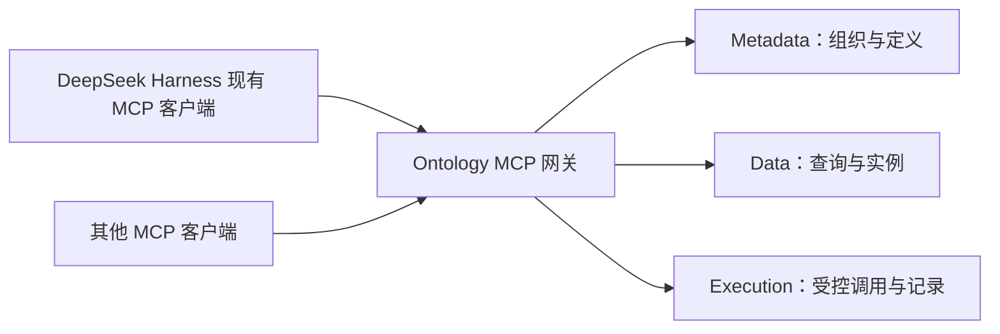

# MCP 服务与客户端接入

状态：2026-11-08 已实现 Ontology 独立 MCP Streamable HTTP 网关、外部连接凭据和 OAuth 授权端点；dsh 复用现有 MCP 客户端。本文仍保留候选范围与验收边界，未将真实生产部署、多副本和 dsh 实例端到端联调写成已验收。

## 1. 服务归属

用户已确认由 **Ontology 提供统一 MCP 服务，dsh 复用现有 MCP 客户端；专用 dsh 插件按体验需要追加**。这符合[项目定位](项目总览.md#项目定位2026-11-08-已确认)：Ontology 为不同应用及智能体提供公共能力，客户端负责模型推理、会话与使用交互。

| 方案 | 适用情况 | 成本与边界 |
| --- | --- | --- |
| dsh 专用插件直接调用 Ontology HTTP API | 仅服务 dsh，或需要它的专用界面与生命周期能力 | 初次可直接接现有 API，但其他客户端仍须另行适配；若查询编译和业务规则写入插件，会重复维护 |
| Ontology 提供 MCP 服务 | 多个支持 MCP 的客户端共用本体能力 | 增加协议与外部认证适配；定义、查询、调用及错误映射由 Ontology 集中维护 |
| Ontology MCP + 可选 dsh 薄插件 | 通用接入后继续改善 dsh 体验 | MCP 提供公共能力，薄插件只补登录、连接配置、分类选择、业务引导或结果展示，不复制服务端规则 |

首批采用第二种，保留第三种的扩展位置。独立的 `services/mcp` 进程经现有公开服务契约调用 Metadata、Data、Execution，不要求全部代码进入 Metadata。

网关只适配协议、受控身份、工具参数和结果，不自行编译物理 SQL、不直接读写服务私表、不另建权限策略。资源服务仍负责最终业务校验与授权；模块及数据所有权见[总体架构](总体架构.md)。

## 2. DeepSeek Harness 调研结果

2026-11-08 核查官方仓库 `master` 文档及传输实现，得到以下结论；尚未核对用户本机 dsh 安装版本，也未进行实际联调。

| 已核查能力 | 对接影响 |
| --- | --- |
| `@deepseek-ai/dsh-mcp-client` 支持 `stdio`、`streamable-http`、自定义请求头及工具发现/调用 | Ontology 提供 HTTP MCP 后可复用现有连接插件，无需为基本调用重写原生工具 |
| `mcp-manager` 支持配置、启停、探测和重连，凭据模板可引用独立凭据存储 | 配置及凭据引用复用现有机制；密钥不进入模型提示词或普通配置正文 |
| `mcp-resources` 支持资源/模板目录及 URI 读取；server instructions 可进入模型上下文 | 可逐步提供本体语义参考，重要发现和查询流程仍通过 Tools 可完成 |
| MCP prompt templates、资源订阅不受支持 | 首批使用工具说明及按需读取，不依赖 Prompts 或实时订阅完成核心流程 |
| `mcp-manager` 明确标注没有 OAuth flow；HTTP 传输当前只注入配置请求头 | 支持 HTTP MCP 不等于已能浏览器授权登录；凭据接入或后续 OAuth 适配须单独验证 |
| 客户端文档说明优先使用 `2026-07-28` 协议，并回退到 SDK 支持的旧修订 | 服务端需冻结双方实际 SDK 支持交集及兼容矩阵，不仅凭 `/mcp` 路径判断兼容 |

依据：[MCP 包组](https://github.com/deepseek-ai/deepseek-harness/tree/master/packages/mcp)、[MCP client](https://github.com/deepseek-ai/deepseek-harness/blob/master/packages/mcp/mcp-client/README.md)、[传输实现](https://github.com/deepseek-ai/deepseek-harness/blob/master/packages/mcp/mcp-client/src/transport.ts)、[MCP manager](https://github.com/deepseek-ai/deepseek-harness/blob/master/packages/mcp/mcp-manager/README.md)、[MCP resources](https://github.com/deepseek-ai/deepseek-harness/blob/master/packages/mcp/mcp-resources/README.md)。上游后续变更须重新核查，不能视为所有已安装版本均有这些能力。

## 3. 传输与协议

面向独立运行的 Ontology，主入口采用 **Streamable HTTP**，路径为 `/mcp`，默认本地端口 `18084`。本地桌面客户端如只接受 stdio，可后续提供轻量桥接器连接同一网关；桥接器不承担第二份领域逻辑，首批未交付。

当前使用官方 `github.com/modelcontextprotocol/go-sdk v1.8.0`，该独立模块要求 Go 1.25+；其他模块及统一发布工具链要求见[开发指南](开发指南.md)。SDK 配置支持 `2026-07-28`、`2025-11-25`、`2025-06-18` 和 `2025-03-26`，由 SDK 负责握手、JSON-RPC 和 HTTP 协商；网关使用无状态模式，每次请求核验凭据。已用官方客户端实测最新和最早两个已配置修订；其他两个修订未单列实测结果。

MCP 协议状态不代替用户认证，也不建立租户或业务授权。浏览器来源检查、HTTPS、代理透传及超时依所支持修订落实；现有工作台 Cookie/CSRF 路由保持独立，不能为适配 MCP 全局放宽来源或关闭校验。

官方依据：[传输总览](https://modelcontextprotocol.io/specification/2026-07-28/basic/transports)、[Streamable HTTP](https://modelcontextprotocol.io/specification/2026-07-28/basic/transports/streamable-http)、[HTTP 授权](https://modelcontextprotocol.io/specification/2026-07-28/basic/authorization)、[Tools](https://modelcontextprotocol.io/specification/2026-07-28/server/tools)。协议版本是软件协议修订，不改变五类定义只有当前态与最多一份草稿的约束。

## 4. 首批工具

当前提供少量稳定工具，通过参数选择业务对象，不按每个 Schema、Action 自动生成大量工具。实际工具及参数以 `services/mcp/tools.go` 为准，按连接范围裁剪工具清单。

| 能力 | 当前工具 | 复用的现有服务能力与边界 |
| --- | --- | --- |
| 上下文与可用能力 | `get_context`、`list_categories` | 当前认证主体、授权目录及各服务 capabilities；只说明当前可用范围 |
| 业务模型发现 | `list_models`、`describe_model` | 优先复用 Data 查询上下文，返回可查询模型、字段与关系；不直接把含源码、物理映射的完整定义作为普通语义摘要 |
| 对象与关系读取 | `get_object`、`query_objects` | 复用 Data 单对象、QuerySpec 及已支持的 Link 查询；必须有界、分页，保持字段与来源说明 |
| 中文本体文本查询 | `analyze_query`、`query_ontology_sql` | 复用现有中文 OntologySQL 分析与执行，绑定稳定 ID 后进入共用执行器；不是数据源物理 SQL 控制台 |
| 当前可执行计算发现及调用 | `list_callables`、`describe_callable`、`invoke_action`、`invoke_function`、`get_invocation` | Metadata 提供最小签名发现契约；调用复用 Execution 当前态、纯计算、幂等及结果读取，不开放任意源码执行或草稿编辑 |

查询及关系支持范围继续由[DataSet](数据查询/DataSet.md)、[OntologySQL](数据查询/OntologySQL.md)、[Link](模块/Link.md)维护；调用语言、签名、隔离和任务边界继续引用[Function](模块/Function.md)、[Action](模块/Action.md)、[执行与调度](执行与调度.md)，MCP 不复制这些规则。仅暴露适配层和当前后端均可支持的组合；有定义不等于可查询或可执行。

结果同时提供结构化数据与客户端可读文本，避免只放在某个客户端未展示的字段中。工具名使用稳定协议名称，描述、业务名称及提示用中文；输入沿用稳定定义/字段/参数 ID，中文名称经明确分类解析。`int64`、`decimal` 沿用现有字符串精度协议，不因 JSON 数字方便而改为浮点。当前共 13 个工具，按连接 scope 裁剪；请求与结果各限 1 MiB，QuerySpec 每页为 1～100 条。

分类通过每次工具参数指定，首批连接不保存默认分类，不使用所有客户端共享的可变“当前分类”。查询结果带身份、字段和续页上下文，改名保留绑定身份；游标继续按 Data 的查询与授权上下文验证。分类及合法跨分类引用仍以[组织与隔离](组织与隔离.md)为准。

Resources 可后续提供模型语义说明、受权对象内容或查询指南，但目录和读取仍需当前授权；首批 Tools 可覆盖完整基本流程。Prompts 作为可选增强，不让 dsh 当前未支持的能力成为接入前提。

首批建议暂不暴露定义编辑/发布、用户权限管理、数据源凭据、物理 SQL 控制台、任意源码执行和业务写入。未来对象/关系写入或有副作用 Action 单独扩展，沿原有并发、幂等与权限机制验收；工具提示或客户端确认不能代替服务端授权。

## 5. 认证与授权依赖

现有服务使用 HttpOnly Cookie、Origin 与 CSRF；普通业务入口不接受旧签名 Bearer，内部服务凭据也不能代替用户调用。MCP 网关不能简单持有管理员会话或服务密钥再代理所有人的请求。

外部凭据、用户授权、OAuth 与受限服务主体的公共规则唯一维护在[权限设计](权限/权限设计.md#mcp-与外部客户端认证2026-11-08已接入)。本轮已实现绑定当前用户、租户、有效期与接入范围的可撤销连接凭据，供 dsh 现有 Header/凭据机制使用；同时提供 OAuth 授权码、PKCE、受保护资源和授权服务器发现。

面向具备交互授权能力的客户端，网关已按 MCP HTTP 授权规范代理 OAuth 及授权服务器发现，复用平台账号会话。dsh 当前缺少 OAuth flow，可使用工作台签发的连接凭据；需要免手工配置登录时，再通过上游能力或薄插件适配。该客户端工作不改变网关及服务端权限归属。

网关转发原始外部凭据，各服务按窄路由白名单和 scope 向 Metadata 核验真实用户，再执行原有业务授权。完整定义接口不向外部凭据开放；Data 的模型目录编译经过独立的内部目录桥，桥保留用户身份且只允许所需当前 Schema/Link/分类目录。网关返回结果前再次核验凭据。

外部凭据直接访问 Execution 也只允许当前态计算；草稿试运行、草稿幂等重放和草稿结果读取在 Execution 内拒绝，不能通过绕开 MCP 工具扩大范围。

## 6. 验证与验收

本轮已完成最小可联调闭环的代码实现：外部认证及主体传递 → HTTP MCP、能力与查询上下文 → 单对象/分页/关系及 OntologySQL → 现有纯计算调用。官方 Go SDK 客户端的真实后端联调已通过，下文记录已验证范围；dsh 实际安装版本及完整组合仍按 MCP-01～MCP-06 分项验收。

| 编号 | 分项验收条件（已验证范围见下文） |
| --- | --- |
| MCP-01 | dsh 通过现有 MCP 客户端连接，另一种独立客户端可发现并调用同一组工具；记录实际客户端/SDK/协议修订、失败与不支持范围 |
| MCP-02 | 外部认证、下游可信主体闭环成立；跨租户 ID、伪造身份、过期/撤销凭据、停用账号及权限变更分别验证；MCP 状态与工具发现不充当授权 |
| MCP-03 | 模型/字段/关系发现及对象读取按当前授权裁剪；查询、错误、资源目录及正文不能泄露未授权值、源码、凭据或物理映射 |
| MCP-04 | MCP 与直接 Data API 的相同查询在稳定 ID、精确数值、行列过滤、关联、分页及不支持语法拒绝方面一致；取消与输出预算生效 |
| MCP-05 | Action/Function 调用复用 Execution；实际语言可用性、幂等重放、本人结果、撤权后拒读及未支持副作用拒绝分别验证 |
| MCP-06 | dsh 重连、凭据轮换、后端不可用及无权限错误明确；工具保持稳定命名，日志/执行审计可追踪真实主体与请求，不记录接入密钥 |

2026-11-08 已验证：官方 Go SDK 客户端通过真实 Metadata、Data、Execution、MySQL 和 OPA，分别以 `2026-07-28`、`2025-03-26` 完成 13 个工具发现、上下文/模型发现、对象查询、OntologySQL 分析/执行、精确数值一致性、Python Function 调用、幂等重放、本人结果读取和连接撤销拒绝；直接访问 Execution 的外部草稿调用返回403。Execution 模块另验证草稿重放和结果读取拒绝、当前态调用不受影响。此测试使用隔离的新租户、测试模型和函数，不更改已有知识库。

真实 MySQL 身份测试覆盖限定 scope、跨租户撤销拒绝、错误 resource/PKCE、精确注册回调、授权拒绝、授权码重放/过期、连接撤销、有效角色变化和账号停用。真实 Edge 浏览器通过个人凭据一次性显示、刷新后隐藏、撤销，以及 OAuth 注册→浏览器同意→PKCE 换令牌→重放拒绝→撤销流程。前端 453 项测试与构建通过；Go 模块测试和 vet 的最终结果见项目总览。dsh 实际安装版本端到端、多副本、性能及恢复仍未验收；MCP 下 JavaScript/Go 与有权限约束的关系矩阵也未因此视为逐项验收。

## 7. 本轮实现范围

- services/mcp 提供 /mcp、受保护资源元数据和 OAuth 公开端点代理；官方 Go SDK 使用无状态 Streamable HTTP。
- Metadata 提供可撤销 mcp_ 连接凭据，按用户、租户、用户 ETag、有效角色和资源受众复核；查询/调用凭据必须同时拥有 ontology:discover。
- OAuth 已实现动态客户端注册、Authorization Code + PKCE S256、一次性五分钟授权码、严格回调地址与 resource 校验、撤销端点；refresh token 不支持。
- 启动脚本已加入 18084 MCP 进程；本机 18083 已被已有系统 HTTP 监听占用，未修改该监听。服务入口不自动迁移，开发脚本先显式执行 Metadata -migrate，再启动服务。

dsh 的连接 URL、凭据模板与完整环境变量见[MCP 服务说明](../services/mcp/README.md)。工作台“外部连接”只显示当前用户的个人连接及 OAuth 授权，可创建并撤销；连接密钥只在创建响应中显示一次。
