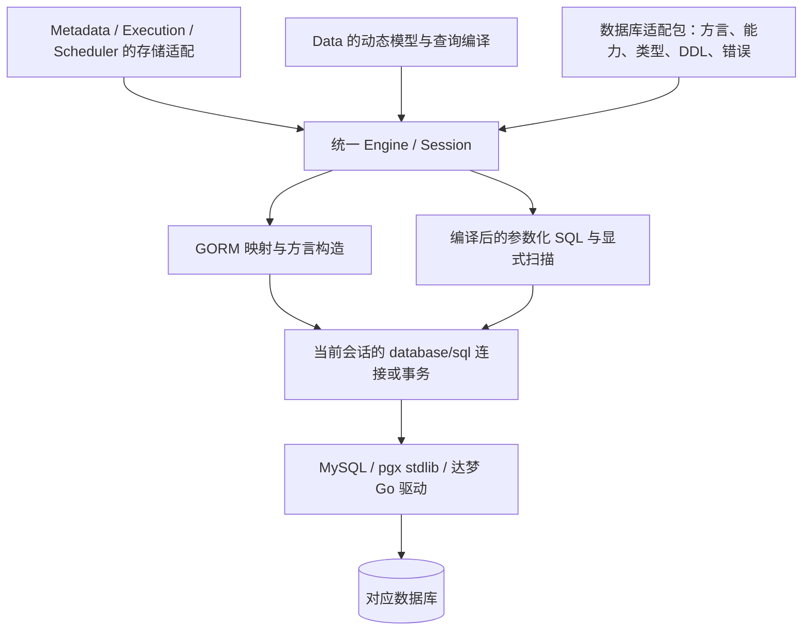

# 统一存储引擎与数据库适配

状态：选型与实现方案草案，尚无引擎代码或数据库压测结果。调研日期：2026-10-17。本文统一维护数据库接入、ORM 取舍、驱动注册、存储映射、性能策略及适配验收。

## 1. 选择与理由

建议采用 **`database/sql` 连接底座 + 项目统一存储引擎 + GORM v2 基础适配 + 直接 SQL 热点路径**。复用现成数据库通信驱动和 ORM 能力，项目自行实现有限的能力契约、动态模型映射和查询编译。首批适配目标为 MySQL、PostgreSQL、达梦，具体服务器和驱动版本逐项认证。

这里的“同一套引擎”是各服务引用同一个版本化 Go 基础库，并使用同一套驱动注册、连接池、事务、方言和观测规则。每个服务保有自己的连接与数据所有权；引擎在进程内运行，查询无需再经过一个远程存储代理服务。

性能是选型约束。选择这条路径的理由如下，尚不把任何框架认定为实测最快：

| 选择 | 性能与工程理由 | 必须验证的代价 |
| --- | --- | --- |
| 复用 `database/sql` 和成熟通信驱动 | 复用连接池、事务及参数绑定；避免自行实现数据库网络协议；直接 SQL 可作为框架开销基线 | 驱动的取消、类型解码、批量操作及连接行为仍需实测 |
| 首轮复用 GORM v2 | MySQL、PostgreSQL 有现成方言；达梦官方也提供 v2 方言包。固定结构的元数据、任务表可少写映射代码，适合单人维护 | 有 ORM 映射、回调和语句构造开销；厂商方言的完整能力与版本兼容不能仅凭示例确认 |
| 热点允许直接执行参数化 SQL | 查询计划、投影、批量、往返次数和结果扫描可控；经测量后可避开热点中的 ORM 构造与对象映射开销 | 项目需维护有限的 SQL 编译与各库优化策略，不能让业务代码散落厂商 SQL |
| 动态 Schema 单独映射 | 用户发布新 Schema 后即可建立存储映射，不要求生成 Go struct、重新编译并发布服务 | 发布时要生成和验证物理映射、索引与迁移计划 |
| 保持一个连接和事务体系 | ORM 路径与直接 SQL 复用同一连接池；在同一事务内写业务数据与 outbox | 必须验证两条执行路径的事务绑定，避免意外使用事务外连接 |

首轮实现中，固定结构 CRUD 可使用 GORM；实例过滤、Link 路径、批量读写、任务竞争等路径优先显式控制 SQL。直接 SQL 使用当前引擎会话的执行器，测量时与原生 `database/sql` 对照；仅换成 `GORM.Raw().Scan()` 仍会保留部分 ORM 开销，不能视为已经绕过 ORM。

选择 GORM 的依据是复用成本和现成适配能力；性能依据来自可控 SQL、连接复用、缓存和对照测试。若某条路径在相同 SQL 与事务条件下因 ORM 开销不达标，就在同一引擎内切换为直接执行及显式扫描；数据库执行计划不佳时先处理 SQL、索引和存储布局。切换条件和比较方法见 [性能与容量](性能与容量.md)。

## 2. 现成方案比较

| 方案 | 对本项目的适用性 | 主要限制与本轮选择 |
| --- | --- | --- |
| GORM v2 | 固定表 CRUD、方言扩展、事务、批量及显式 SQL；达梦有厂商方言包 | 不能自动提供 Ontology 版本、动态字段语义和 Link 查询计划；选作首轮基础实现，不让领域接口依赖 `gorm.DB` |
| Bun | SQL 构造与结构映射接近显式 SQL，官方区分通信驱动和方言 | 所核对的方言文档未列达梦；仍需补适配和动态模型层。作为候选，不在首期同时引入第二套 ORM |
| Ent | 根据 Go Schema 生成强类型实体和查询代码，适合编译期确定的模型 | 动态 Ontology 定义无法直接变成已编译的 Ent 类型；所核对方言列表未列达梦。暂不作为统一底座 |
| sqlc | 从固定 SQL 生成 Go 访问代码，可减少手写扫描；适合已知静态查询 | 已列主要支持 MySQL、PostgreSQL、SQLite，未列达梦；运行时新增查询仍需另做。暂不作为三库共同依赖 |
| `database/sql` + sqlx | 直接控制 SQL；sqlx 可减少结构扫描和占位符处理代码 | sqlx 不统一类型、DDL、分页和事务语义。保留原生 SQL 通道，不因引入 sqlx 就宣称完成跨库适配 |
| 完整自研 ORM | 能控制全部实现 | 还要维护对象关系映射、方言、迁移、反射和生命周期；这些工作不直接证明更快。本项目只实现需要的薄引擎 |

GORM 可以使用动态表名、map 或显式 SQL，并非只能访问静态 Go struct；但这些能力仍需要本项目提供类型、版本、约束及查询规则。所有性能比较必须针对同一个行为和工作负载，不能依据框架名称或公开的单条 CRUD 排名直接决定。

## 3. 哪些数据使用引擎

Schema、Enum、Link、Function、Action 的**定义本身就是平台元数据**，与按 Schema 创建的业务实例区分。它们都需要持久化，但访问形态不同。

| 数据 | 所有者 | 建议存储形态与高频访问方式 |
| --- | --- | --- |
| 五类定义、单位字典、发布集和依赖 | Metadata | 固定结构的版本记录与依赖索引；定义正文可为 JSON 文档，由方言映射到适合的 JSON/文本大字段；ID、版本、状态、引用等检索条件单独建列及索引 |
| 实例、关系、读数上下文 | Data | 优先验证有类型列的实体表和关系表，字段过滤、排序及关联在数据库执行；物理布局见下文 |
| 任务、尝试、幂等键、outbox、订阅 | Execution 或对应事件生产服务 | 固定结构表、唯一约束、状态条件写入和短事务；业务变更与所属 outbox 同事务 |
| 周期规则、到期登记及触发记录 | Scheduler | 固定结构表与唯一约束；登记和待发记录同事务 |

各模块仍独立维护定义校验、repository 接口和存储适配代码。允许复用序列化及通用 SQL 构造，避免把五类业务塞进一个按类型切换的通用 repository。定义正文存成 JSON 不表示高频筛选也要读取全文后在 Go 内过滤。

“支持三种数据库”首先指每种受认证数据库都能承担平台元数据、任务及 Data 存储。初期每个部署可统一选择一种后端；各服务也可以分别配置后端，但每个服务的本地事务只覆盖自己的一份存储。连接多个数据库、在线搬迁数据库和跨源 Link 查询是另外的能力，不由驱动注册自动获得。

## 4. 引擎分层及注册



注册分两层：Go 的 `sql.Register` 注册底层通信驱动；项目的注册表注册**数据库适配工厂**，组合通信驱动、GORM 方言、能力检查、类型编码和迁移策略。业务服务在启动时选择已编译的适配包。

以下是拟定调用方式，包和 API 尚未实现，错误处理必须保留：

```go
registry := storage.NewRegistry()
if err := registry.Register("mysql", mysqldriver.New); err != nil {
    return err
}
if err := registry.Register("postgres", postgresdriver.New); err != nil {
    return err
}
if err := registry.Register("dameng", damengdriver.New); err != nil {
    return err
}
engine, err := registry.Open(ctx, cfg.Storage)
if err != nil {
    return err
}
defer engine.Close()
```

生产镜像可以只编译需要的适配包；注册阶段校验重名，服务开始接收请求后注册表只读。增加数据库时新增适配包并在程序启动处注册，业务规则无需修改；新增包进入二进制仍需要正常构建和发布。首期采用普通 Go 包及工厂函数，不引入运行时加载 `.so` 的机制。

建议包边界如下，按实际实现逐步创建：

```text
libs/storage/                   # 独立 go.mod；稳定引擎契约与公共执行设施
  registry/                     # 工厂注册与配置
  session/                      # 连接池、事务、超时及观测
  plan/                         # 有限的类型化 SQL 计划与绑定参数契约
  drivers/mysql/                # 可独立发布为 Go 子模块
  drivers/postgres/
  drivers/dameng/
services/<service>/internal/adapter/storage/
                                # 本服务的记录模型、repository 实现和业务查询
```

引擎核心不导入具体驱动，适配包依赖稳定的引擎契约，由各服务启动代码组装。共享引擎是基础设施，不包含业务 ORM 模型、任务状态机或跨服务数据访问。公共契约与适配包锁定版本；单服务应在 `GOWORK=off` 时独立构建。

引擎对外提供注册/打开、能力读取、查询/写入、事务会话和迁移执行接口；内部保留 GORM 使用细节。所有查询接受 context、返回错误并有关闭资源的规则。SQL 编译只覆盖本项目支持的操作，例如按键读写、类型化过滤、投影、排序、游标分页、JOIN/EXISTS、批量及条件更新；查询策略由 Data 决定，代价优化仍交给数据库。

校验、权限过滤、版本条件、审计/outbox 等业务要求由用例及查询计划显式组织；若启用软删除，也必须明确过滤条件。不能只把这些规则藏在 GORM Hooks 或自动关联行为中，否则直接 SQL 路径可能漏执行。两个执行路径使用同一组业务正确性用例。

## 5. 数据库能力契约

能连接成功不等于适配完成。每个后端以“产品 + 服务器版本 + 驱动/方言版本 + 关键配置”登记能力；未知能力默认不启用，必要能力不足时在启动或发布校验阶段明确拒绝。

| 适配项 | 需要统一的行为 | 可按数据库提供的实现 |
| --- | --- | --- |
| SQL 构造 | 值始终绑定参数；表/列标识由可信映射解析并按方言引用 | 占位符、标识符大小写及长度、关键字、分页、返回写入结果 |
| 类型与扫描 | int64、decimal、时间、binary、boolean、null/缺失按逻辑契约往返 | 数值精度范围、时间类型、JSON/大字段、编码；不支持时拒绝或采用已声明映射 |
| 比较与约束 | 稳定 ID、Enum 编码、唯一键、文本比较的含义一致 | 显式排序规则、索引和约束；测试大小写、尾随空格、空字符串与 NULL，不能依赖厂商默认值 |
| 写入及批量 | 创建、条件更新、冲突、受影响行数与批量失败语义 | UPSERT/MERGE、批量参数上限、原生批量接口；语法相似仍需并发验证 |
| 事务与竞争 | 支持本地原子事务，声明隔离级别，防止重复受理和旧尝试覆盖 | 行锁、条件更新、唯一约束；`SKIP LOCKED` 等作为已验证的增强能力 |
| 迁移 | 平台与模型迁移分开记录、可核对执行进度 | DDL、目录查询、锁行为、事务性 DDL 和在线变更能力分别声明 |
| 错误与取消 | 区分冲突、不支持、死锁、超时、连接故障及提交结果未知 | 解析结构化错误码；验证 context 取消是否终止服务端工作及释放连接 |

不能把 PostgreSQL 的 `RETURNING`、JSONB 操作、MySQL 的冲突更新或某库的锁语法作为通用 SQL。适配包可选择优化实现，也可用经过验证的等价算法；如果只能改变原子性、单位精度或删除语义，就必须报告不支持。

任务领取可在支持的数据库上使用锁定批次及跳过已锁行，也可使用带状态/租约条件的原子更新竞争。后者必须检查受影响行数、重试上限及死锁行为；其吞吐需独立验证，不能仅因语法更通用就认定性能相同。重试由用例按幂等性决定，引擎提供错误分类；网络断开造成的提交结果未知不能盲目重做写入。

### 首批后端

| 后端 | 首轮接入方式 | 认证重点 |
| --- | --- | --- |
| MySQL | `go-sql-driver/mysql` + GORM MySQL 方言；候选 MySQL 8.4 LTS 与 InnoDB | 排序规则、decimal/时间、连接与预处理策略、锁及 DDL；5.7 如有真实部署需求另列兼容目标 |
| PostgreSQL | `pgx/v5/stdlib` + GORM PostgreSQL 方言；选择一个受支持的明确主版本与补丁版 | 类型编码、预处理与连接代理兼容、计划及批量能力；公共路径保持 `database/sql` 接口 |
| 达梦 | 厂商 Go 驱动 + 厂商 GORM v2 方言；以目标 DM8 构建版本认证 | 驱动模块化、方言版本匹配、大小写/兼容模式、精度/时间/大字段、错误码、取消、锁和迁移行为 |

达梦官方文档明确提供 `drivers/go` 中的原生驱动以及 `gorm_v1_dialect.zip`、`gorm_v2_dialect.zip`，并提示引用路径和版本差异。需要取得目标版本的驱动包，固定模块路径、版本及校验信息，以可复现的 Go modules 依赖方式接入；不能把文档中的手工复制包步骤直接作为生产构建流程。厂商包的分发条件、目标 OS/CPU 支持和测试环境一并确认。

达梦不是因支持某种兼容模式就自动等同于 MySQL/PostgreSQL；其他国产数据库也逐个注册和认证。没有运行对应数据库的集成与压力测试前，只标记“接入候选”，不标记“已支持”。

## 6. 动态模型与物理存储

首轮性能原型优先验证**每个 Schema 的有类型实体表 + 每个 Link 的关系表**。过滤、排序和关系查询可以利用常规列、约束与两端索引，在三种关系数据库上较容易控制执行计划。这是待压测确认的布局建议；Schema 数量与变更频率显著增大时，需另测表数量、目录管理和迁移成本。

| 映射 | 建议行为 |
| --- | --- |
| Schema 定义 → 实体表 | 稳定 Schema/属性 ID 映射为受控物理表名、列名；显示改名不自动改物理名；应用使用发布对应的映射版本 |
| Schema 新版本 → 存储计划 | 判断兼容扩展、回填或结构替换；每个版本不必建一套新表，新旧映射共存及切换沿用发布协议 |
| Enum 引用 → 实例列 | 首轮用稳定编码列及版本化校验，代码/大小写语义见 Enum；原生数据库 ENUM 为可选能力 |
| Link 定义 → 关系表 | 保存一份权威边事实，建立正反向访问索引；根据方向、基数、隔离域和重复规则生成唯一约束及端点约束 |
| 非核心扩展值 → JSON/文本或独立记录 | 可用于低频扩展属性及观测上下文；进入高频筛选的字段需评估有类型列或索引，不默认为任意文档属性提供高性能检索 |

完整定义正文保存为 JSON 与实例全部塞入 JSON 是不同决策。统一实例表/文档存储可以作为后续布局候选；首轮不采用所有值都转字符串的 EAV 通用表来承诺数值过滤和多跳性能。

Data 在查询编译前解析发布版本、字段类型、单位、权限范围及物理映射；引擎生成厂商 SQL，绑定参数执行。字段/表标识不能由外部字符串直接拼接，数值过滤先转换为字段的规范单位。固定记录使用显式扫描或已有结构映射；动态结果按已编译的投影及类型解码，避免逐行重新解析 Schema。

DDL 只由受控迁移入口执行。GORM 的 Migrator 可以作为方言工具，但 `AutoMigrate` 不承担数据回填、版本激活及跨 Pod 协调；服务启动和普通查询都不能顺便修改数据库结构。

## 7. 高频调用的实现约束

| 位置 | 实现策略 | 需要观察的结果 |
| --- | --- | --- |
| 定义读取 | 按隔离域、发布/定义版本缓存不可变元数据；批量加载，限制容量及并发回源 | 热查询不逐字段访问 Metadata/数据库；缓存失效与冷启动时不出现请求集中回源 |
| 查询编译 | 按后端能力、物理映射版本、查询结构及权限结构缓存编译结果；每次绑定当前参数 | 缓存有界，不能缓存上一次调用的参数；模型切换后旧计划不可误用 |
| SQL 与索引 | 投影必要列、下推过滤、固定路径 JOIN/EXISTS、批量访问、稳定游标排序 | 实际计划、扫描量、往返次数和分页结果正确，避免 N+1 与无界结果加载 |
| 行扫描 | 热点固定记录显式/生成扫描；动态投影复用类型计划 | CPU、分配量及 GC 经剖析下降；decimal、时间和 NULL 仍无损 |
| 写入与任务 | 有限批次、短事务、索引化状态领取及条件更新；业务写入与 outbox 同事务 | 锁等待、冲突、提交延迟和每批效果可核对；不得用弱化持久化或原子性换取漂亮指标 |
| 连接与预处理 | 每个连接配置复用池；预处理按驱动/代理验证并限制缓存规模 | 等待连接的耗时、缓存命中及服务端预处理数量；不能随 Pod 增加无限扩大连接总量 |

`*sql.DB` 是连接池句柄，不能每次请求创建一个。GORM 和直接 SQL 共用同一池，可由引擎注入已有连接，或取得初始化后的 ORM 连接池统一管理；具体方式由适配包验证。`WithTx` 返回事务会话，事务内的 ORM 和 SQL 必须落在同一事务执行器上。禁止在事务回调中从根 Engine 取连接执行参与原子操作的语句；验证两种路径交叉写入后回滚均无残留。未验证事务绑定的适配包，其事务内操作统一走已经验证的直接 SQL 通道。

不为了跑分全局关闭必要的事务。GORM 默认写事务与用例显式事务的关系需要检查；仅在确认单条语句的原子语义和实测收益后调整配置。批量中途失败、业务写入与 outbox、唯一键竞争的正确性仍是前提。

预处理并非永远更快：不同驱动可能已经缓存语句，动态 SQL 形态过多会放大缓存，连接代理也可能影响可用性。参数绑定是必需行为，服务端预处理是否启用是独立性能选择。原生批量能力通过可选适配接口接入；如果使用 pgx 专有能力，仍明确连接和事务归属，不能悄悄再开一套池。

## 8. 迁移和验收

各服务持有自己的平台迁移文件/步骤；Data 持有动态模型迁移计划。引擎提供厂商 DDL、目录读取和执行设施，业务模块决定变更含义。两类迁移记录分开，校验和、目标版本、进度及失败结果可查；多副本互斥、旧执行者隔离及兼容窗口见 [发布与迁移](发布与迁移.md)。

| 编号 | 要求 | 验收方法 |
| --- | --- | --- |
| DB-01 | 平台记录及 Ontology 数据共用引擎，各模块保有数据所有权 | 同一目标后端完成定义发布、实例/关系读写、任务/outbox 事务；无跨服务私有表写入 |
| DB-02 | 驱动可注册，能力按数据库及版本声明 | 三个适配包运行同一契约套件；未注册后端、重名注册及必要能力缺失明确失败 |
| DB-03 | 类型、比较、约束和错误语义可移植 | 对照 int64/decimal/时间/空值、大小写与唯一键、分页、重复边和错误分类结果 |
| DB-04 | ORM 与直接 SQL 共用连接及事务，业务语义一致 | 两路径的校验/权限/版本规则一致；交叉写入后注入失败，业务记录和 outbox 同时回滚；并发领取、超时、连接中断结果可核对 |
| DB-05 | 动态模型无需重新编译业务服务 | 运行中发布 Schema/Enum/Link，生成映射、执行迁移后读写查询；错误映射阻止激活 |
| DB-06 | 迁移与能力限制可恢复、可解释 | 三库分别验证升级、中断恢复、锁行为及不支持特性；不在请求或 Pod 启动中自动迁移 |
| DB-07 | 性能选型有原生基线和真实数据库证据 | 按 [性能与容量](性能与容量.md) 比较 ORM/直接 SQL、物理布局、冷/热缓存及多 Pod；记录具体优化路径和选择理由 |

首轮顺序：先冻结接口和代表性查询，在 MySQL、PostgreSQL、目标达梦版本上验证连接、类型、事务及关键 SQL；再实现一个后端的端到端闭环，补齐其余两库同一套用例，最后测容量和扩容。达梦驱动、部署环境或版本尚未取得时明确记录缺口，不因其他两库通过而认定三库完成。

## 9. 调研依据与未决信息

| 一手资料 | 核对结论 |
| --- | --- |
| [Go：连接管理](https://go.dev/doc/database/manage-connections)、[database/sql/driver](https://pkg.go.dev/database/sql/driver) | 标准库提供连接池和驱动契约，SQL 语义仍由具体数据库处理 |
| [GORM：连接数据库](https://gorm.io/docs/connecting_to_the_database.html)、[自定义驱动](https://gorm.io/docs/write_driver.html) | 支持现有连接及自定义 Dialector；方言涉及类型、参数、引用及迁移，不能只替换 DSN |
| [GORM：性能](https://gorm.io/docs/performance.html)、[迁移](https://gorm.io/docs/migration.html) | 提供预处理、投影、批量等手段；自动迁移不是本体发布流程；文档未证明本项目负载下的性能 |
| [达梦：Go DM 接口](https://eco.dameng.com/document/dm/zh-cn/app-dev/go_dm.html)、[GORM 框架](https://eco.dameng.com/document/dm/zh-cn/app-dev/go_gorm.html) | 厂商提供 Go 驱动及 v1/v2 方言包，需处理依赖路径和版本匹配；不等于已经通过项目适配验收 |
| [Bun：驱动与方言](https://bun.uptrace.dev/guide/drivers.html) | 区分 `database/sql` 驱动与 ORM 方言；所列后端未列达梦 |
| [Ent：代码生成](https://entgo.io/docs/code-gen/)、[方言](https://entgo.io/docs/dialects/) | 根据 Schema 生成 Go 代码，需区分编译期模型与运行期本体定义 |
| [sqlc：语言及数据库支持](https://docs.sqlc.dev/en/v1.31.1/reference/language-support.html)、[sqlx 文档](https://jmoiron.github.io/sqlx/) | 生成/扫描工具并不同时提供本项目所需的三库动态模型适配 |
| [MySQL Go 驱动](https://pkg.go.dev/github.com/go-sql-driver/mysql)、[pgx stdlib](https://pkg.go.dev/github.com/jackc/pgx/v5/stdlib) | 可经标准 SQL 接口接入；驱动配置、专有能力及参数处理仍需分别验证 |

待确定：三库目标版本及兼容配置、达梦驱动包与测试环境、数据库部署资源、真实读写比例和调用规模、Schema 数量及变更频率。GORM 的具体版本及厂商方言版本在原型兼容测试后固定。最终性能结论必须附原始测量结果，本轮未连接数据库，仓库也尚无实现可供跑分。
