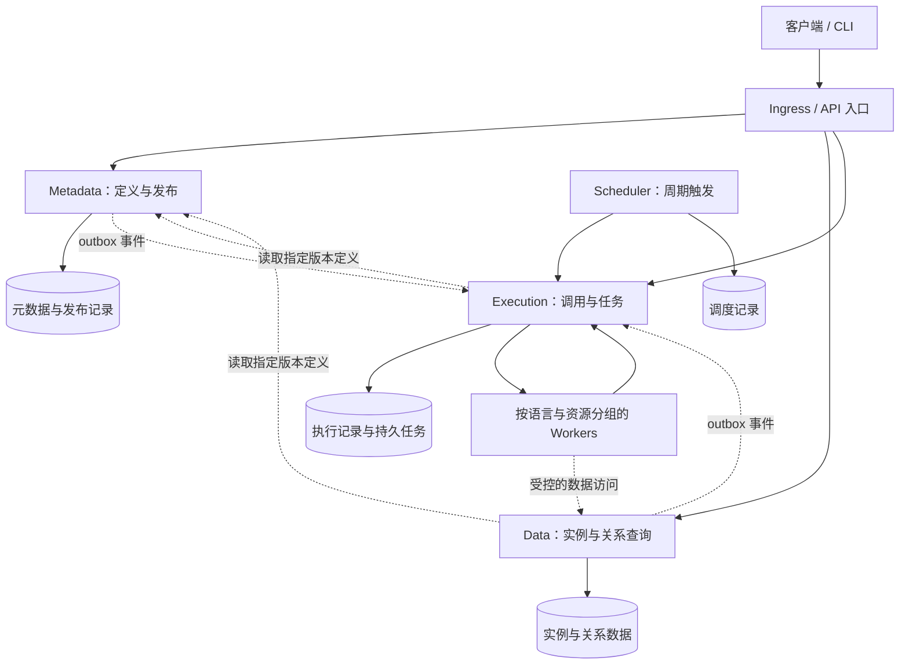

# 总体架构与模块组织

状态：方案草案，尚无业务实现。本文统一维护模块边界、服务划分、依赖规则和工程验收。

## 1. 模块与服务

采用单仓库组织多个可独立部署的服务。定义按五类对象拆模块，数据查询和执行计算按负载拆服务。首先实现最小闭环，再以压测决定缓存、消息系统和存储扩展，避免尚无负载依据就引入多套基础设施。



图中的存储表示逻辑所有权，初期可以共用数据库基础设施，使用独立 schema/库、账号和迁移。任务持久化可以先使用所属服务的数据库；是否引入消息系统由吞吐和调度需求决定。图中任务分派是逻辑关系，可以实现为 Worker 主动领取，或由消息系统传递引用。

各服务共用进程内的 [存储引擎](存储引擎.md) 基础库，统一驱动注册、SQL 方言、类型、事务、连接池和观测。引擎以 `database/sql` 为连接底座，首轮复用 GORM v2，热点通过当前会话直接执行参数化 SQL；MySQL、PostgreSQL、达梦分别适配和验收。同一套引擎不改变数据所有权，也不引入额外的远程数据库代理。

| 模块 | 负责 | 与其他模块的协作 |
| --- | --- | --- |
| Schema | 属性、逻辑类型、键与约束、单位及量类型语义、结构兼容性 | 通过版本引用使用 Enum 和受控单位字典，向 Link 和调用参数提供类型信息 |
| Enum | 稳定值编码、标签、废弃和取值兼容性 | 向引用方提供校验接口和版本化定义 |
| Link | 端点、方向、基数、关系约束 | 校验 Schema 引用；关系实例及查询由数据模块实现 |
| Function | 输入输出、运行清单、制品与版本定义 | 将具体计算交给执行服务和运行器 |
| Action | 操作参数、效果声明、权限及 Function 引用 | 将运行状态、副作用执行和重试交给执行服务 |
| 发布协调 | 跨类型依赖检查、完整发布集及激活状态 | 使用五类模块的接口组织发布，不承接它们的具体规则 |

模块自身的实现版本、对外协议版本、Ontology 定义版本是不同概念。定义引用至少包含稳定标识与版本；已发布定义和执行记录不能随草稿改动而漂移。

建议五类定义模块先归入 Metadata 服务，以便一次发布校验 Schema、Enum、Link 和调用定义之间的完整约束。它们在代码和测试上分别演进；跨类型发布由专用协调层组织。

Data、Execution、Scheduler、不同语言 Worker 按职责和资源特征独立部署。这样查询压力增大时可扩容 Data，计算积压时可扩容对应 Worker。迁移是独立命令或部署任务，不必作为常驻服务。

将某个定义模块进一步拆为微服务的条件包括：存在明确的独立负载、独立发布频率或维护责任，并已设计跨服务引用校验与发布一致性。拆分后需要承担网络调用、版本兼容及故障处理成本，因此服务边界应在详细设计中说明理由。

五类业务细节分别见 [Schema](模块/Schema.md)、[Enum](模块/Enum.md)、[Function](模块/Function.md)、[Action](模块/Action.md)、[Link](模块/Link.md)。单人开发也保留清晰接口，修改一个模块时只需读取其说明及所引用的公共机制。

## 2. 服务和数据所有权

| 部署单元 | 内部模块与职责 | 权威数据 | 扩展方式 |
| --- | --- | --- | --- |
| Metadata | schema、enum、link、action、function、publish | 类型定义、不可变发布集、激活状态 | 多副本、版本缓存；发布写入受协调 |
| Data | instance、relation、query、adapter | 实例、关系、数据 outbox、模型存储迁移记录 | 多副本；受数据库容量约束 |
| Execution | invocation、task、dispatch、subscription | 执行记录、尝试、租约、幂等键、订阅与任务 outbox | 多副本接收及分派 |
| Scheduler | schedule、trigger | 周期规则、到期登记及待发送触发 | 多副本安全；领导者或分片方案待细化 |
| Worker | runtime、artifact、executor | 临时工作目录和缓存；结果通过 Execution 提交 | 按语言、CPU/内存及外部配额独立扩容 |
| migrate 命令/Job | 各服务平台迁移、Data 所有的模型存储迁移 | 由对应数据所有者保存记录 | 每目标受控执行，不以增副本提高吞吐 |

API 入口优先复用 Ingress 或现有代理，承担路由、基础鉴权及入口限流。资源级权限由各服务执行。初期建议对外 HTTP/JSON 与 OpenAPI；服务间可先使用 HTTP，是否采用 gRPC 依据协议、流式调用和实测需求决定。

### 发布与版本读取

Metadata 协调定义校验及版本激活，Data 执行其拥有的数据和结构迁移；请求与任务固定发布版本，跨服务步骤可恢复。发布集、迁移流程、兼容窗口和缓存版本规则统一见 [发布与迁移](发布与迁移.md)。

### 执行与副作用

Execution 管理持久任务和尝试，Worker 执行代码，Scheduler 登记周期触发；模型和数据事件交由 Execution 的订阅模块分派。调用方式、运行器、状态、幂等、outbox 与触发去重统一见 [执行与调度](执行与调度.md)。

## 3. 建议代码目录

以下是未来代码布局，当前仅创建文档。

```text
services/
  metadata/
    go.mod
    cmd/server/
    cmd/migrate/
    internal/
      schema/
      enum/
      link/
      action/
      function/
      publish/
      transport/
      adapter/
    migrations/
    Dockerfile
  data/                     # 独立 go.mod、cmd、internal、迁移与镜像
  execution/                # 独立 go.mod、cmd、internal、迁移与镜像
  scheduler/                # 独立 go.mod、cmd、internal、迁移与镜像
workers/
  <runtime>/                # 按语言管理依赖、入口与镜像
contracts/
  openapi/
  events/
  runtime/                  # 运行清单、任务与结果协议
libs/
  storage/                    # 独立版本的引擎契约、执行设施与数据库适配包
  <基础库>/                  # 按需要建立；禁止共享业务实现
deploy/
  compose/
  kubernetes/
tests/
  integration/
  contracts/
  performance/
docs/
  模块/                     # 五类对象各自的完整说明
  README.md                 # 项目和公共机制入口
```

各 Go 服务使用独立 `go.mod`，本地可生成 `go.work` 辅助开发；每个服务在 `GOWORK=off` 时仍能独立构建，不能靠工作区隐式补齐依赖。当前 `.gitignore` 已忽略 `go.work`。公共协议产物和基础库需有独立版本，避免一次共享改动强制所有服务同步升级。

模块内部按实际复杂度区分领域规则、用例接口与适配实现，不强制每个小模块都建立大量空目录。发布协调层通过模块接口检查引用；禁止五类模块互相调用私有 repository。Go 的 `internal` 有助于限制外部导入，但服务内模块边界还需要依赖规则检查和测试约束。

## 4. 开发与独立演进

一次开发任务应说明所属模块、对外行为、允许的依赖、涉及的契约及完成条件。优先在模块内部新增能力；共享基础库的修改需要检查所有使用方。

服务入口只负责启动与依赖组装，协议层只负责解析和响应，业务规则归领域模块，存储与外部系统实现归适配层。避免 `common`、`utils` 或一个通用 manager 累积所有类型的业务逻辑。

后续工程检查应覆盖跨服务源码引用、循环依赖、契约兼容性和各模块的关键行为。CI 工具在工程落地时确定，目录建议见上文。

## 5. 验收条件

| 编号 | 要求 | 验收方法 |
| --- | --- | --- |
| MOD-01 | 五类对象各有明确目录、接口、校验规则和测试归属 | 能单独运行各模块测试；增加一种 Enum 校验时，无需修改通用入口中的全类型分支 |
| MOD-02 | 禁止循环依赖；跨模块访问通过窄接口或版本化数据契约 | 检查依赖图；禁止直接访问另一个模块的 repository、私有表结构或内部状态 |
| MOD-03 | 可独立部署的服务分别构建、配置、发布、扩容 | 单独构建和替换 Data 服务，其余服务无需一起重新编译或发布，前提是契约兼容 |
| MOD-04 | 每份业务数据只有一个写入所有者 | 实例写入走 Data，执行状态走 Execution；数据库账号和代码检查阻止跨服务写表 |
| MOD-05 | 扩展数据库或语言时通过适配接口接入 | 新增数据库适配器无需修改 Schema/Action 领域规则；新增运行器无需修改查询服务 |
| MOD-06 | 公共代码限于稳定协议和基础设施，不共享业务服务、ORM 模型或业务 repository | 共享包依赖可列举；领域模型由所属模块维护，协议转换在边界完成 |
| MOD-07 | 契约、存储与定义变更有兼容策略 | 滚动升级可处理兼容窗口内的新旧版本；不兼容发布被识别并给出迁移路径 |
| MOD-08 | 每次功能变更能定位所属模块及受影响契约 | 变更说明列出需求、模块、接口及验证；边界检查阻止业务逻辑继续汇入通用入口 |

模块化目标不依赖“每个文件最多多少行”。大文件、重复规则、大型类型分支、循环引用和过宽接口都应触发拆分评估；仅按行数机械拆文件无法保证独立演进。

## 6. 公共机制与待定事项

| 主题 | 唯一维护位置 |
| --- | --- |
| 数据库接入、ORM 取舍、驱动能力与动态存储映射 | [存储引擎](存储引擎.md) |
| 定义依赖、发布集、迁移与兼容窗口 | [发布与迁移](发布与迁移.md) |
| 持久任务、同步/异步、状态与触发 | [执行与调度](执行与调度.md) |
| 探针、连接预算、Pod 弹性与恢复 | [部署与运维](部署与运维.md) |
| 数据集、性能指标及压测 | [性能与容量](性能与容量.md) |

数据库适配目标已包含 MySQL、PostgreSQL、达梦，具体版本与首个闭环后端、运行器、接口、依赖检查工具和发布流水线仍待确定。共享引擎不包含业务 ORM 模型，各服务仍在自己的适配层维护记录与查询。缓存、物化关系、读副本和独立消息系统以代表性压测为依据，用户函数计算进入 Worker，避免查询服务承担任意语言执行。
