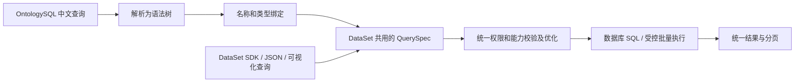

# OntologySQL：中文本体查询语言与统一查询计划

状态：已明确需要通过 OntologySQL 查询，当前仅进行设计。本文建议将 OntologySQL 编译为 DataSet 共用的 QuerySpec，再由统一查询引擎执行；编译路线、语法、接口和首批范围仍为候选，尚无解析器、服务实现或性能实测。本文只维护文本语法、编译与诊断；公共查询语义和执行边界唯一见 [DataSet](DataSet.md)，名称与身份规则见[组织与隔离](../组织与隔离.md)。

## 1. 方案选择

用户可以直接提交 OntologySQL 文本，客户端无需先构造 DataSet。内部建议采用以下路线，其中 DataSet/QuerySpec 表示延迟执行的查询描述，不是已经读取到内存的数据集。



| 路线 | 收益与成本 | 当前建议 |
| --- | --- | --- |
| OntologySQL → DataSet 共用 QuerySpec → 存储计划 | 复用中文名称、类型/单位、Link、权限、计算属性、分表、分页及缓存规则；增加文本解析与语法映射 | 推荐，共用一个逻辑计划和执行引擎 |
| OntologySQL → 独立的物理 SQL 编译器 | 初期可直接处理简单查询；需要再次维护关系、隔离、映射、分表及多后端规则，两个入口容易产生不同结果 | 不单独建设；若最后仍复用同一逻辑计划与优化器，实际上属于上一条路线 |

“编译到 DataSet”是将整条查询降低为同一份结构化逻辑计划，不是把 SQL 翻译成 SDK 代码后执行，也不是每解析一个 JOIN 就发起一次数据库请求。同库适合下推的查询仍可生成一条完整 SQL；分表和跨源执行方式复用 DataSet。OntologySQL 无法表达或 QuerySpec 尚未支持的语义应明确拒绝，不能丢弃条件或将原文透传数据库。

DataSet SDK、JSON、OntologySQL 和可视化配置是不同的编写入口，统一能力以 QuerySpec 可精确表示且后端已认证为前提。不要求各入口立即具备完全相同的表达范围；SQL 新增 JOIN、聚合或表达式前，先明确共享计划中的结果模式、类型及操作语义，不能借 SQL 单独开放另一套执行行为。

[可视化查询编辑器](可视化查询编辑器.md) 直接构造相同的结构化描述，等价 SQL 展示及导入作为候选互通能力。转换只在双方都能无损表示的子集内进行；不能将实体身份去重、嵌套展开或作用域条件简化后宣称等价。无法转换的查询保留原稿或文本模式，具体交互和单一执行来源规则由编辑器文档维护。

## 2. 中文标识符与参数

建议保留熟悉的 SELECT、FROM、WHERE、ORDER BY 等英文关键字，业务 Schema、属性、Link 和输出别名使用中文。关键字大小写不敏感，业务名称的归一和唯一性沿用组织文档，不采用数据库对标识符的默认折叠规则。

| 内容 | 候选规则 |
| --- | --- |
| Schema | `"生产管理"."设备"` 表示业务分类与 Schema；分类不是物理数据库 schema，租户来自可信请求上下文 |
| 属性 | `"设备"."额定电压"` 表示已声明别名上的中文字段；解析到有效 field ID，不使用英文技术键或物理列名猜测 |
| 引号 | 双引号包围一个标识符，内部双引号以两个双引号转义；单引号表示文本值。中文标识符是否允许省略双引号待语法冻结，本文统一使用双引号 |
| 点号与别名 | 点号只分隔语法节点；`"设备.扩展"` 是一个完整名称。别名只在当前查询作用域内有效，重复或歧义须报错 |
| 分类 | 可在可信请求中声明 defaultCategory，确定后允许写 `FROM "设备"`；未限定且不能唯一定位时拒绝，不跨分类取第一项 |
| 参数 | `:最低电压` 等命名参数通过独立 parameters 提供值，按目标类型和规范单位绑定；文本值不通过拼接写入查询 |
| Enum | 中文取值标签按确定字段的 Enum 唯一解析为 code，绑定后使用稳定 code 比较；普通字符串不因此被当成枚举 |
| 实例与上下文 | 以有类型的真实实例身份或显式唯一业务键定位，不将“产线一”等实例显示名当作唯一 ID |

参数只能提供数值、文本、时间、集合或有类型对象引用等声明的值，不能替换 Schema、字段、Link、排序方向或任意 SQL 片段。decimal、日期、空值和计量值使用与 DataSet 相同的类型化编码，不为了 SQL 文本入口丢失精度或单位。

以下示例都是候选 OntologySQL，不能直接作为 MySQL、PostgreSQL 或达梦 SQL 执行。假设“生产管理”中已定义设备、产线、工单及文中字段；设备编码和产线编码分别是对应具体 Schema 内经认证的唯一业务键，额定电压的规范单位为 V。

## 3. 基本查询与编译对应

查询额定电压超过给定阈值的设备，调用时提供最低电压参数，结果列仍使用中文。

```sql
SELECT "设备"."设备编码", "设备"."设备名称"
FROM "生产管理"."设备" AS "设备"
WHERE "设备"."额定电压" > :最低电压
ORDER BY "设备"."设备编码" ASC
LIMIT 50;
```

| OntologySQL 部分 | 降低到共享查询描述 |
| --- | --- |
| FROM 分类.Schema | 当前租户内的 category ID、Schema ID 和精确类型范围 |
| SELECT 中文字段 | 稳定 field ID 投影及中文输出描述，保留源别名映射 |
| WHERE 比较及参数 | 有类型的比较节点、字段 ID、参数声明及规范单位，参数值逐次绑定 |
| ORDER BY | 合法字段排序及结果模式所需的稳定决胜键 |
| LIMIT | 最终结果页上限，仍受服务端限额；不限制数据库或多跳中间扫描量 |

建议首批支持单条只读 SELECT、显式字段投影、参数化比较、AND/OR/NOT、IS NULL/IS NOT NULL、有限 IN 集合、排序和有界分页。经认证后再开放 DISTINCT、固定 Link 导航、受限 EXISTS、聚合及 HAVING；文本比较、LIKE 和算术按类型及后端能力逐项开放。SELECT *、任意子查询、普通任意键 JOIN、UNION、窗口函数、递归 CTE 及不定长遍历不自动进入首批范围。

计算属性可以按中文字段名选择和筛选，实际使用 virtual、stored_sync 或 stored_async 规则仍由 [Schema](../模块/Schema.md) 决定。WHERE 中使用计算值时按完整逻辑集合计算后筛选，不能先 LIMIT 再计算。SQL 中的函数初期仅允许查询引擎明确支持的无副作用操作和聚合，不将同名 Function 定义当作数据库函数或逐行远程调用入口。

## 4. Link 导航、多跳与前后关系

建议使用显式 `JOIN LINK` 扩展，区分通过本体关系导航与按任意字段关联。短写使用当前端点上的中文方向入口；完整写法使用分类、Link 主名称和方向，解决入口重名或需要明确方向的情况。以下是候选语法骨架，不是完整语法定义：

```text
JOIN LINK 起点别名.方向入口名 AS 终点别名
  [EDGE AS 边别名] [CONTEXT :上下文参数] [ON 附加条件]

JOIN LINK 起点别名 VIA 分类.Link主名称 DIRECTION OUT或IN AS 终点别名
  [EDGE AS 边别名] [CONTEXT :上下文参数] [ON 附加条件]
```

OUT/IN 是语法中的方向关键字，对应 Link 的正向/反向；不根据“包含”“属于”等动词猜方向。绑定时校验起点实际类型、Link 端点、上下文及权限，终点类型由 Link 推导。方向入口不能唯一解析时要求完整写法。边别名用于引用已声明的中文关系属性，边身份保留在内部行绑定中；基础 INNER 导航先认证，LEFT JOIN LINK 的空值补齐、ON 与 WHERE 区别需在共享计划具备明确语义后开放。BOTH、对称、有效时间和派生关系也分别沿用已认证能力。

### 查询一条产线的设备

```sql
SELECT "设备"."设备编码", "设备"."设备名称"
FROM "生产管理"."产线" AS "产线"
JOIN LINK "产线"."包含设备" AS "设备"
WHERE "产线"."产线编码" = :产线编码
ORDER BY "设备"."设备编码" ASC
LIMIT 50;
```

“包含设备”绑定为“产线设备成员”的正向视图，数据仍来自统一成员事实。此查询按设备编码返回一页成员，不表示产线前后顺序；查询全部成员需沿游标读取完，实际工艺顺序和前驱规则见 [Link](../模块/Link.md)。

### 查询某设备在指定产线的上一台

```sql
SELECT "上一台"."设备编码", "上一台"."设备名称"
FROM "生产管理"."设备" AS "当前设备"
JOIN LINK "当前设备"
  VIA "生产管理"."产线设备直接后继" DIRECTION IN AS "上一台"
  CONTEXT :产线上下文
WHERE "当前设备"."设备编码" = :设备编码
LIMIT 1;
```

产线上下文参数是同租户“产线”的有类型实例引用，绑定和执行时验证实际身份及授权。这里 IN 读取当前设备作为 target 的直接后继边，返回 source，即上一台；唯一约束来自该上下文中已认证的 chain 规则，LIMIT 1 不能替代基数和顺序校验。短写可选择当前设备的“上一台”方向入口；权限隐藏邻居、读取失败与真实首节点的区别沿用 Link，不伪装成相同空结果。

### 连续多个 Link

```sql
SELECT DISTINCT "设备"."设备编码", "设备"."设备名称"
FROM "生产管理"."工单" AS "工单"
JOIN LINK "工单"."使用设备" AS "工单设备"
JOIN LINK "工单设备"."所属产线" AS "产线"
JOIN LINK "产线"."包含设备" AS "设备"
WHERE "工单"."工单编码" = :工单编码
ORDER BY "设备"."设备编码" ASC
LIMIT 50;
```

路径绑定为“工单使用设备 OUT → 产线设备成员 IN → 产线设备成员 OUT”，与 DataSet 多跳示例共用计划；假设本例工单编码也是已校验的唯一键。这里 DISTINCT 去重的是所选字段组合，在本例设备编码唯一且只查具体设备 Schema 的前提下可得到每台设备一次。一般情况下不能把字段值相同当作实体身份相同，也不能把 DISTINCT 当作降低多跳成本的保证。

## 5. 行数、聚合和分页语义

OntologySQL 的普通 SELECT 是行投影，JOIN LINK 默认每个匹配边/路径绑定产生一行，N:M 可能重复根对象或终点对象；不隐式套用 DataSet 关联存在性筛选的实体去重。需要“至少存在一条满足条件的关系”的筛选时，应编译为共享计划的关系存在性节点；候选相关子查询写法为 `EXISTS (SELECT 1 FROM LINK 起点别名.方向入口名 AS 终点别名 WHERE 条件)`，只允许已认证的相关范围，不默认开放任意子查询。

| 语义 | 共享计划必须保留的区别 |
| --- | --- |
| 普通 SELECT 与 JOIN LINK | 显式扁平行结果，保留参与对象、边及路径身份；不能用 EXISTS 替换会影响行数的 JOIN |
| EXISTS | 根对象的关系存在性条件，不因多条匹配关系复制根对象 |
| DISTINCT | 按投影后的值元组去重，遵循 NULL 及类型比较规则，不等于按实体 ID 去重 |
| COUNT(*) / COUNT(字段) | 分别计算输入行和非空字段值数量；COUNT(DISTINCT 字段) 计算不同非空值，不自动表示实体数 |
| GROUP BY / HAVING | 全部授权输入先分组聚合，再筛选聚合结果，最后排序分页；无意展开造成的重复汇总须由显式查询形态解决 |
| NULL 和布尔条件 | 采用 SQL 三值逻辑，WHERE/HAVING 仅保留 TRUE；共享表达式必须明确 NULL、缺失、NOT、IN 及比较语义，不能错误转换成普通二值判断 |

例如按设备状态统计时，可以在聚合开放后采用以下写法，避免先关联多值关系导致 COUNT(*) 计成关系行数。

```sql
SELECT "设备"."设备状态" AS "状态", COUNT(*) AS "设备数量"
FROM "生产管理"."设备" AS "设备"
GROUP BY "设备"."设备状态"
HAVING COUNT(*) >= :最少数量
ORDER BY "设备数量" DESC, "状态" ASC
LIMIT 50;
```

同名输出列要求显式中文别名或明确的来源分组，不能覆盖结果键。聚合结果和扁平行不伪装成可保存的实体；字段、Enum code/中文标签、单位和隐藏身份描述仍沿用 DataSet。类型继承默认精确 Schema，不因写 FROM 自动包含子类；子类型文本语法另行确定。

LIMIT 对应最终页大小；游标建议作为查询请求参数传递，沿用 DataSet 的条件、参数、当前定义/映射及权限绑定，不将底层厂商游标写入 SQL 文本。实体页、扁平路径行和聚合页分别确定稳定排序身份：路径行须考虑参与边的完整绑定，聚合页按分组身份及排序键处理；未认证稳定续页的形态不能承诺游标分页。OFFSET 和无 ORDER BY 的稳定翻页策略待定，不默认开放无界深分页。

## 6. 编译、接口和诊断

建议 Data 服务内部增加文本前端，不新增独立查询服务或执行通道。编译步骤为：完整解析单条语句并保留源码位置 → 按可信租户及作用域绑定名称/ID → 检查类型、单位、参数及操作权限 → 降低为 QuerySpec → 执行统一能力/预算校验及优化 → 生成数据库 SQL 或受控批量计划。SDK/JSON 也通过同一校验器，外部提交的 IR 或已绑定对象同样不被直接信任。

使用真正的词法/语法解析与类型化语法树，不能靠正则替换字段或按分号切分文本。解析库优先评估 Go 生态对 Unicode、双引号、参数、作用域、位置错误和 JOIN LINK 扩展的支持；可复用现成解析器的适用部分，不预设某个方言解析器直接符合本体语义。当前不引入解析依赖或生成解析代码。

| 用途 | 候选入口与信息 |
| --- | --- |
| 执行文本查询 | POST /data/query/ontology-sql；包含 text、独立 parameters、明确的默认分类及分页选项，租户由认证上下文取得 |
| 编译和查询预览 | 同一文本前端以预览模式返回授权范围内的名称/ID 绑定、结果列、共享逻辑计划及预算/后端能力；不生成已执行的业务结果 |
| 语法或语义错误 | 区分语法不完整、名称歧义、字段/参数类型不符、未认证能力及超预算；指向相关行列/片段，越权及未找到的反馈不泄露未授权定义 |
| 执行结果 | 与 DataSet 使用相同结果模式、字段描述、分页和错误语义，附加可选编译诊断；不维护独立的 SQL 结果编码 |

只读入口初期仅接受一条 SELECT，允许可选末尾分号并要求其后只有合法空白或注释；不允许多语句、DDL、DML、过程调用、文件访问、系统目录或物理表逃逸。表和列仅来自绑定后的受控映射，值仍参数化；即使底层数据库支持某语法，也须先满足本体规则与能力认证。

预览复用 DataSet 的只读边界，不默认执行 EXPLAIN ANALYZE、样例扫描、COUNT 或业务 Function。文本长度、token/AST 节点、嵌套和参数集合均有编译预算，多跳与执行仍有中间结果、成员数、字节和耗时预算；小 LIMIT 不构成廉价查询保证。具体限额和 HTTP 协议待后续验证。

## 7. 改名、缓存和性能

临时文本每次首次绑定按当前中文名称解析；持久查询若后续开放，应保存原始文本、参数声明、ID 绑定的逻辑计划及源码映射，执行时使用原 ID 并校验当前定义。改名后可从绑定生成当前中文名称的展示或格式化文本，原始文本仅作编辑来源；重新编辑并编译视为显式新绑定，展示绑定变化，不让同名新建自动接管旧依赖。沿用单份当前定义，不引入业务 version；具体保存查询能力仍是候选。

SQL 文本解析和语义绑定可缓存，但绑定及执行计划须按租户、当前名称登记、依赖/映射、权限、能力及查询结构隔离并校验权威当前状态；参数值每次绑定。缓存命中不跳过授权，不能缓存上次参数；名称不在逐行执行阶段重新解析。参数变化影响成员裁剪或执行计划时重新校验，不复用上次参数的分表成员集合。

性能比较以等价 OntologySQL、DataSet SDK/JSON 和人工核对的参数化 SQL 为基线，要求相同行结果、重复/空值、权限、单位、读取一致性和预算。分别测文本解析、中文绑定、逻辑计划编译与数据库执行，并记录冷暖缓存、并发和多跳规模。经共享计划执行可复用同库下推，不能据此宣称文本解析零开销或所有查询只发一条 SQL；测量方法统一维护在[性能与容量](../性能与容量.md)。

## 8. 验收与待定事项

以下为候选能力的未来验收，当前仅检查文档、示例和规则一致性。

| 编号 | 要求 | 验收方法 |
| --- | --- | --- |
| OSQL-01 | 文本入口降低为统一查询描述 | 同语义 SQL、SDK、JSON 得到等价 ID 绑定及结果，编译不加载全集或逐 JOIN 发请求；未表示的语义明确拒绝 |
| OSQL-02 | 中文名称、作用域及诊断明确 | 分类同名、别名、引号内点号、转义双引号和 Unicode 可核对；参数不能替换标识符，错误定位到源码且不越权泄露 |
| OSQL-03 | Link 方向、上下文和多跳沿用统一规则 | 成员 OUT、所属产线 IN 和指定产线的上一台与 DataSet 等价；歧义拒绝，关系属性、N:M 和后续 LEFT 语义逐项认证 |
| OSQL-04 | SQL 行数、聚合及空值不被错误简化 | JOIN 重复行、EXISTS 根对象、DISTINCT 值元组、COUNT/NULL、三值逻辑、HAVING 和全局分页有独立可核对结果 |
| OSQL-05 | 只读、参数化及预算在所有入口成立 | 多语句/写语句/物理表访问拒绝，参数和名称不能注入 SQL；复杂文本及小页高扇出受控失败，无物理 SQL 兜底通道 |
| OSQL-06 | 绑定身份、当前态和权限一致 | 改名、同名重建、原文重编译、缓存失效及参数变化不误绑/漏成员；依赖或权限失效明确拒绝，旧绑定不运行历史定义 |
| OSQL-07 | 预览与性能结论有相同语义基线 | 预览不执行业务扫描，三种编写入口复用当前校验；分阶段报告解析/绑定/编译/执行成本，不将文档或单例等价当作三库性能通过 |

待定：编译路线确认、最终语法和关键字、解析器选择、QuerySpec 的扁平行/相关 EXISTS/聚合节点、关系边及上下文表达、LEFT/NULL 细节、分页形式、表达式与子类型范围、参数编码、编译/执行限额、三库能力和持久查询需求。先完成共享语义及代表性查询设计，再进入用户明确授权的编码阶段。
