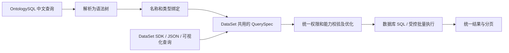

# OntologySQL：中文本体查询语言与统一查询计划

状态：用户于2026-11-07确认按工作台方案开发。已实现只读文本、类型化参数、授权目录、诊断、补全、格式化、最多4条INNER JOIN LINK及单模型聚合，统一编译到QuerySpec；完整目标中的LEFT、EXISTS、HAVING和复杂关系文本仍为候选。实现与验证结果统一见[项目总览](../项目总览.md#当前实现与验证2026-11-06)。本文只维护文本语法、编译与诊断；页面、引导和补全交互见[查询工作台设计增量](可视化查询编辑器.md#ontologysql-工作台设计增量2026-11-07候选)，公共查询语义和执行边界唯一见 [DataSet](DataSet.md)，名称与身份规则见[组织与隔离](../组织与隔离.md)。

### 单模型聚合与模板编译（2026-11-08已实现）

当前SQL新增 `COUNT(*)`、`COUNT(属性)`、`COUNT(DISTINCT 属性)`、`SUM/AVG/MIN/MAX(属性)` 及可选 `GROUP BY`。普通投影字段须先于计量，且与GROUP BY逐项同序；计量可用 `AS "中文名称"` 命名，内部按出现顺序生成m0、m1等输出ID。只允许一个输出排序；计量可按其中文输出名定位。纯计量无需GROUP BY，独立返回 `aggregateMode/aggregateRows/fields`，不能按实例编辑。示例为当前支持语法，具体类型、精度、权限、组数预算、分页及拒绝组合唯一见[公共单模型聚合](DataSet.md#公共单模型聚合2026-11-08本批实现)：

```sql
SELECT "状态", COUNT(*) AS "数量", SUM("金额") AS "合计"
FROM "业务"."工单"
WHERE "金额" >= :最低金额
GROUP BY "状态"
ORDER BY "数量" DESC
LIMIT 25;
```

该子集仅支持默认平台MySQL单Schema，JOIN LINK与聚合不能组合，HAVING、窗口、表达式计量和映射聚合仍明确拒绝。聚合下的普通字段插入接口拒绝改稿，避免破坏GROUP BY或输出粒度。SQL与可视化的统计转换必须完整保留同一QuerySpec。

个人模板使用独立 `POST /data/saved-queries/compile`，输入仅text和可选defaultCategoryId，不携带当前运行实参。它按AST区分固定常量与命名占位，输出稳定ID计划及参数声明，不查询业务行。模板编译首批拒绝IN/NOT IN列表中的任何命名参数，临时SQL原有标量参数列表不受影响。加载、执行旧模板使用已保存ID计划，不重新解析source.text；其权限和生命周期唯一见[个人保存查询](DataSet.md#个人保存查询2026-11-08本批实现)。

## 1. 方案选择

用户可以直接提交 OntologySQL 文本，客户端无需先构造 DataSet。内部建议采用以下路线，其中 DataSet/QuerySpec 表示延迟执行的查询描述，不是已经读取到内存的数据集。



| 路线 | 收益与成本 | 当前建议 |
| --- | --- | --- |
| OntologySQL → DataSet 共用 QuerySpec → 存储计划 | 复用中文名称、类型/单位、Link、权限、计算属性、分表、分页及缓存规则；增加文本解析与语法映射 | 推荐，共用一个逻辑计划和执行引擎 |
| OntologySQL → 独立的物理 SQL 编译器 | 初期可直接处理简单查询；需要再次维护关系、隔离、映射、分表及多后端规则，两个入口容易产生不同结果 | 不单独建设；若最后仍复用同一逻辑计划与优化器，实际上属于上一条路线 |

“编译到 DataSet”是将整条查询降低为同一份结构化逻辑计划，不是把 SQL 翻译成 SDK 代码后执行，也不是每解析一个 JOIN 就发起一次数据库请求。同库适合下推的查询仍可生成一条完整 SQL；分表和跨源执行方式复用 DataSet。OntologySQL 无法表达或 QuerySpec 尚未支持的语义应明确拒绝，不能丢弃条件或将原文透传数据库。

DataSet SDK、JSON、OntologySQL 和可视化配置是不同的编写入口，统一能力以 QuerySpec 可精确表示且后端已认证为前提。不要求各入口立即具备完全相同的表达范围；SQL 新增 JOIN、聚合或表达式前，先明确共享计划中的结果模式、类型及操作语义，不能借 SQL 单独开放另一套执行行为。

[可视化查询编辑器](可视化查询编辑器.md)直接构造相同的结构化描述，已实现单模型及最多4条INNER Link查询与SQL双向转换，范围见[可视化关联与模式互通](可视化查询编辑器.md#可视化关联与模式互通2026-11-08已实现)。转换只在双方都能无损表示的子集内进行；不能将实体身份去重、嵌套展开或作用域条件简化后宣称等价。无法转换的查询保留原稿或文本模式，具体交互和单一执行来源规则由编辑器文档维护。

## 2. 中文标识符与参数

建议保留熟悉的 SELECT、FROM、WHERE、ORDER BY 等英文关键字，业务 Schema、属性、Link 和输出别名使用中文。关键字大小写不敏感，业务名称的归一和唯一性沿用组织文档，不采用数据库对标识符的默认折叠规则。

| 内容 | 候选规则 |
| --- | --- |
| Schema | `"生产管理"."设备"` 表示业务分类与 Schema；分类不是物理数据库 schema，租户来自可信请求上下文 |
| 属性 | `"设备"."额定电压"` 表示已声明别名上的中文字段；解析到有效 field ID，不使用英文技术键或物理列名猜测 |
| 引号 | 双引号包围一个标识符，内部双引号以两个双引号转义；单引号表示文本值。中文标识符是否允许省略双引号待语法冻结，本文统一使用双引号 |
| 点号与别名 | 点号只分隔语法节点；`"设备.扩展"` 是一个完整名称。别名只在当前查询作用域内有效，重复或歧义须报错 |
| 分类 | 可在可信请求中声明 defaultCategory，确定后允许写 `FROM "设备"`；未限定且不能唯一定位时拒绝，不跨分类取第一项 |
| 参数 | `:最低电压` 等命名参数通过独立 parameters 提供值，按目标类型和规范单位绑定；文本值不通过拼接写入查询 |
| Enum | 中文取值标签按确定字段的 Enum 唯一解析为 code，绑定后使用稳定 code 比较；普通字符串不因此被当成枚举 |
| 实例与上下文 | 以有类型的真实实例身份或显式唯一业务键定位，不将“产线一”等实例显示名当作唯一 ID |

参数只能提供数值、文本、时间、集合或有类型对象引用等声明的值，不能替换 Schema、字段、Link、排序方向或任意 SQL 片段。decimal、日期、空值和计量值使用与 DataSet 相同的类型化编码，不为了 SQL 文本入口丢失精度或单位。

以下示例都是候选 OntologySQL，不能直接作为 MySQL、PostgreSQL 或达梦 SQL 执行。假设“生产管理”中已定义设备、产线、工单及文中字段；设备编码和产线编码分别是对应具体 Schema 内经认证的唯一业务键，额定电压的规范单位为 V。

## 3. 基本查询与编译对应

查询额定电压超过给定阈值的设备，调用时提供最低电压参数，结果列仍使用中文。

```sql
SELECT "设备"."设备编码", "设备"."设备名称"
FROM "生产管理"."设备" AS "设备"
WHERE "设备"."额定电压" > :最低电压
ORDER BY "设备"."设备编码" ASC
LIMIT 50;
```

| OntologySQL 部分 | 降低到共享查询描述 |
| --- | --- |
| FROM 分类.Schema | 当前租户内的 category ID、Schema ID 和精确类型范围 |
| SELECT 中文字段 | 稳定 field ID 投影及中文输出描述，保留源别名映射 |
| WHERE 比较及参数 | 有类型的比较节点、字段 ID、参数声明及规范单位，参数值逐次绑定 |
| ORDER BY | 合法字段排序及结果模式所需的稳定决胜键 |
| LIMIT | 最终结果页上限，仍受服务端限额；不限制数据库或多跳中间扫描量 |

建议首批支持单条只读 SELECT、显式字段投影、参数化比较、AND/OR/NOT、IS NULL/IS NOT NULL、有限 IN 集合、排序和有界分页。经认证后再开放 DISTINCT、固定 Link 导航、受限 EXISTS、聚合及 HAVING；文本比较、LIKE 和算术按类型及后端能力逐项开放。SELECT *、任意子查询、普通任意键 JOIN、UNION、窗口函数、递归 CTE 及不定长遍历不自动进入首批范围。

计算属性可以按中文字段名选择和筛选，实际使用 virtual、stored_sync 或 stored_async 规则仍由 [Schema](../模块/Schema.md) 决定。WHERE 中使用计算值时按完整逻辑集合计算后筛选，不能先 LIMIT 再计算。SQL 中的函数初期仅允许查询引擎明确支持的无副作用操作和聚合，不将同名 Function 定义当作数据库函数或逐行远程调用入口。

### 工作台首批语法候选（2026-11-07）

本节保留2026-11-07第一阶段单Schema实体语法及既有锚点；后续已增加INNER Link关联行和上节单模型聚合，新增形态按各自增量说明执行。用户已确认第一阶段实施下表，使相同条件的 SQL 与现有可视化查询可精确对照；实际 HTTP 类型以 [contracts/ontology_sql.go](../../contracts/ontology_sql.go) 为准。

| 文本形态 | 第一阶段候选规则与对应能力 |
| --- | --- |
| `SELECT` | 仅显式属性列表，按源码顺序绑定为 `select` 中的稳定字段ID；重复投影拒绝。不支持星号、列输出 `AS` 别名、常量列、算术或任意函数表达式，结果沿用原属性描述与实例身份 |
| `FROM` | 一个已生效 Schema；允许 `"分类"."对象"` 或当前分类内的 `"对象"`，可用 `AS "别名"`。Schema 别名仅用于绑定，降低后不新增结果模式；无别名时可用对象名限定属性 |
| 中文名称 | 首批业务标识符统一双引号，字符串使用单引号；引号内同类引号双写转义。补全和模板自动加引号，点号只在引号外分隔；只归一标识符，不改写字面值 |
| `WHERE` | 属性与有类型的字面值/命名参数比较，`= <> != < <= > >=`、括号及 `AND / OR / NOT`，沿用当前运算符和三值逻辑；不接受字段对字段比较 |
| 空值和集合 | `IS NULL / IS NOT NULL`、有限 `IN / NOT IN`。首批集合是括号中的字面值/标量参数列表；不隐式把一个数组参数展开为多个值。`= NULL` 明确报错并提示空值语法 |
| 字面前缀 | `STARTS_WITH(属性, 值或参数)` 精确降低为 `startsWith`，仅用于当前支持的文本类型，`%`、`_` 等仍为普通字符。该内建谓词不是业务 Function 调用；首批不开放任意 `LIKE`、包含检索或全文检索 |
| `ORDER BY` | 至多一个可排序属性及 `ASC / DESC`；未声明时按现有稳定实例ID排序，声明后仍以实例ID决胜。`text / longtext` 不可排序，跨表/跨源属性沿现有主表限制 |
| `LIMIT` | 整数字面量1至100，表示每页条数；省略时建议25并在界面提示。SQL模式不再叠加一份独立页大小配置，不支持 `OFFSET` 或厂商 `LIMIT offset,count` |
| 语句边界 | 仅一条只读查询，可选末尾分号，支持常规行注释及非嵌套块注释。注释/字符串中的分号不能被当作语句分隔符；不接受第二条语句或未消费尾部文本 |

未通过共享引擎认证的字段操作仍拒绝；SQL语法允许比较不表示每个数据类型支持所有比较。显式映射允许已认证的跨来源属性投影，但筛选、排序及权限行条件继续遵守主表边界。2026-11-08已支持引用 Enum 的字符串字段按稳定 code 比较和返回当前选项，详见[Enum](../模块/Enum.md#当前实现协议2026-11-08)；上文候选的中文取值标签自动解析尚未开放。计算及单位表达式继续拒绝。

首批语法骨架如下；标识符和字符串均由词法器处理转义，注释只作为 token 间空白，不通过正则替换 SQL。关键字大小写不敏感，`OR < AND < NOT` 为从低到高的优先级。

```ebnf
statement  = SELECT field { "," field } FROM source [ AS identifier ]
             { JOIN LINK identifier ( "." identifier | VIA source DIRECTION ( OUT | IN ) ) AS identifier }
             [ WHERE expression ] [ ORDER BY field [ ASC | DESC ] ]
             [ LIMIT integer ] [ ";" ] EOF ;
source     = identifier [ "." identifier ] ;
field      = identifier [ "." identifier ] ;
expression = conjunction { OR conjunction } ;
conjunction = negation { AND negation } ;
negation   = NOT negation | "(" expression ")" | predicate ;
predicate  = field comparison scalar
           | field IS [ NOT ] NULL
           | field [ NOT ] IN "(" scalar { "," scalar } ")"
           | STARTS_WITH "(" field "," scalar ")" ;
comparison = "=" | "<>" | "!=" | "<" | "<=" | ">" | ">=" ;
scalar     = string | number | TRUE | FALSE | NULL | parameter ;
```

`identifier` 是双引号标识符，内部双引号双写；`string` 是单引号字符串，内部单引号双写；`parameter` 是冒号加名称。数字保留原始十进制文本后按字段类型校验，不经过浮点数。`NULL` 只在共享引擎允许的位置使用；比较或前缀操作的空值须改写为 `IS NULL` 等明确形态，不能将空值悄悄当空字符串。`IN` 中允许的空值仍按字段可空性及 SQL 三值逻辑处理，不展开数组参数。

可将当前个人知识库生成的第一条指导查询设为：

```sql
SELECT "笔记"."标题", "笔记"."来源相对路径"
FROM "个人知识库"."笔记" AS "笔记"
WHERE "笔记"."来源可用" = TRUE
LIMIT 25;
```

该示例可通过首批文本入口执行，内部仍由 QuerySpec 查询。“标题”和“来源相对路径”实际为 `text`，不能在指导中推荐按标题排序；若用户需要排序，候选列表只提供实际可排序字段。包含完整 Markdown 的属性可显式选择，模板默认不展开长正文。

参数化前缀示例为 `WHERE STARTS_WITH("笔记"."标题", :标题前缀)`，参数面板独立填写字符串，用户无需在参数值中加单引号或 `%`。int64、decimal 的字面数字由服务端保留词法原值并按目标字段编码为十进制字符串；参数控件也保留字符串，不能经过 JavaScript Number。时间沿当前RFC3339及微秒约束，不擅自转成浏览器毫秒值。同名参数多次出现必须具有兼容类型；缺值可完成结构分析并提示待填写，执行必须完整绑定。空字符串、未填写和显式空值分别处理。

### 当前INNER Link语法（2026-11-07）

用户确认多模型路径辅助后，已补齐共享关联行计划、编译和执行闭环。实际支持以下两种写法，Link端点由定义确定，无需用户填写物理ON条件：

```sql
SELECT "设备"."设备编码", "工单"."编号", "产线"."编号"
FROM "生产管理"."设备" AS "设备"
JOIN LINK "设备"."工单" AS "工单"
JOIN LINK "工单" VIA "生产管理"."工单产线" DIRECTION OUT AS "产线"
WHERE "工单"."金额" >= :最低金额
LIMIT 25;
```

短写的 `起点别名.方向入口` 仅在授权图内唯一时接受；歧义必须使用 `VIA 分类.Link主名 DIRECTION OUT/IN`。每个JOIN起点须已声明，目标须给不同别名，同类型可以通过新别名再次出现，支持反向和分支。未限定字段在当前所有角色内必须唯一；路径辅助会先按原作用域为已有未限定字段补别名，防止添加模型后改变原条件绑定。

最多4条INNER Link、5个对象节点。单Schema查询继续允许已认证的跨来源投影，关联行只接受各对象主表属性；跨源/跨数据库、次表属性、LEFT、普通ON、both、关系属性、EXISTS和聚合明确拒绝。结果为独立关联行，保留一对多，不做隐式DISTINCT；稳定分页、授权和结果协议唯一见[DataSet关联行](DataSet.md#关联行查询增量2026-11-07)。以下完整关系导航及复杂语义示例继续标为候选，不因支持INNER而全部开放。

### Link 文本查询的分期

第一阶段继续保留结果行“关联数据”入口，实际通过既有 `via` 查询；它支持从一个确定实例正向或反向读取终点实体，不能替代下面的全集 `JOIN LINK` 示例。`via` 的筛选、投影、排序只作用于返回端，并按终点身份去重；它不能保留任意根端投影、根端条件或多条路径产生的重复行。

建议后续第二阶段单独定义“固定起点关系导航”的文本形态，要求有类型起点实例参数、明确方向和终点实体结果，再精确降低为 `via`。该形态的最终拼写待确认，不提前作为 `JOIN LINK` 的简写实现。若要开放本节后续的 `JOIN LINK`、相关 `EXISTS` 或聚合，应先扩展 DataSet 共用计划及结果模式，再同时落实编译、权限和分页；不能只扩展文本解析器。

2026-11-07已落实“连续选择多个模型辅助生成多Link查询”，图搜索和路径采纳交互唯一维护在[查询编辑器](可视化查询编辑器.md#多模型与link路径辅助2026-11-07已实现)。当前INNER语法先于固定实例文本交付，依赖完整关联行计划及执行器，不借用固定起点 `via` 冒充多模型关系行。

开放上述自动生成前，须先在DataSet共用计划中具备多别名扫描、显式Link展开、各作用域表达式、扁平投影及稳定路径行分页，并有区别于实体 `Instance[]` 的只读行结果描述。服务端同时完成Link和模型的查询授权发现、语法解析/中文绑定、参数类型与上下文检查、每个参与对象的行权限、关系权限、定义/映射gate及执行后重检；游标绑定完整路径、定义、权限和实际参数，不能继续沿用单一终点身份。能力声明只开放已认证的方向和存储组合，候选首批限定同数据源、同数据库的INNER关系，跨源和LEFT等另行认证。

生成器输出的是引用中文名称及别名的OntologySQL草稿，服务端解析后才形成稳定ID的共同计划；名称变更、权限变化及关系映射失效仍可导致重新检查失败。无论通过确定图搜索还是可选AI提出路径，生成器都不能绕过编译执行能力、改写行数语义或直接下发底层厂商SQL。具体JOIN、去重与分页区别继续由下列章节及DataSet共同规则维护；本段不是新增HTTP协议或已实现能力声明。

## 4. Link 导航、多跳与前后关系

建议使用显式 `JOIN LINK` 扩展，区分通过本体关系导航与按任意字段关联。短写使用当前端点上的中文方向入口；完整写法使用分类、Link 主名称和方向，解决入口重名或需要明确方向的情况。以下是候选语法骨架，不是完整语法定义：

```text
JOIN LINK 起点别名.方向入口名 AS 终点别名
  [EDGE AS 边别名] [CONTEXT :上下文参数] [ON 附加条件]

JOIN LINK 起点别名 VIA 分类.Link主名称 DIRECTION OUT或IN AS 终点别名
  [EDGE AS 边别名] [CONTEXT :上下文参数] [ON 附加条件]
```

OUT/IN 是语法中的方向关键字，对应 Link 的正向/反向；不根据“包含”“属于”等动词猜方向。绑定时校验起点实际类型、Link 端点、上下文及权限，终点类型由 Link 推导。方向入口不能唯一解析时要求完整写法。边别名用于引用已声明的中文关系属性，边身份保留在内部行绑定中；基础 INNER 导航先认证，LEFT JOIN LINK 的空值补齐、ON 与 WHERE 区别需在共享计划具备明确语义后开放。BOTH、对称、有效时间和派生关系也分别沿用已认证能力。

### 查询一条产线的设备

```sql
SELECT "设备"."设备编码", "设备"."设备名称"
FROM "生产管理"."产线" AS "产线"
JOIN LINK "产线"."包含设备" AS "设备"
WHERE "产线"."产线编码" = :产线编码
ORDER BY "设备"."设备编码" ASC
LIMIT 50;
```

“包含设备”绑定为“产线设备成员”的正向视图，数据仍来自统一成员事实。此查询按设备编码返回一页成员，不表示产线前后顺序；查询全部成员需沿游标读取完，实际工艺顺序和前驱规则见 [Link](../模块/Link.md)。

### 查询某设备在指定产线的上一台

```sql
SELECT "上一台"."设备编码", "上一台"."设备名称"
FROM "生产管理"."设备" AS "当前设备"
JOIN LINK "当前设备"
  VIA "生产管理"."产线设备直接后继" DIRECTION IN AS "上一台"
  CONTEXT :产线上下文
WHERE "当前设备"."设备编码" = :设备编码
LIMIT 1;
```

产线上下文参数是同租户“产线”的有类型实例引用，绑定和执行时验证实际身份及授权。这里 IN 读取当前设备作为 target 的直接后继边，返回 source，即上一台；唯一约束来自该上下文中已认证的 chain 规则，LIMIT 1 不能替代基数和顺序校验。短写可选择当前设备的“上一台”方向入口；权限隐藏邻居、读取失败与真实首节点的区别沿用 Link，不伪装成相同空结果。

### 连续多个 Link

```sql
SELECT DISTINCT "设备"."设备编码", "设备"."设备名称"
FROM "生产管理"."工单" AS "工单"
JOIN LINK "工单"."使用设备" AS "工单设备"
JOIN LINK "工单设备"."所属产线" AS "产线"
JOIN LINK "产线"."包含设备" AS "设备"
WHERE "工单"."工单编码" = :工单编码
ORDER BY "设备"."设备编码" ASC
LIMIT 50;
```

路径绑定为“工单使用设备 OUT → 产线设备成员 IN → 产线设备成员 OUT”，与 DataSet 多跳示例共用计划；假设本例工单编码也是已校验的唯一键。这里 DISTINCT 去重的是所选字段组合，在本例设备编码唯一且只查具体设备 Schema 的前提下可得到每台设备一次。一般情况下不能把字段值相同当作实体身份相同，也不能把 DISTINCT 当作降低多跳成本的保证。

## 5. 行数、聚合和分页语义

OntologySQL 的普通 SELECT 是行投影，JOIN LINK 默认每个匹配边/路径绑定产生一行，N:M 可能重复根对象或终点对象；不隐式套用 DataSet 关联存在性筛选的实体去重。需要“至少存在一条满足条件的关系”的筛选时，应编译为共享计划的关系存在性节点；候选相关子查询写法为 `EXISTS (SELECT 1 FROM LINK 起点别名.方向入口名 AS 终点别名 WHERE 条件)`，只允许已认证的相关范围，不默认开放任意子查询。

| 语义 | 共享计划必须保留的区别 |
| --- | --- |
| 普通 SELECT 与 JOIN LINK | 显式扁平行结果，保留参与对象、边及路径身份；不能用 EXISTS 替换会影响行数的 JOIN |
| EXISTS | 根对象的关系存在性条件，不因多条匹配关系复制根对象 |
| DISTINCT | 按投影后的值元组去重，遵循 NULL 及类型比较规则，不等于按实体 ID 去重 |
| COUNT(*) / COUNT(字段) | 分别计算输入行和非空字段值数量；COUNT(DISTINCT 字段) 计算不同非空值，不自动表示实体数 |
| GROUP BY / HAVING | 全部授权输入先分组聚合，再筛选聚合结果，最后排序分页；无意展开造成的重复汇总须由显式查询形态解决 |
| NULL 和布尔条件 | 采用 SQL 三值逻辑，WHERE/HAVING 仅保留 TRUE；共享表达式必须明确 NULL、缺失、NOT、IN 及比较语义，不能错误转换成普通二值判断 |

例如按设备状态统计时，可以在聚合开放后采用以下写法，避免先关联多值关系导致 COUNT(*) 计成关系行数。

```sql
SELECT "设备"."设备状态" AS "状态", COUNT(*) AS "设备数量"
FROM "生产管理"."设备" AS "设备"
GROUP BY "设备"."设备状态"
HAVING COUNT(*) >= :最少数量
ORDER BY "设备数量" DESC, "状态" ASC
LIMIT 50;
```

同名输出列要求显式中文别名或明确的来源分组，不能覆盖结果键。聚合结果和扁平行不伪装成可保存的实体；字段、Enum code/中文标签、单位和隐藏身份描述仍沿用 DataSet。类型继承默认精确 Schema，不因写 FROM 自动包含子类；子类型文本语法另行确定。

LIMIT 对应最终页大小；游标建议作为查询请求参数传递，沿用 DataSet 的条件、参数、当前定义/映射及权限绑定，不将底层厂商游标写入 SQL 文本。实体页、扁平路径行和聚合页分别确定稳定排序身份：路径行须考虑参与边的完整绑定，聚合页按分组身份及排序键处理；未认证稳定续页的形态不能承诺游标分页。OFFSET 和无 ORDER BY 的稳定翻页策略待定，不默认开放无界深分页。

## 6. 编译、接口和诊断

### 首批实际协议（2026-11-07）

请求和响应类型见 [ontology_sql.go](../../contracts/ontology_sql.go)、[query_context.go](../../contracts/query_context.go)，路由与共用查询执行见 [Data 服务](../../services/data/README.md)。以下入口使用现有服务端会话及 POST 的同源/CSRF 校验，响应均为 `Cache-Control: no-store`。

| 入口 | 首批协议 |
| --- | --- |
| `GET /data/query/context` | `categoryId/schemaId/search/cursor/limit` 可选过滤；limit默认30、范围1～50，同时按完整模型执行1MiB分页，返回 `models` 和可选 `nextCursor`。仅需当前instance.query；模型含分类、Schema稳定ID/中文名及授权字段，字段含类型、可空性、精度、filterable/sortable，不含物理映射或业务数据 |
| `POST /data/query/ontology-sql/analyze` | 正文 `text/parameters/defaultCategoryId/requestId`，返回 `requestId/textHash/diagnostics/parameters/fields/ready`；完整可执行时含稳定ID的 `query`；关联查询还提供授权 `scope`，缺参时也可用于角色选择。缺参仍返回类型和出现范围，`provided=false/ready=false`，不读取业务行 |
| `POST /data/query/ontology-sql/complete` | 同上并提交从0开始的UTF-16 `cursorOffset`；返回 `items`，每项含 `label/insertText/detail/kind/range`。容忍未完成语法，最多50项；仅使用授权模型与字段，WHERE/ORDER按实际能力过滤 |
| `POST /data/query/ontology-sql/format` | 同一词法/语法前端格式化，返回 `text/diagnostics/requestId/textHash`；字符串、标识符、注释保留，不完整语句不通过删除片段修复 |
| `POST /data/query/ontology-sql` | 正文与analyze相同；检查完整且参数齐全才执行，返回QueryResult的 `data/fields/hasMore/nextCursor`，关联查询另有 `rowMode/rows`，聚合另有 `aggregateMode/aggregateRows`，附加实际绑定的 `query/requestId/textHash`。后续页携带此query及游标提交既有 `/data/query`，继续重新授权 |

目录已使用独立业务发现桥，原会话在Metadata恢复并复核；内部每次最多20份定义、2MiB，数据库每批最多5份并先关闭cursor再授权。公开目录包含游标最多1MiB，按完整模型分页，不静默删字段；单模型超限返回422 `directory_budget`。游标最多4096字符、15分钟有效，HMAC绑定租户/用户、分类/模型/搜索/limit、最后模型ETag和授权State；每页重新授权，篡改、跨上下文、绑定定义或权限变化拒绝。其他模型的并发变化不提供历史快照。目录从准入及会话校验开始整体4秒，为OntoApp单次5秒留传输余量；客户端累计4MiB/100页等预算仍独立生效，真实代表目录压力与时延未验收。SQL文本模型解析及关系发现仍要求其原有定义/组织读取授权，不能把目录只需instance.query推广到完整SQL编辑协议。

路径及字段辅助均为POST只读编辑接口，使用同一会话/CSRF校验，响应 `no-store`：

- `/data/query/ontology-sql/paths`：输入原请求及 `targetSchemaId`；返回 `requestId/textHash/candidates/diagnostics/truncated`。候选包含接入 `fromAlias`、每步 `linkId/name/category/direction/fromAlias/toAlias/target` 和完整新 `text`。扩展只添加JOIN，保留既有SELECT（未限定字段按原作用域补别名），不自动投影目标属性。从所有已声明角色查找全局最短授权路径，最多4条总JOIN、20个候选、500次边扩展；预算耗尽不返回任意部分候选。无路径、无权、原稿无效均保留原稿，不猜同名字段关联。
- `/data/query/ontology-sql/insert-field`：输入原请求及 `schemaId/fieldId/alias/selectionFrom/selectionTo`；返回 `requestId/textHash/text/from/to/diagnostics`。多角色须明确alias，范围用UTF-16；完整解析绑定后安全添加SELECT并去重，保留筛选、排序及独立参数，注释/字面值等不安全位置不改稿。

路径规划只读取当前授权定义，不访问业务行或预先验证物理目录；执行器重新核验来源启用状态、实际目录和发布gate。候选文本不持有额外权限，采纳后仍须重新分析；前端核对原文摘要和请求代次后才允许采纳。以上实际结构唯一见 [row_query.go](../../contracts/row_query.go)。

`parameters` 是按名称传递的JSON标量对象；int64/decimal必须使用字符串，boolean使用JSON布尔值，文本/UUID/时间使用字符串，合法位置的空值使用JSON null。省略某个键表示未提供，空字符串是已提供的文本值；不把数组参数展开为IN集合。同名参数的类型、精度及全部使用位置必须兼容，未使用的实参明确拒绝。文本最多64KiB、8192个token、64个命名参数；投影和IN集合最多100项，筛选节点最多100、嵌套最多10层，LIMIT默认25、范围1..100。目录读取另有1000项扫描预算，要求缩小范围后重试。

所有源码范围为UTF-16半开区间 `from/to`；展示用 `line/column` 从1开始，CRLF算一个换行。`textHash` 是输入文本UTF-8的SHA-256，供调用方与requestId一起拒绝旧响应，不是授权或持久计划凭证。语法、字段和类型诊断由analyze返回；不完整或非法文本执行返回422。不可见和不存在的模型统一为 `source_unavailable`，字段统一为 `field_unavailable`，不返回隐藏名称或绑定；身份失效、目录读取或权限服务故障仍使用对应HTTP错误。

目录以当前调用者身份读取Metadata公开目录，叠加 `instance.query` 与 `readFields` 生成，不用服务身份列目录。显式FROM的名称解析随后也检查定义可发现性及当前查询授权。格式化只处理调用者提交的文本，不解析隐藏目录；analyze、context和complete不查询业务表、样例或COUNT。物理目录、gate、实际来源及授权状态在执行时仍按共用执行器重新核验，分析通过不能代替运行时检查。

以下继续描述完整方案；其中计划预览、复杂关系、关系/跨源聚合、持久缓存等为后续候选，不能从上表接口可用推断为已开放。

建议 Data 服务内部增加文本前端，不新增独立查询服务或执行通道。编译步骤为：完整解析单条语句并保留源码位置 → 按可信租户及作用域绑定名称/ID → 检查类型、单位、参数及操作权限 → 降低为 QuerySpec → 执行统一能力/预算校验及优化 → 生成数据库 SQL 或受控批量计划。SDK/JSON 也通过同一校验器，外部提交的 IR 或已绑定对象同样不被直接信任。

使用真正的词法/语法解析与类型化语法树，不能靠正则替换字段或按分号切分文本。首批有限语法建议使用Go显式词法器与递归下降解析，保留token及源码范围，布尔表达式明确优先级；实现时先冻结EBNF和代表用例，再决定是否复用适合的解析库。评估Unicode、双引号、参数、容错上下文及未来关系扩展，不将MySQL等厂商方言直接当作本体语言。前端仅做高亮和交互，权威语义编译保持一份。后端解析器无新增依赖或生成代码；前端使用独立加载的CodeMirror 6。

查询计划预览仍待后续实现；不返回物理SQL或厂商EXPLAIN，也不自动执行样例扫描。其余首批入口的协议以上表为准，新增上下文不能获得额外业务权限；公共授权规则仍唯一见[权限设计](../权限/权限设计.md)。

建议执行流程为 `读取可信上下文 → 解析 → 绑定Schema/字段 → 类型化参数 → 共用校验器 → 共用执行器`，将当前HTTP入口中的绑定/执行逻辑提取为Data内部可复用函数。SQL接口不通过回环HTTP另调自己，也不读取Metadata私有表。编译/补全不开放底层表、列、凭据或不可见字段；无权与不存在的业务名称采用不泄露目录的统一反馈，可见但能力未支持的语法才具体说明原因。

首批分页建议复用现有结构：执行返回实际已绑定的 `QuerySpec` 作为执行上下文，参数值已按当前类型写入表达式；下一页将这份稳定ID描述及游标提交现有 `POST /data/query`。该描述与其他客户端QuerySpec一样必须重新授权，不是授权令牌，也不创建持久计划。修改文本、参数、默认分类或模式后清除上下文和游标；仅排版变化也可保守要求重新运行。不能每一页重新按中文名称解析到另一个对象。定义/权限/来源变化仍使现有游标失效，依照DataSet当前分页规则重新运行。

诊断与补全候选建议携带 `requestId`、源码摘要、范围、稳定错误码及中文修正说明。范围统一为从0开始、末端不包含的UTF-16文档偏移，供浏览器直接标注；展示行列从1开始。Go内部的UTF-8字节位置在输出前转换，显式覆盖中文、emoji、CRLF和双引号转义。缺少参数、同名参数类型冲突、字段不可用、不可排序、能力未开放及超预算分别定位；旧请求响应不得套用到新文本或新分类。

只读入口初期仅接受一条 SELECT，允许可选末尾分号并要求其后只有合法空白或注释；不允许多语句、DDL、DML、过程调用、文件访问、系统目录或物理表逃逸。表和列仅来自绑定后的受控映射，值仍参数化；即使底层数据库支持某语法，也须先满足本体规则与能力认证。

预览复用 DataSet 的只读边界，不默认执行 EXPLAIN ANALYZE、样例扫描、COUNT 或业务 Function。文本长度、token/AST 节点、嵌套和参数集合均有编译预算，多跳与执行仍有中间结果、成员数、字节和耗时预算；小 LIMIT 不构成廉价查询保证。具体限额和 HTTP 协议待后续验证。

首批工程预算已经在实际协议中冻结；后续多跳、中间结果与响应容量仍须按能力单独验证，不能将有界页大小视为性能承诺。

## 7. 改名、缓存和性能

临时文本每次首次绑定按当前中文名称解析；持久查询若后续开放，应保存原始文本、参数声明、ID 绑定的逻辑计划及源码映射，执行时使用原 ID 并校验当前定义。改名后可从绑定生成当前中文名称的展示或格式化文本，原始文本仅作编辑来源；重新编辑并编译视为显式新绑定，展示绑定变化，不让同名新建自动接管旧依赖。沿用单份当前定义，不引入业务 version；具体保存查询能力仍是候选。

SQL 文本解析和语义绑定可缓存，但绑定及执行计划须按租户、当前名称登记、依赖/映射、权限、能力及查询结构隔离并校验权威当前状态；参数值每次绑定。缓存命中不跳过授权，不能缓存上次参数；名称不在逐行执行阶段重新解析。参数变化影响成员裁剪或执行计划时重新校验，不复用上次参数的分表成员集合。

性能比较以等价 OntologySQL、DataSet SDK/JSON 和人工核对的参数化 SQL 为基线，要求相同行结果、重复/空值、权限、单位、读取一致性和预算。分别测文本解析、中文绑定、逻辑计划编译与数据库执行，并记录冷暖缓存、并发和多跳规模。经共享计划执行可复用同库下推，不能据此宣称文本解析零开销或所有查询只发一条 SQL；测量方法统一维护在[性能与容量](../性能与容量.md)。

## 8. 验收与待定事项

以下覆盖完整目标；单Schema、有界INNER Link及本批单模型聚合已有模块及真实数据库验证，复杂关系、关系/跨源聚合、缓存与性能继续待验收，具体结果见项目总览。

| 编号 | 要求 | 验收方法 |
| --- | --- | --- |
| OSQL-01 | 文本入口降低为统一查询描述 | 同语义 SQL、SDK、JSON 得到等价 ID 绑定及结果，编译不加载全集或逐 JOIN 发请求；未表示的语义明确拒绝 |
| OSQL-02 | 中文名称、作用域及诊断明确 | 分类同名、别名、引号内点号、转义双引号和 Unicode 可核对；参数不能替换标识符，错误定位到源码且不越权泄露 |
| OSQL-03 | Link 方向、上下文和多跳沿用统一规则 | 成员 OUT、所属产线 IN 和指定产线的上一台与 DataSet 等价；歧义拒绝，关系属性、N:M 和后续 LEFT 语义逐项认证 |
| OSQL-04 | SQL 行数、聚合及空值不被错误简化 | JOIN 重复行、EXISTS 根对象、DISTINCT 值元组、COUNT/NULL、三值逻辑、HAVING 和全局分页有独立可核对结果 |
| OSQL-05 | 只读、参数化及预算在所有入口成立 | 多语句/写语句/物理表访问拒绝，参数和名称不能注入 SQL；复杂文本及小页高扇出受控失败，无物理 SQL 兜底通道 |
| OSQL-06 | 绑定身份、当前态和权限一致 | 改名、同名重建、原文重编译、缓存失效及参数变化不误绑/漏成员；依赖或权限失效明确拒绝，旧绑定不运行历史定义 |
| OSQL-07 | 预览与性能结论有相同语义基线 | 预览不执行业务扫描，三种编写入口复用当前校验；分阶段报告解析/绑定/编译/执行成本，不将文档或单例等价当作三库性能通过 |
| OSQL-08 | 实体、关联行与单模型聚合文本分别降低为等价QuerySpec | 比较基础SELECT、参数、NULL/集合、精确数值及分页；INNER Link比较多角色、反向/自关联/分支、主表限制、路径候选及保留重复行；聚合比较分组、六类计量和输出排序；拒绝实体星号/列别名、字段间比较、普通JOIN/LEFT、JOIN聚合及尾部多语句，不丢弃未支持片段 |
| OSQL-09 | 查询上下文、补全与源码诊断准确受控 | 不完整语句可补全；候选随分类、别名、字段类型/主表能力及当前权限变化，不泄露隐藏目录或扫描业务值；UTF-16范围覆盖中文/emoji/CRLF，旧响应被拒绝 |

单Schema文本、最多4条INNER Link关联行、单模型聚合及个人模板编译已按用户确认方案落实，实际验证以项目总览为准。固定起点关系文本、EXISTS、HAVING、关系聚合、复杂关系、三库能力、团队查询分享、缓存及性能目标继续待定。
