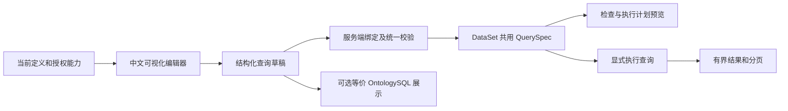

# 可视化查询编辑器：工作台体验、中文配置与关系导航

状态：已明确需要可视化查询编辑器并重视使用体验，当前仅维护设计文档。本文推荐同一工作台内逐步配置查询，通过中文选择器、条件分组和关系路径构建 DataSet 共用查询计划；页面布局、交互、协议、组件选型及首批范围仍为候选，尚无界面或服务实现，也未开展用户试用。公共查询语义与授权边界见 [DataSet](DataSet.md)，文本语法见 [OntologySQL](OntologySQL.md)，命名和稳定身份见[组织与隔离](../组织与隔离.md)。

## 1. 定位与整体路线

面向业务人员和分析人员，使用“设备”“额定电压”“所属产线”等中文名称完成筛选、关联和统计。编辑器直接构造结构化查询描述，经 Data 服务校验后进入统一 QuerySpec；不需要先生成 OntologySQL 才能执行。SQL 可作为经能力检查的查看或交换形式，共用同一结果语义。



编辑器负责表达查询意图、显示检查结果和关联错误位置；服务端负责当前定义、权限、类型/单位、Link、计算属性、分表、成本及执行。客户端隐藏选项、校验通过或已有 ID 均不能替代服务端验证。不新增一套查询引擎，也不通过浏览器逐行导航或计算代替全局查询。

## 2. 页面与基本操作

推荐“同一工作台、逐步展开”的交互：默认完成选对象、加条件、选返回列和运行，关系、统计、参数及 SQL 按需展开。步骤表达任务顺序，配置保持在同一页面可回改，不要求填完多页向导。以搜索式选择器、就地条件编辑和可折叠关系树为主，路径缩略图辅助说明复杂多跳。基础布局示意如下，名称及页大小仅作候选示例。

```text
数据查询  / 当前租户 / 生产管理                 [运行] [更多 ▾]

查询对象：设备                     结果方式：对象列表（每台设备一次）

字段和关系             查询配置
设备                   条件：全部满足
  设备编码               额定电压  大于  [最低电压：220 V]
  设备名称               存在 所属产线，且同一产线满足：
  额定电压                 产线编码 等于 [产线编码：L1]
  所属产线 → 产线
                       返回列：设备编码、设备名称、额定电压
                       [添加条件] [添加关联条件]
                       排序：设备编码 升序       每页：50

查询说明：查询属于产线 L1 且额定电压大于 220 V 的设备，每台一次
结果：[尚未运行]                   就地提示：[定位到对应条件]
```

| 区域 | 候选操作与边界 |
| --- | --- |
| 对象选择 | 在当前可信租户内选择分类和 Schema；分组仅辅助浏览，默认分类显式确定；显示已选中文名称和必要的类型说明，不自动选中搜索首项 |
| 字段与关系目录 | 按当前节点的 Schema 展示可用字段、计算属性和正反向 Link 入口；支持搜索、键盘选择和懒加载，选择后加入配置，不一次加载全租户定义图 |
| 条件区 | 添加字段条件、全部/任一/取反条件组、关系存在性及关系内条件；保留括号和层级，可用按钮操作，拖动不是唯一编辑方式 |
| 结果配置 | 选择对象列表、关系明细或分组统计，再配置返回列、中文别名、排序、参数和页大小；模式变化先说明行数含义及受影响配置 |
| 关系路径 | 展示每一步起点、方向入口、终点、基数和必要上下文；同类节点使用中文角色名区分，例如“当前设备”“上一台” |
| 结果区 | 只读表格、字段/单位说明、续页和错误状态；当前页、全部匹配数量和未计算总数明确区分，可从列或单元格发起新的配置操作，不提供隐式回写 |
| 就地提示 | 自动检查后将未知字段、失效依赖、类型错误、关系歧义或成本限制定位到相应控件，必要时汇总并提供跳转；只显示当前用户可见的诊断 |

空配置不自动等于授权范围内的全量读取。用户明确选择查询对象及结果列后才能运行；“不设条件”可表示查询完整逻辑集合，但仍返回有界页并受预算约束。基础模式不默认展开所有字段和关系。

### 首次查询与日常修改

以“查产线 L1 上额定电压大于 220 V 的设备”为例，候选操作路径如下：

1. 搜索并选择“生产管理 / 设备”，页面展示字段和关系，提供可明确采纳的推荐返回列“设备编码、设备名称”；用户也可自行选列。
2. 添加“额定电压”，控件提供数值比较和单位，选择“大于”并输入“220 V”。不要求用户输入字段路径或表达式。
3. 添加关联条件，选择“所属产线”以及“用它筛选设备”，在同一关系组中添加“产线编码 = L1”。组标题持续显示“同一产线需满足”。
4. 页面同步展示中文查询说明“属于产线 L1，且额定电压大于 220 V；每台设备一次”，用户点击“运行”后在下方查看结果。
5. 将 220 改为 380，控件立即保留新值，旧结果显示“条件已修改，运行后更新”；再次运行后整体替换对应结果。

顶栏只突出“运行”一个主操作；执行期间在同一位置提供真实进度状态和“取消”。轻量检查自动发生，运行动作衔接必要的服务端校验，用户无需依次点击检查、预览和运行。“查看 OntologySQL”“执行计划”和手动重新检查收进“更多”，业务使用不依赖技术视图。一次运行只提交一份确定的配置和参数；正在检查时接收运行意图并明确显示状态，检查完成前配置若又发生变化，取消该待运行意图。

桌面工作台建议左侧目录可收起、中间配置与下方结果可调整高度，主操作和查询对象始终可见；窄屏将目录和高级配置折叠为抽屉，保留当前编辑位置。避免为每条条件反复开关弹窗，拖拽、双击和悬停均有可点击或键盘操作的替代。

### 搜索、中文说明与结果反馈

选择器支持中文名称和定义说明搜索，展示分类、类型、单位及关系方向等必要上下文；参数、操作符、Enum 标签均使用业务措辞。最近使用入口只可作为同租户、当前授权范围内的候选，不保存业务结果或敏感实参；选不到的项目给出可行动的空状态，不能只显示空白下拉框。

中文查询说明从当前结构和已绑定元数据确定性生成，随编辑更新，可点击片段定位对应条件或关系组；未完成部分显示“尚未填写”，不能生成一个看似完整的说明。无需大模型参与说明生成，也不自动从说明反推或更改查询。内部稳定 ID 和完整字段路径不成为业务用户必须理解的内容。

结果表头提供“加入筛选”“设置排序”，单元格可提供按该值添加条件；统计入口仅在共享能力支持时出现。操作先更新同一查询配置并展示变化，点击运行后对逻辑全集重查。拖动列宽、调整显示顺序属于展示操作；筛选、排序或聚合不能只处理当前页。无结果、尚未运行、执行失败及条件已改但仍显示旧结果分别呈现；只有成功的完整空结果才能显示“没有匹配项”。

## 3. 中文名称、字段与条件

用户看到中文主业务名称和中文输出别名，技术关键字、UUID、物理表列名不成为必填操作内容。选择器取得当前定义身份后，在草稿中保留稳定 Schema/字段/Link ID、名称描述及声明来源；字段绑定到具体关系节点，避免多个“设备”混用同名属性。服务端核对归属、类型和当前可用性，名称定位与 ID 同时作为有效定位信息提交时仍需验证一致。

| 数据类型或操作 | 候选编辑方式 |
| --- | --- |
| 数值与计量 | 只展示该类型支持的等于、大于、区间等操作，输入附明确单位；允许的显示单位转为规范单位后绑定，保留 decimal 精度 |
| 文本 | 等值、集合或经后端认证的前缀等操作；字面输入不变成 SQL 片段或默认通配表达式 |
| Enum | 显示中文标签，实际选择目标 Enum 的稳定 code；同标签用授权可见说明辅助区分，不能按第一项猜测 |
| 日期与时间 | 明确日期/时间戳、时区和区间边界；如支持“最近一天”等相对条件，按共享规则在每次执行开始时确定基准，后续页沿用该次绑定 |
| 空值 | 提供“为空”“不为空”等独立操作；空输入、空字符串和 NULL 分别处理，不把未填写误作比较 NULL |
| 对象引用 | 从授权候选中选择真实类型与实例身份，可按唯一业务键查找；实例中文显示名不自动唯一 |
| 查询参数 | 可将条件值设为“最低电压”“产线编码”等中文参数，保存类型、单位及必填规则；执行前填值，不能用参数替换字段或方向 |
| 计算属性 | 按当前 Schema 定义选择，显示必要的新鲜度说明；查询条件不能修改公式或计算策略，不允许直接写任意 Function 表达式 |

条件树明确“全部满足”“任一满足”和“对整组取反”，以共享表达式表达 NULL/缺失及三值逻辑。尤其“不是大于 220”不自动包含 NULL；如需空值也满足，用户显式添加“为空”分支。非法操作符、空 IN 集合和缺失参数由同一规则检查，客户端不自行补成宽松条件。

条件行就地编辑，支持复制、移动到分组、删除及撤销；全部/任一/取反使用文字标题、缩进和边框共同表达，不能只靠颜色区分。选择字段后仅推荐与类型匹配的操作，不替用户补全业务值；更换字段使旧值或操作不兼容时，保留受影响内容供修正并阻止执行。深层条件可折叠并显示摘要、未完成项及错误数，错误可直接展开并定位，不能因折叠而忽略校验。

同一个关联对象必须同时满足的条件放在同一关系条件组中。例如“存在一张工单，同时状态为进行中且优先级为高”，不能拆成“存在进行中工单”和“存在高优先级工单”后误将两张工单当成同一张。需要不同关联对象分别满足时，显式添加两个独立关系条件组；编辑器保留各自作用域。

## 4. Link、多跳和结果方式

关系选择显示“包含设备（正向）”“所属产线（反向）”“上一台（反向）”等入口，并提供主 Link 中文名称和分类用于消歧。内部仍保存 Link ID 与 OUT/IN；默认只展开用户选择的固定路径，不自动寻找最短路径、无限递归或推断业务关系。上下文、有效时间、关系属性及子类型能力只在当前服务声明支持时提供。

### 三种关系操作

| 用户意图 | 候选控件与结果含义 |
| --- | --- |
| 用关联条件筛选对象 | “存在满足条件的关联对象”或经认证的“不存在”；编译为存在性条件，根对象只保留一次，不自动增加结果列 |
| 展示对象的关联信息 | “附带关联信息”；保持根对象列表，嵌套结果有逐父数量及续页上限，不默认加载全部多值关系 |
| 查看关系/路径明细 | 显式切换“关系明细”；按每个匹配边/路径形成行，清楚提示同一对象可能出现多次，可选择授权的关系属性 |

选择关系后先说明“你希望用这个关系做什么”，用上述三种业务意图引导配置；默认对象列表中的“添加关联条件”进入存在性筛选。整个关系组持续标出当前对象、方向、目标角色和必填上下文，组内条件只绑定到该角色。增加多跳时沿当前关系节点继续选择下一步，同时显示可点击的中文路径面包屑；可选路径图用于定位和理解，点选节点与表单选择同步，布局不改变查询含义。

模式切换说明具体影响，例如“每台设备一次”改为“每条匹配关系一行，同一设备可能重复”，并列出受影响的列和统计项。需要调整时让用户确认具体处理或返回原配置，不能在确认前静默丢弃条件、列或上下文；未解决的配置冲突阻止运行。

首批建议优先对象列表与关系存在性；固定路径导航沿用后端已认证能力，关系明细、有限展开和统计按共享计划逐项开放。一个 Schema 上的多个 Link 不能通过图形上画一条无类型线就当作同一关系。路径增删或变更起点时，标出受影响的条件/列并允许撤销，不静默删除条件后继续运行。

### 产线设备与上一台示例

1. 查询一条产线的设备：选择“生产管理 / 产线”，条件为“产线编码 = 参数”，沿“包含设备”正向导航到设备，将终点设备选为对象结果，返回设备编码和设备名称。按实际设备身份去重，并沿游标读完所有成员；按编码排序不表示工艺顺序。
2. 查询设备在产线内的上一台：选择“设备”，按唯一设备编码定位起点，沿“产线设备直接后继”的反向入口“上一台”导航；选择真实产线作为关系上下文，结果选终点设备。上下文必填来自 Link 定义，不允许用页大小 1 替代链约束。
3. 多跳：依次选择“工单 → 使用设备 → 所属产线 → 包含设备”，可以在每层添加授权字段条件，结果选择终点设备或显式路径明细。终点去重与保留全部路径是两种不同结果，不能因界面相同列名而混用。

本例沿用 [Link](../模块/Link.md) 与 [OntologySQL](OntologySQL.md) 中的定义和方向。根节点与当前结果节点分别标记，用户始终知道“从哪里开始”“最后返回谁”。真实首节点、隐藏邻居及读取失败的区别按 Link 查询契约呈现。

### 分组统计

切换为统计时，用户选择分组字段、计量对象和经认证的聚合函数，再设置聚合后条件及排序。例如直接从设备集合按“设备状态”分组、统计设备数量，输出“状态”“设备数量”。若之前配置了多值关系明细，应提示并要求确认统计的是设备数、关系数还是明细行数。

“设备数”只有共享计划可按真实类型及实例身份去重时才开放，不能用 DISTINCT 设备名称代替；“不同取值数量”按字段值计算。SUM/AVG 遇到关系放大不能靠去重数值修正，需明确回到实体集合或使用已认证的分层聚合。统计在全部授权且满足条件的逻辑集合上进行，再对统计结果分页；前台不汇总当前表格冒充全局统计。

## 5. 编辑状态、预览与执行

建议使用“编辑中 → 自动检查中 → 可运行/待修正 → 执行中 → 已完成/已取消/失败”的页面状态。状态由页面反馈，不要求用户逐项操作。编辑器可保留未填完的会话草稿用于撤销或返回修改，但只有完整且经服务端当前校验的查询才能执行；该状态不是业务定义的发布或 version。

| 操作 | 候选行为 |
| --- | --- |
| 编辑和撤销 | 只修改查询意图及展示布局；条件树/路径节点保留编辑节点标识，用于定位和撤销，不充当业务实例 ID |
| 自动检查 | 本地即时检查已知结构、必填和类型问题，字段完成或短暂停止编辑后合并发起服务端检查；校验名称/ID、作用域、单位、参数、能力及结构预算，不读取业务样例 |
| 预览计划 | 复用 DataSet 的只读预览，提供中文条件/路径/结果方式说明及授权可见的成本信息；业务用户无需理解物理 SQL，详细计划另按权限展示 |
| 运行 | 用户明确触发，绑定当前参数并实际查询有界数据；样例预览也属于真实执行，不能因“预览”字样绕过数据权限或执行预算 |
| 修改后再运行 | 旧结果标记“对应上次查询”，新配置和旧结果不混合；修改条件/参数/结果方式后丢弃原续页上下文 |
| 下一页 | 使用同一已绑定查询、参数和服务端游标；不将当前页数组当作后续筛选或统计的全集 |
| 取消与失败 | 请求服务端取消并展示实际状态；无法确认取消完成时不显示已取消成功，超预算/部分成员失败不冒充完整空结果 |

候选执行请求复用 DataSet 入口，不另设可绕过统一引擎的“前端查询”服务。检查与计划预览可复用查询编译入口；最终协议待定，编辑器节点标识可映射到服务端诊断位置。界面布局、展开状态和列宽单独作为展示配置，不进入查询语义或数据库 SQL。

异步检查、元数据请求和执行响应都关联本次页面请求及查询指纹；收到旧响应时不得覆盖更新后的条件或结果。切换 Schema 或结果范围时清理不适用的候选项、结果与游标，保留当前租户内可撤销的操作说明。会话与撤销历史按租户隔离，切换租户不能将原租户定义、实参、结果或旧响应带入新会话；客户端取消请求不等于数据库已经停止。

### 错误恢复、键盘与中文输入

| 场景 | 候选体验 |
| --- | --- |
| 未完成或填错条件 | 就地说明原因和修正动作，例如“请填写最低电压，单位 V”；尝试运行时定位首个可见问题，不能只给一个禁用按钮或弹出技术错误码 |
| 检查、元数据或执行请求失败 | 保留已输入配置和参数，提供就地重试；与真实空列表区分，不因网络错误重置条件树 |
| 删除条件、路径或切换模式 | 查询级撤销/重做恢复结构、绑定及编辑位置；更换查询语义后旧结果仍按过期结果处理，不能恢复已失效的游标或旧权限 |
| 表单与输入焦点 | 通过 Tab 和方向键访问选择器，新增条件后聚焦字段入口，删除后焦点回到相邻可操作位置；校验刷新不抢焦点或关闭用户正在使用的控件 |
| 中文输入法 | 组合输入期间不触发快捷执行、选中候选、远程搜索或服务端检查，确认汉字后再合并处理；普通 Enter 优先完成当前控件，不能默认运行查询 |
| 快捷键与可访问性 | 可提供 Ctrl/Cmd+Enter 运行并显示提示，但须排除输入法组合状态；文字输入撤销与查询结构撤销分清作用域，错误/状态兼有文字提示，读屏可识别字段、分组及加载状态 |

查询级历史建议仅在当前租户会话内有界保留编辑状态，不保留结果副本或作为可选历史定义；输入值的恢复与清理仍遵守第 7 节敏感信息策略。点击清空或离开带未保存修改的会话时提供明确的保留/放弃选择，浏览器刷新或崩溃恢复范围取决于后续确认的草稿存储策略，不能承诺所有内容已自动保存。

## 6. 与 OntologySQL 的互通

建议先提供“查看等价 OntologySQL”，作为可选高级视图，不强迫业务人员阅读或填写 SQL。仅当当前逻辑计划可以无损表示为已开放 SQL 语法时生成；中文名称来自绑定 ID，参数继续独立传递。对象身份去重、嵌套展开、结果模式和分页不能在生成过程中退化为普通 SELECT 或字段值 DISTINCT。

从 SQL 切换到可视化也须先解析、绑定并检查其 QuerySpec 是否被编辑器覆盖。支持的部分可重建条件树、路径、角色别名及统计配置；不支持的子查询或表达式保留为完整文本模式并明确原因，不显示一个省略条件的“近似可视化结果”。若编辑器不具备的语法仍被文本入口支持，可继续走文本模式。

同一编辑会话只以一种当前查询描述作为执行来源。切换模式时显示语义或绑定变化，成功转换后才替换当前编辑内容；失败保留原稿。布局还原与语义等价分开处理，不承诺 SQL 格式、注释、控件位置完全往返不变；界面不得同时编辑两份未同步的 SQL 与条件树后任意选择一份执行。

## 7. 保存复用、改名与权限

临时查询无需先创建 DataSet 业务定义。编辑器的撤销/重做及会话恢复不等于保存查询模板；若后续确认持久复用需求，再沿用 DataSet 的保存查询候选，保存 ID 绑定描述、参数声明、中文编辑来源及独立展示配置，所有入口使用同一个模板模型。

模板不保存默认结果副本，不自动成为第六类 Ontology 定义，也不自行建立业务 version 或历史定义选择。模板组织、分享、草稿权限、并发编辑和保留期仍待确认；共享查询不授予底层数据权限，每次执行按当前调用者检查。敏感实参和结果不默认随模板或浏览器持久缓存保存，具体存储策略待定。

Schema、字段和 Link 改名后，已绑定选择保持原 ID 并显示当前中文名；删除、停用、类型不兼容或撤权时标出失效位置并阻止相关执行。相同名称的新定义不自动替换旧选择，重新绑定需明确展示新目标及影响。定义、参数或权限变更使旧预览/计划/游标失效时，提示重新检查或执行，不靠编辑器本地缓存继续使用。

目录发现、字段/操作列表、对象选择、样例、计划、结果描述和后续页均受当前权限约束。无权发现的定义不显示为可猜测的禁用项；仅对已授权可见但能力不支持的操作说明原因。界面权限与字段义务复用公共授权计划，不能只在结果表格隐藏敏感列。未授权数据不能通过候选值自动补全、计数、错误或 SQL 预览泄露。

## 8. 组件方案、性能与能力范围

### 推荐的候选组件组合

仓库尚无既有前端工程或框架约束，建议首选 React + TypeScript + Ant Design，组合通用控件与薄的 Ontology 专属查询编辑层。前者承担一致的表单、选择器和表格体验，后者负责关系作用域、类型/单位、稳定绑定及结果含义；具体版本、中文输入与可访问性表现需后续验证，此处不安装依赖或创建工程。

| 位置 | 首选候选与理由 |
| --- | --- |
| 工作台、表单及选择器 | React + TypeScript + Ant Design；统一布局、输入、树选择、弹出层与反馈，再按授权元数据提供中文 Schema/字段/实例选择 |
| 条件与关系编辑 | 基于上述控件自持受控条件卡片、分组和关系作用域编辑；业务查询状态独立于控件，通用 Query Builder 可作为交互对照，不作为首批核心依赖，避免为套通用 SQL 条件模型而隐藏本体语义 |
| 结果表格 | 首批使用 Ant Design 表格与服务端分页，固定表头并按需要限制渲染；只有实测表明列数/渲染规模需要时再评估专用表格，过滤和聚合始终交给统一查询引擎 |
| 关系路径图 | 可选 React Flow，按需加载，用于节点定位和路径说明；首批可先用关系树与面包屑，图的拖动布局不修改 Link 或查询作用域 |
| 高级文本视图 | 可选 Monaco，进入 SQL 视图时再加载；OntologySQL 诊断和中文补全接服务端绑定上下文，通用 SQL 模式不能替代本体语法、授权及 ID 绑定 |

编辑器状态建议区分可未完成的输入草稿、完整查询描述及独立展示布局，并由同一受控状态驱动条件、路径、中文说明和结果操作。服务端诊断通过编辑节点标识回到控件；组件事件只改变查询意图，不直接拼接物理 SQL。语义变化统一标记旧结果、使旧游标失效，表格布局变化则不触发重查。通用组件自带的 SQL 生成、前端过滤及聚合不成为执行来源。

### 响应与能力开放

| 位置 | 候选处理 |
| --- | --- |
| 定义和关系发现 | 按分类/Schema/当前节点分页搜索及懒加载，批量取得授权字段和操作能力；限制图节点与渲染规模，避免全租户目录和逐字段远程请求 |
| 条件编辑 | 输入、增删、展开与焦点变化先本地反馈，检查不阻塞继续编辑；服务端检查合并请求且可取消，拖动、展开和每次键入不自动执行业务查询 |
| 候选值 | Enum 按定义加载，实例按授权搜索并分页；任意字段不默认扫描全库 DISTINCT 来填下拉框 |
| 结果 | 后端过滤、计算、去重/聚合及分页，客户端表格按需渲染；刷新时保留清楚标记的旧结果及配置，前端渲染优化不代表减少数据库扫描 |
| 多跳和统计 | 展示已认证的深度、结果模式和预算信息，超限定位相关路径；最终页小不消除高扇出成本 |

度量方法由[性能与容量](../性能与容量.md)统一维护，区分目录加载、编辑响应、检查往返、计划编译、执行和表格渲染，当前没有响应时间或容量实测。首批建议覆盖对象选择、显式列、类型化条件/参数、固定关系存在性、排序分页、检查和显式运行；多跳导航、统计、明细和 SQL 转换按共享能力逐项开放。图形画布、图表看板、报表调度、导出、大规模路径分析和完整公式编辑不自动纳入首批。

组件候选须通过中文输入、键盘/读屏、复杂条件恢复和大目录体验验证后再定型。当前交付仍为文档，组件名称表示推荐方向，未确认依赖或实现可用性。

## 9. 验收与待定事项

以下为未来候选能力的验收，当前只检查文档、示例及规则一致性。共同查询与权限行为继续引用 DataSet、OntologySQL 等来源，不在本文件重新定义。

| 编号 | 要求 | 验收方法 |
| --- | --- | --- |
| VQE-01 | 中文选择与稳定绑定 | Schema/字段/Link/Enum/实例显示中文且按真实身份绑定，跨分类同名及方向歧义明确处理；改名不换 ID，同名重建不接管 |
| VQE-02 | 条件分组与关联作用域完整 | AND/OR/NOT、NULL、参数/单位和同一关联对象多条件保持共享语义；未完成条件不可执行，不能丢弃条件继续查询 |
| VQE-03 | 关系方向、上下文及结果身份明确 | 产线成员、上一台及三跳与 DataSet 等价；根/终点、存在性/嵌套/路径明细区分，逐父分页、必填上下文和统计计量可核对 |
| VQE-04 | 执行与页面状态对应 | 编辑不触发业务扫描；检查/计划预览与样例运行分开，旧响应不覆盖新查询，旧结果可识别，修改后不用旧游标，取消状态不虚报 |
| VQE-05 | SQL 转换不丢语义 | 支持范围双向转换得到等价共享计划；对象去重、重复行、NULL/聚合和参数一致，不支持的配置保留原稿或文本模式，不执行近似结果 |
| VQE-06 | 发现、预览、结果与分享均受控 | 无授权定义/候选值/敏感字段不泄露；篡改客户端描述仍被服务端拒绝，模板分享不授予数据权限，撤权后不能继续读取旧页 |
| VQE-07 | 性能与能力提示有共同边界 | 大目录按需加载、无逐字段/逐对象远程请求，无全库候选值扫描；高扇出、超预算和失败成员不因前端限页而误报成功 |
| VQE-08 | 编辑状态和复用不改变定义模型 | 展示布局与查询语义分离，模式切换/撤销不误换绑定；临时查询不强制保存，持久模板沿用统一候选且无业务 version |
| VQE-09 | 常用任务可理解、可连续修改 | 通过下表任务走查与业务用户试用，记录完成情况、误解及恢复；简单查询无需 SQL、自由连线或手动检查三连，中文说明与结果粒度可解释，结果操作更新同一查询后全局重查 |
| VQE-10 | 中文输入、键盘及异常恢复可用 | 输入法组合确认不误运行或抢焦点；键盘可完成增删/分组/选择/运行/纠错；不依赖颜色或拖拽，检查/网络失败保留配置，撤销和模式转换不丢失条件或混用旧结果 |

### 体验验证任务

进入界面设计时先在同一流程的低保真页面中走查，再在用户明确要求实现后安排可交互原型和业务用户试用。验证记录区分任务完成与查询语义是否正确，不能仅凭“点出了结果”判断体验通过。

| 代表任务 | 重点观察 |
| --- | --- |
| 设备额定电压大于 220 V，改成 380 V 再运行 | 是否能找到字段/单位、理解自动检查与显式运行，辨认旧结果并继续修改 |
| 查询指定产线的所有设备 | 是否能选择关系意图和最终返回对象，理解每台设备一次及有界分页，不把第一页当全部设备 |
| 查询设备在产线 L1 上的上一台 | 是否能理解反向入口并填写真实产线上下文，辨认当前设备与上一台 |
| 查存在同一张进行中且高优先级工单的设备 | 是否能将条件放在同一关联组，并用受控样例识别两张不同工单分别满足时不应命中 |
| 按设备状态统计设备数，尝试切换关系明细 | 是否能说明当前一行代表什么、数量按谁计算，模式影响是否足够清楚 |
| 输入错误值、删除一段路径、网络失败后继续 | 是否能定位原因、撤销/重试并恢复操作，是否丢失条件、参数、焦点或误用旧结果 |

记录首次完成时间、无协助完成率、错误条件/方向/统计口径次数、恢复步骤及主观理解困难；分别观察初次使用者和熟练用户，并覆盖中文输入法、纯键盘及受限权限。具体通过门槛结合目标用户试用确定，界面响应指标统一见[性能与容量](../性能与容量.md)。当前没有体验测试结果，不能将组件复用或设计走查等同于体验已达标。

待定：首批页面范围、条件/路径协议、元数据与操作能力发现接口、诊断定位、候选组件验证、参数与上下文选择器、统计及游标形态、SQL 转换子集、草稿/模板共享与缓存策略、体验通过门槛及能力/性能预算。当前交付为设计方案，后续实现需另行明确授权。
