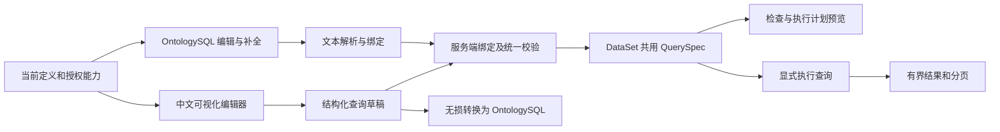

# 可视化查询编辑器：工作台体验、中文配置与关系导航

状态：完整交互设计与当前实现并行维护。用户于2026-11-07确认开发后，`#query` 已默认进入OntologySQL，提供授权目录、模板、指导、类型化参数、CodeMirror补全和诊断；保留中文可视化单Schema查询及结果行Link关联。首批交付与验证见[项目总览](../项目总览.md#当前实现与验证2026-11-06)，后续关系/统计编辑仍为候选。公共查询语义唯一见 [DataSet](DataSet.md)，文本语法和HTTP协议见 [OntologySQL](OntologySQL.md)，命名和稳定身份见[组织与隔离](../组织与隔离.md)，授权规则见[权限设计](../权限/权限设计.md)。

### 当前实现范围

实际代码见[查询页面](../../apps/web/src/features/query/QueryPage.tsx)，工程入口见[前端说明](../../apps/web/README.md)。查询页使用工作台顶栏的当前分类，从该分类中选择已生效 Schema；全局分类规则唯一见[组织与隔离](../组织与隔离.md#工作台当前分类2026-11-07-已确认)。用户以中文字段配置嵌套 AND/OR/NOT、比较、显式空值、集合及前缀条件，明确勾选返回字段并配置一个排序字段、每页 1–100 条，点击运行后调用同一 QuerySpec 接口。页面不执行另一套数据筛选或聚合。

未运行、执行中、取消、失败、成功空结果及配置已改分别显示。编辑配置会取消在途查询并将已有结果标为过期，禁止旧游标继续翻页；新运行替换结果，续页绑定实际已运行的配置。旧响应不能覆盖新配置或其他模型；权限拒绝清除已有结果。结果列与类型使用服务端返回的 fields，int64、decimal 与微秒时间保留字符串原文，不转为 JavaScript 浮点数。

数据探索同时提供当前模型的单条实例创建、读取、修改与确认删除；保存复用后端幂等键和 ETag，PATCH 仅提交变动字段。创建结果不确定时，同一会话和模型的相同请求内容保留原幂等键；切换模型或展示信息更新不生成第二次创建意图。页面字段可见性不替代后端授权；完整读写规则引用[数据读写](../数据读写.md)。

查询结果每行的“关联数据”按当前生效 Link 展示正反方向，选择返回字段后调用带 `via` 的同一 QuerySpec，支持分页。未绑定关系明确提示先配置映射；平台托管关系可增加/移除，外部映射只读。关系定义配置在模型编辑页维护，范围见 [Link](../模块/Link.md#当前关系数据库实现2026-11-07)。切换关系或起点取消旧请求并清除旧结果；权限拒绝不能保留前次数据。

SQL首批代码为[查询工作台](../../apps/web/src/features/query/OntologySQLWorkspace.tsx)和独立懒加载的[CodeMirror编辑器](../../apps/web/src/features/query/OntologySQLEditor.tsx)。默认空白稿由授权模型生成少量字段模板，只插入而不执行；目录选择不覆盖FROM。检查有500ms防抖，补全携带UTF-16光标，点击诊断跳转到片段；requestId、文本摘要、请求代次和取消信号共同隔离旧响应。中文输入期间暂停运行、检查、补全选择和格式化响应。数值与微秒时间保持字符串，实参区分未填写、空字符串、合法NULL。

2026-11-07按用户要求将查询指导移至编辑区上方，桌面左侧浏览模型、右侧查看选中模型字段，中间保留SQL与参数。单击模型仅切换字段目录，双击模型或使用键盘操作生成查询；双击字段按当前语句和光标插入引用。已有原稿的模型模板替换须明确确认，并可恢复SQL及参数；详细操作见下文“页面布局与首次查询”。多模型Link路径辅助已接入真实INNER关联行查询，范围见下文。

SQL转可视化先由服务端完整绑定，再校验全部条件、字段、排序与页大小可表示，已填写实参明确固化为可视化条件。反向转换将值放入独立参数稿；不能表示的NULL集合、含换行集合值、过深条件或跨分类可视化查询等明确拒绝并保留原稿。切换模式取消旧执行并清游标；文本/参数改变保留标为过期的结果但停用续页，授权失效清结果与候选。分类内存稿最多保留8份，不持久保存SQL、参数或结果；结果按返回字段展示，支持只读详情和现有Link入口。实例写入仍通过可视化入口并按映射能力决定是否开放。

以下章节继续维护完整目标与后续交互候选，不表示已开放全部关系语义、统计、单位换算或执行计划。

### OntologySQL 工作台设计增量（2026-11-07，候选）

已确认并实施查询页支持OntologySQL、使用指导与自动补全，在现有 `#query` 内提供“OntologySQL / 可视化查询”两个模式，首次进入默认SQL；保留既有可视化及结果能力。以下维护确认的交互原则及后续体验目标；标题保留设计期锚点以维持已有引用。

#### 页面布局与首次查询

```text
工作台当前分类：个人知识库             数据查询
[OntologySQL] [可视化查询]                [运行 Ctrl+Enter]

查询指导（可收起）：选择/双击模型 → 双击字段 → 按需加条件/参数 → 运行
[读取常用字段] [加一个筛选] [使用参数] [语法速查]

模型目录（可收起）      SQL编辑器                       模型字段（可收起）
搜索模型或字段          SELECT ...                     笔记
笔记                    FROM ...                       标题 · text
分类                    WHERE ...                      来源相对路径 · text
标签                    LIMIT 25;                      来源可用 · boolean
                        [格式化] [补全] [参数]          [生成查询]

参数：标题前缀 [字符串输入]       检查：待填写参数 / 可运行 / 点击定位错误
结果：本页条数、字段类型、详情、关联数据、上一页/下一页
```

左侧模型目录与右侧字段目录辅助编写，真实查询对象由SQL的 `FROM` 确定。单击左侧模型只更新选中状态及右侧字段，不覆盖原文，也不自动执行业务查询。当前分类作为默认解析范围；显式限定其他合法分类时保持真实绑定，不静默改写到顶栏分类。目录可搜索授权模型及属性，选中模型的字段在右侧集中显示；桌面两侧独立滚动并可收起，窄屏按单列布局展示和折叠。按分组浏览为后续目录增强，分组不进入SQL名称路径。

首次空白编辑区提供“生成查询”和三个短例：“读取常用字段”“加一个筛选”“使用参数”。双击左侧模型、在模型上按 `Shift+Enter` 或点击“生成查询”，插入经授权字段组成的完整模板；默认少量普通字段，长正文按需添加，只插入不自动运行。已有SQL时先显示替换提示，明确替换当前SQL及参数后才应用；“保留原稿”取消替换，“撤销生成或插入”恢复原SQL及参数。已有SQL时双击其他模型改为规划并预览Link路径，明确采纳后新增JOIN；“生成查询”按钮继续提供显式替换流程。模板和操作说明按服务端实际能力生成，不能推荐不可排序的TEXT字段或尚未开放的JOIN。个人知识库的具体示例统一引用[首批语法候选](OntologySQL.md#工作台首批语法候选2026-11-07)，不另维护第二份语法。

右侧双击字段或在字段上按 `Enter`，按实际 `FROM` 绑定及别名生成正确转义的引用。SELECT内插入处理字段分隔和重复投影；WHERE的合法字段位置允许插入，ORDER BY只接受可排序属性；其他可编辑位置默认将字段加入SELECT。注释和字符串字面值中的光标不触发改写；字段不属于当前对象、语句无法安全识别或位置不允许该字段时保留原文并提示修正。尚无SQL时生成只查询所选字段的当前模型语句。此处的轻量词法识别只用于安全编辑，类型、权限和最终绑定仍由后端裁决，不另实现一份语义编译器。替换已有内容、清空或从其他模型生成新查询前说明影响，保留撤销机会。

右侧字段在当前文本分析完成后显示“已选”，依据绑定的角色和属性稳定ID判断；同一模型出现多次时，标记随角色选择切换。重复添加同一角色的已有返回字段只定位原列，手动删除或撤销后重新分析并更新标记。不同模型或不同角色的同名属性分别保留，例如“笔记.来源键”与“标签.来源键”不能按列名合并；SELECT去重也不限制同一字段用于WHERE或ORDER BY。单模型本地安全编辑额外识别NFC等价名称及大小写拼写，实际语义仍由服务端裁决。

顶部查询指导提供操作步骤、三个模板和可展开的双引号/单引号、NULL、参数、分页及支持范围速查。指导与字段目录独立开关，查看某模型字段时仍可直接阅读上方步骤。后续候选可按光标位置突出FROM、WHERE和参数说明；当前诊断给出可采取的修正，例如“标题目前不支持排序，请选择可排序字段”，并可跳回具体片段。

桌面保留中间编辑器与下方结果区，左右目录可独立收起；窄屏改为单列并保留折叠入口，顶部指导可独立收起，运行始终可达。编辑区水平滚动限制在代码区域内，不撑宽整个390px页面；可调结果高度及抽屉继续作为后续候选。返回结果复用现有表格、精确类型显示、详情及“关联数据”；SQL本身只读，已有实例维护继续通过独立明确入口并遵守来源写入能力。

#### 多模型与Link路径辅助（2026-11-07已实现）

用户确认连续双击多个模型生成关联查询，已实现有界授权路径规划、候选预览/采纳及真实INNER Link执行；以下说明当前行为，尚未支持的范围明确保留。文本关系分期及执行前置条件唯一见[OntologySQL](OntologySQL.md#link-文本查询的分期)，共用结果语义仍见[DataSet](DataSet.md#ontologysql-与统一逻辑计划)。

当前采用确定的图搜索，无需AI服务。服务端按当前主体、租户和查询上下文构建有界授权图：节点使用Schema稳定ID，边使用Link稳定ID、实际端点、方向、所需上下文及已认证能力。只有可发现、可查询的模型及可发现、具有 `link.query` 权限的关系可成为候选；不返回隐藏名称、物理映射、凭据或业务行。关系定义存在不等于可执行，还须检查当前生效状态、存储映射及后端能力。图按当前节点按需扩展，不能把全租户定义交给浏览器，也不能直接把Metadata目录当成已获查询授权的关系图。

每个允许正向访问的Link形成OUT有向边，允许反向访问时形成独立IN有向边；搜索不忽略方向，也不根据中文动词猜方向。首次选定模型成为根节点。继续添加模型时从当前明确的起点别名进行有界广度优先搜索，寻找目标模型的最少Link路径；若允许从已选的任意别名接入，先在界面显示接入起点，并将其纳入候选区别。Schema、属性及关系内部使用稳定ID，别名表示语句中的每一次对象出现；同类型的不同别名不合并，改名只更新展示名，不更换既有绑定。

| 规划结果 | 当前交互 |
| --- | --- |
| 只有一条最短授权定义路径 | 显示“起点 → Link与方向 → 中间模型 → 目标”的预览及SQL，经采纳后插入JOIN；目标字段在右侧按需添加，不自动运行 |
| 多条最短路径或多个接入别名 | 列出各自关系名称、方向和中间模型，由用户选择；不按目录顺序取第一条，不以AI评分代替确认 |
| 授权图中没有路径 | 保留SQL并提示当前可用关系不能连接；可以选择替换为目标模型的单模型查询，不泄露隐藏关系，也不按同名字段猜测JOIN |
| 达到目录、路径深度或候选数预算 | 明确提示规划未完成，请缩小范围或指定中间模型；不把预算内未找到表述为全图不存在 |
| 自关联或再次加入同类型模型 | 明确选择角色、方向和新别名；根模型的普通重复双击不自动建立自关联或无限循环 |
| 路径存在但后端能力未开放 | 展示受控的能力说明，保持原稿，不插入可执行状态的JOIN；不能用逐行请求现有 `via` 拼接近似结果 |

图搜索本身不读取业务数据；候选预览和实际执行分别重新校验当前权限与定义，授权或映射改变后使旧候选失效。参数、上下文和行条件继续进入共用计划，不能因已展示过路径而跳过验证。用户采纳路径后仅修改查询草稿，保留原文及参数的有界撤销快照；人工编写的SQL先由服务端绑定再扩展，无法完整表示的文本不靠正则重写或删除条件修复。

当前执行范围限定为同数据源、同数据库关系的INNER行展开，最多4条Link、5个对象节点；跨源、LEFT、任意字段JOIN及未认证上下文分别拒绝。多模型字段意味着一行可能代表一条匹配边或路径，界面必须显示结果粒度，不能默认按对象去重或偷偷补DISTINCT；具体行、存在性、值去重及分页规则引用上述DataSet与OntologySQL主说明，不在编写器另定语义。新增关联只扩展关系作用域，保留原SELECT，不再自动追加目标模型的前几个属性，避免连续关联产生无意选择的通用来源列；返回字段由用户双击明确添加并受授权和投影预算限制。原有未限定字段在扩展前按原作用域补上别名，防止新角色引入同名歧义。

AI可作为后续自然语言入口，将“笔记关联标签”转换为待确认的模型、字段和路径意图；其候选仍只能来自同一授权图，经同一绑定、预算及能力校验后才可采纳。不能让AI生成物理数据库SQL、猜测隐藏模型或替代关系方向与多路径选择。实际路径、字段插入、作用域和行结果协议由OntologySQL与DataSet维护。关联查询结果使用独立只读表格，列名为“别名.属性”，一对多保留重复根对象并提示行粒度，row ID不提供实例操作；分页复用全部已绑定节点和Link。自关联的同模型多次出现通过角色下拉框选择，缺参时仍可读取分析scope；关联SQL无法转为现有单模型可视化时保留原稿并说明原因。

#### 上下文补全与参数指导

| 光标位置 | 候选内容与提示 |
| --- | --- |
| 空白/语句起点 | 插入基础SELECT模板；仅提示首批支持的关键字和片段 |
| `FROM` 后 | 当前分类内已生效、可发现且可查询的对象；输入显式分类前缀后按该分类发现，不展开全租户所有字段 |
| 别名后的点号 | 仅补全该别名绑定Schema的授权属性，显示中文名、类型及简短说明，自动插入正确转义的双引号 |
| `SELECT` 中 | 可投影属性，优先常用字段；无FROM且未能确定对象时提示先补充对象或使用模板，不猜测第一个模型 |
| `WHERE` 中 | 可筛选属性及对应类型运算符/片段，标明NULL、前缀、集合等用法；跨来源字段按实际筛选能力过滤 |
| `ORDER BY` 后 | 只提供可排序属性、ASC/DESC；已知但不可排序字段的错误通过诊断说明，不当成可执行候选 |
| `:` 后 | 当前查询已有参数及可生成的参数名；参数面板按服务端推断类型建立控件，不自动搜索业务值 |
| 关系引导 | 第一阶段提示从结果“关联数据”继续；仅在对应关系文本能力开放后提供可执行Link语法，不提前补出未支持的JOIN |

补全提供可点击的“补全”按钮和快捷键；`Ctrl+Space`可能与输入法冲突，因此不能作为唯一入口。中文输入法组合期间不发远程检查/补全，不接管Enter、Tab或Ctrl+Enter；组合完成后再处理。接受候选时只替换返回的源码范围，撤销恢复到插入前，候选框不抢编辑焦点。

静态关键字可以本地提示；对象、属性及类型能力由Data侧查询上下文/补全接口按当前目录和查询权限提供。现有定义列表不能直接充当列权限过滤后的候选。只取必要上下文，按分类/模型/前缀懒加载，客户端缓存按用户、租户和当前上下文隔离；未授权名称不以灰色禁用项泄露。普通字符串不执行全库DISTINCT取候选，补全和指导均不默认读取业务实例。

输入暂停后建议约250ms合并补全、约500ms合并语义检查，具体节奏待实测；新请求取消旧请求，并核对请求标识、文本摘要、分类和光标。诊断/替换范围按文本协议的UTF-16偏移定位，覆盖中文及emoji。检查中继续允许输入，迟到结果不能改写新文本、旧分类或已退出会话。

分析返回参数类型和各次引用的位置，面板展示“必填/待填写/类型冲突”；int64/decimal用字符串控件，时间保留微秒。相同名字复用一个输入，改名/删除引用时同步面板，不静默沿用其他类型的旧值。业务值不拼回SQL文本，缺失值与空串、显式NULL分清；最终由服务端执行前再次绑定和验证。

#### 编辑、检查、运行与模式切换

运行是唯一主操作，Ctrl/Cmd+Enter作用于整条当前语句，首批不提供“选中文本运行”或多语句批量执行。语法/权限检查不查业务数据；缺少参数时定位到参数面板，点击修正只修改输入，不自动运行。格式化在支持范围内保持注释和绑定语义，不完整文本保留原稿并说明原因。

每次运行固定当前SQL、实参、默认分类及稳定ID执行上下文。修改任意一项时取消旧请求、标记旧结果“对应上次查询”并禁用旧续页；下一页复用上次实际绑定描述和游标，不重新解释中文名称。不能把“尚未检查”“检查失败”“查询空结果”混为一类；网络失败保留原稿，401/403清理对应结果、候选和执行上下文。浏览器停止接收不等于数据库已确认停止。

两种编写模式只有一个激活的执行来源。可视化→SQL按稳定ID生成当前中文名和独立参数；SQL→可视化先分析并确认整个描述都能表达，再切换。不能转换的语法留在SQL原稿，标明具体原因；不删除条件后生成近似结果。原文/注释及旧结构可作为有界撤销快照保留，但恢复后重新检查，不能继续使用旧游标。

同一登录会话内按用户/租户/分类隔离保留有界编辑草稿；分类切换清理旧结果、候选和分页，恢复另一个分类原稿也须重新检查。未限定FROM随默认分类变化时提示绑定范围变化；显式限定的合法跨分类查询继续显示真实目标。退出或切换租户清理内存。首批不自动把SQL、实参、结果写入持久浏览器历史，也不承诺刷新恢复；保存/分享模板沿第7节单独设计。

#### 组件与开发分期

首批使用 **CodeMirror 6**，编辑器代码单独懒加载，接入OntologySQL高亮、服务端补全/诊断及键盘操作。语义解析放在Go服务，前端不另维护完整编译器；自定义高亮只负责展示，不把通用SQL插件当作本体语言执行实现。组件测试与真实Edge验证分别记录，构建体积及性能不由功能通过推断。

单SchemaSQL、参数、引导、补全、错误定位和现有可视化子集无损转换已交付；新增多模型路径辅助和最多4条INNER Link运行。固定实例文本、EXISTS、聚合与复杂关系继续分期。持久查询、AI生成SQL、全文检索、批量脚本及查询图画布不自动进入本轮范围。文本协议与语义只在[OntologySQL](OntologySQL.md)维护，此处只维护交互。

## 1. 定位与整体路线

面向业务人员和分析人员，使用“设备”“额定电压”“所属产线”等中文名称完成筛选、关联和统计。本轮候选让OntologySQL与可视化成为同页两种编写模式，默认SQL；文本编译和可视化描述均经Data校验后进入统一QuerySpec。可视化仍可直接执行，不要求先生成文本。以下可视化结构及关系/统计部分继续是相应模式和后续范围的设计。



编辑器负责表达查询意图、显示检查结果和关联错误位置；服务端负责当前定义、权限、类型/单位、Link、计算属性、分表、成本及执行。客户端隐藏选项、校验通过或已有 ID 均不能替代服务端验证。不新增一套查询引擎，也不通过浏览器逐行导航或计算代替全局查询。

## 2. 页面与基本操作

可视化模式推荐“同一工作台、逐步展开”的交互：完成选对象、加条件、选返回列和运行，关系、统计及参数按需展开，SQL通过同页模式入口进入。步骤表达任务顺序，配置保持在同一页面可回改，不要求填完多页向导。以搜索式选择器、就地条件编辑和可折叠关系树为主，路径缩略图辅助说明复杂多跳。以下布局针对可视化模式，名称及页大小仅作候选示例。

```text
数据查询  / 当前租户 / 生产管理                 [运行] [更多 ▾]

查询对象：设备                     结果方式：对象列表（每台设备一次）

字段和关系             查询配置
设备                   条件：全部满足
  设备编码               额定电压  大于  [最低电压：220 V]
  设备名称               存在 所属产线，且同一产线满足：
  额定电压                 产线编码 等于 [产线编码：L1]
  所属产线 → 产线
                       返回列：设备编码、设备名称、额定电压
                       [添加条件] [添加关联条件]
                       排序：设备编码 升序       每页：50

查询说明：查询属于产线 L1 且额定电压大于 220 V 的设备，每台一次
结果：[尚未运行]                   就地提示：[定位到对应条件]
```

| 区域 | 候选操作与边界 |
| --- | --- |
| 对象选择 | 在当前可信租户内选择分类和 Schema；分组仅辅助浏览，默认分类显式确定；显示已选中文名称和必要的类型说明，不自动选中搜索首项 |
| 字段与关系目录 | 按当前节点的 Schema 展示可用字段、计算属性和正反向 Link 入口；支持搜索、键盘选择和懒加载，选择后加入配置，不一次加载全租户定义图 |
| 条件区 | 添加字段条件、全部/任一/取反条件组、关系存在性及关系内条件；保留括号和层级，可用按钮操作，拖动不是唯一编辑方式 |
| 结果配置 | 选择对象列表、关系明细或分组统计，再配置返回列、中文别名、排序、参数和页大小；模式变化先说明行数含义及受影响配置 |
| 关系路径 | 展示每一步起点、方向入口、终点、基数和必要上下文；同类节点使用中文角色名区分，例如“当前设备”“上一台” |
| 结果区 | 只读表格、字段/单位说明、续页和错误状态；当前页、全部匹配数量和未计算总数明确区分，可从列或单元格发起新的配置操作，不提供隐式回写 |
| 就地提示 | 自动检查后将未知字段、失效依赖、类型错误、关系歧义或成本限制定位到相应控件，必要时汇总并提供跳转；只显示当前用户可见的诊断 |

空配置不自动等于授权范围内的全量读取。用户明确选择查询对象及结果列后才能运行；“不设条件”可表示查询完整逻辑集合，但仍返回有界页并受预算约束。基础模式不默认展开所有字段和关系。

### 首次查询与日常修改

以“查产线 L1 上额定电压大于 220 V 的设备”为例，候选操作路径如下：

1. 搜索并选择“生产管理 / 设备”，页面展示字段和关系，提供可明确采纳的推荐返回列“设备编码、设备名称”；用户也可自行选列。
2. 添加“额定电压”，控件提供数值比较和单位，选择“大于”并输入“220 V”。不要求用户输入字段路径或表达式。
3. 添加关联条件，选择“所属产线”以及“用它筛选设备”，在同一关系组中添加“产线编码 = L1”。组标题持续显示“同一产线需满足”。
4. 页面同步展示中文查询说明“属于产线 L1，且额定电压大于 220 V；每台设备一次”，用户点击“运行”后在下方查看结果。
5. 将 220 改为 380，控件立即保留新值，旧结果显示“条件已修改，运行后更新”；再次运行后整体替换对应结果。

顶栏只突出“运行”一个主操作；执行期间在同一位置提供真实进度状态和“取消”。轻量检查自动发生，运行动作衔接必要的服务端校验，用户无需依次点击检查、预览和运行。OntologySQL为常驻模式入口，“执行计划”和手动重新检查可收进“更多”。一次运行只提交一份确定的配置和参数；正在检查时接收运行意图并明确显示状态，检查完成前配置若又发生变化，取消该待运行意图。

桌面工作台建议左侧目录可收起、中间配置与下方结果可调整高度，主操作和查询对象始终可见；窄屏将目录和高级配置折叠为抽屉，保留当前编辑位置。避免为每条条件反复开关弹窗，拖拽、双击和悬停均有可点击或键盘操作的替代。

### 搜索、中文说明与结果反馈

选择器支持中文名称和定义说明搜索，展示分类、类型、单位及关系方向等必要上下文；参数、操作符、Enum 标签均使用业务措辞。最近使用入口只可作为同租户、当前授权范围内的候选，不保存业务结果或敏感实参；选不到的项目给出可行动的空状态，不能只显示空白下拉框。

中文查询说明从当前结构和已绑定元数据确定性生成，随编辑更新，可点击片段定位对应条件或关系组；未完成部分显示“尚未填写”，不能生成一个看似完整的说明。无需大模型参与说明生成，也不自动从说明反推或更改查询。内部稳定 ID 和完整字段路径不成为业务用户必须理解的内容。

结果表头提供“加入筛选”“设置排序”，单元格可提供按该值添加条件；统计入口仅在共享能力支持时出现。操作先更新同一查询配置并展示变化，点击运行后对逻辑全集重查。拖动列宽、调整显示顺序属于展示操作；筛选、排序或聚合不能只处理当前页。无结果、尚未运行、执行失败及条件已改但仍显示旧结果分别呈现；只有成功的完整空结果才能显示“没有匹配项”。

## 3. 中文名称、字段与条件

用户看到中文主业务名称和中文输出别名，技术关键字、UUID、物理表列名不成为必填操作内容。选择器取得当前定义身份后，在草稿中保留稳定 Schema/字段/Link ID、名称描述及声明来源；字段绑定到具体关系节点，避免多个“设备”混用同名属性。服务端核对归属、类型和当前可用性，名称定位与 ID 同时作为有效定位信息提交时仍需验证一致。

| 数据类型或操作 | 候选编辑方式 |
| --- | --- |
| 数值与计量 | 只展示该类型支持的等于、大于、区间等操作，输入附明确单位；允许的显示单位转为规范单位后绑定，保留 decimal 精度 |
| 文本 | 等值、集合或经后端认证的前缀等操作；字面输入不变成 SQL 片段或默认通配表达式 |
| Enum | 显示中文标签，实际选择目标 Enum 的稳定 code；同标签用授权可见说明辅助区分，不能按第一项猜测 |
| 日期与时间 | 明确日期/时间戳、时区和区间边界；如支持“最近一天”等相对条件，按共享规则在每次执行开始时确定基准，后续页沿用该次绑定 |
| 空值 | 提供“为空”“不为空”等独立操作；空输入、空字符串和 NULL 分别处理，不把未填写误作比较 NULL |
| 对象引用 | 从授权候选中选择真实类型与实例身份，可按唯一业务键查找；实例中文显示名不自动唯一 |
| 查询参数 | 可将条件值设为“最低电压”“产线编码”等中文参数，保存类型、单位及必填规则；执行前填值，不能用参数替换字段或方向 |
| 计算属性 | 按当前 Schema 定义选择，显示必要的新鲜度说明；查询条件不能修改公式或计算策略，不允许直接写任意 Function 表达式 |

条件树明确“全部满足”“任一满足”和“对整组取反”，以共享表达式表达 NULL/缺失及三值逻辑。尤其“不是大于 220”不自动包含 NULL；如需空值也满足，用户显式添加“为空”分支。非法操作符、空 IN 集合和缺失参数由同一规则检查，客户端不自行补成宽松条件。

条件行就地编辑，支持复制、移动到分组、删除及撤销；全部/任一/取反使用文字标题、缩进和边框共同表达，不能只靠颜色区分。选择字段后仅推荐与类型匹配的操作，不替用户补全业务值；更换字段使旧值或操作不兼容时，保留受影响内容供修正并阻止执行。深层条件可折叠并显示摘要、未完成项及错误数，错误可直接展开并定位，不能因折叠而忽略校验。

同一个关联对象必须同时满足的条件放在同一关系条件组中。例如“存在一张工单，同时状态为进行中且优先级为高”，不能拆成“存在进行中工单”和“存在高优先级工单”后误将两张工单当成同一张。需要不同关联对象分别满足时，显式添加两个独立关系条件组；编辑器保留各自作用域。

## 4. Link、多跳和结果方式

关系选择显示“包含设备（正向）”“所属产线（反向）”“上一台（反向）”等入口，并提供主 Link 中文名称和分类用于消歧。内部仍保存 Link ID 与 OUT/IN；常规关系编辑默认只展开用户选择的固定路径，不无限递归或推断业务关系。用户显式请求连接多个模型时，可按上文“多模型与Link路径辅助”的候选规则规划路径，仍须消歧、预览和采纳。上下文、有效时间、关系属性及子类型能力只在当前服务声明支持时提供。

### 三种关系操作

| 用户意图 | 候选控件与结果含义 |
| --- | --- |
| 用关联条件筛选对象 | “存在满足条件的关联对象”或经认证的“不存在”；编译为存在性条件，根对象只保留一次，不自动增加结果列 |
| 展示对象的关联信息 | “附带关联信息”；保持根对象列表，嵌套结果有逐父数量及续页上限，不默认加载全部多值关系 |
| 查看关系/路径明细 | 显式切换“关系明细”；按每个匹配边/路径形成行，清楚提示同一对象可能出现多次，可选择授权的关系属性 |

选择关系后先说明“你希望用这个关系做什么”，用上述三种业务意图引导配置；默认对象列表中的“添加关联条件”进入存在性筛选。整个关系组持续标出当前对象、方向、目标角色和必填上下文，组内条件只绑定到该角色。增加多跳时沿当前关系节点继续选择下一步，同时显示可点击的中文路径面包屑；可选路径图用于定位和理解，点选节点与表单选择同步，布局不改变查询含义。

模式切换说明具体影响，例如“每台设备一次”改为“每条匹配关系一行，同一设备可能重复”，并列出受影响的列和统计项。需要调整时让用户确认具体处理或返回原配置，不能在确认前静默丢弃条件、列或上下文；未解决的配置冲突阻止运行。

后续可视化关系编辑建议优先对象列表与关系存在性；固定路径导航沿用后端已认证能力，关系明细、有限展开和统计按共享计划逐项开放。一个 Schema 上的多个 Link 不能通过图形上画一条无类型线就当作同一关系。路径增删或变更起点时，标出受影响的条件/列并允许撤销，不静默删除条件后继续运行。

### 产线设备与上一台示例

1. 查询一条产线的设备：选择“生产管理 / 产线”，条件为“产线编码 = 参数”，沿“包含设备”正向导航到设备，将终点设备选为对象结果，返回设备编码和设备名称。按实际设备身份去重，并沿游标读完所有成员；按编码排序不表示工艺顺序。
2. 查询设备在产线内的上一台：选择“设备”，按唯一设备编码定位起点，沿“产线设备直接后继”的反向入口“上一台”导航；选择真实产线作为关系上下文，结果选终点设备。上下文必填来自 Link 定义，不允许用页大小 1 替代链约束。
3. 多跳：依次选择“工单 → 使用设备 → 所属产线 → 包含设备”，可以在每层添加授权字段条件，结果选择终点设备或显式路径明细。终点去重与保留全部路径是两种不同结果，不能因界面相同列名而混用。

本例沿用 [Link](../模块/Link.md) 与 [OntologySQL](OntologySQL.md) 中的定义和方向。根节点与当前结果节点分别标记，用户始终知道“从哪里开始”“最后返回谁”。真实首节点、隐藏邻居及读取失败的区别按 Link 查询契约呈现。

### 分组统计

切换为统计时，用户选择分组字段、计量对象和经认证的聚合函数，再设置聚合后条件及排序。例如直接从设备集合按“设备状态”分组、统计设备数量，输出“状态”“设备数量”。若之前配置了多值关系明细，应提示并要求确认统计的是设备数、关系数还是明细行数。

“设备数”只有共享计划可按真实类型及实例身份去重时才开放，不能用 DISTINCT 设备名称代替；“不同取值数量”按字段值计算。SUM/AVG 遇到关系放大不能靠去重数值修正，需明确回到实体集合或使用已认证的分层聚合。统计在全部授权且满足条件的逻辑集合上进行，再对统计结果分页；前台不汇总当前表格冒充全局统计。

## 5. 编辑状态、预览与执行

建议使用“编辑中 → 自动检查中 → 可运行/待修正 → 执行中 → 已完成/已取消/失败”的页面状态。状态由页面反馈，不要求用户逐项操作。编辑器可保留未填完的会话草稿用于撤销或返回修改，但只有完整且经服务端当前校验的查询才能执行；该状态不是业务定义的发布或 version。

| 操作 | 候选行为 |
| --- | --- |
| 编辑和撤销 | 只修改查询意图及展示布局；条件树/路径节点保留编辑节点标识，用于定位和撤销，不充当业务实例 ID |
| 自动检查 | 本地即时检查已知结构、必填和类型问题，字段完成或短暂停止编辑后合并发起服务端检查；校验名称/ID、作用域、单位、参数、能力及结构预算，不读取业务样例 |
| 预览计划 | 复用 DataSet 的只读预览，提供中文条件/路径/结果方式说明及授权可见的成本信息；业务用户无需理解物理 SQL，详细计划另按权限展示 |
| 运行 | 用户明确触发，绑定当前参数并实际查询有界数据；样例预览也属于真实执行，不能因“预览”字样绕过数据权限或执行预算 |
| 修改后再运行 | 旧结果标记“对应上次查询”，新配置和旧结果不混合；修改条件/参数/结果方式后丢弃原续页上下文 |
| 下一页 | 使用同一已绑定查询、参数和服务端游标；不将当前页数组当作后续筛选或统计的全集 |
| 取消与失败 | 请求服务端取消并展示实际状态；无法确认取消完成时不显示已取消成功，超预算/部分成员失败不冒充完整空结果 |

候选执行请求复用 DataSet 入口，不另设可绕过统一引擎的“前端查询”服务。检查与计划预览可复用查询编译入口；最终协议待定，编辑器节点标识可映射到服务端诊断位置。界面布局、展开状态和列宽单独作为展示配置，不进入查询语义或数据库 SQL。

异步检查、元数据请求和执行响应都关联本次页面请求及查询指纹；收到旧响应时不得覆盖更新后的条件或结果。切换 Schema 或结果范围时清理不适用的候选项、结果与游标，保留当前租户内可撤销的操作说明。会话与撤销历史按租户隔离，切换租户不能将原租户定义、实参、结果或旧响应带入新会话；客户端取消请求不等于数据库已经停止。

### 错误恢复、键盘与中文输入

| 场景 | 候选体验 |
| --- | --- |
| 未完成或填错条件 | 就地说明原因和修正动作，例如“请填写最低电压，单位 V”；尝试运行时定位首个可见问题，不能只给一个禁用按钮或弹出技术错误码 |
| 检查、元数据或执行请求失败 | 保留已输入配置和参数，提供就地重试；与真实空列表区分，不因网络错误重置条件树 |
| 删除条件、路径或切换模式 | 查询级撤销/重做恢复结构、绑定及编辑位置；更换查询语义后旧结果仍按过期结果处理，不能恢复已失效的游标或旧权限 |
| 表单与输入焦点 | 通过 Tab 和方向键访问选择器，新增条件后聚焦字段入口，删除后焦点回到相邻可操作位置；校验刷新不抢焦点或关闭用户正在使用的控件 |
| 中文输入法 | 组合输入期间不触发快捷执行、选中候选、远程搜索或服务端检查，确认汉字后再合并处理；普通 Enter 优先完成当前控件，不能默认运行查询 |
| 快捷键与可访问性 | 可提供 Ctrl/Cmd+Enter 运行并显示提示，但须排除输入法组合状态；文字输入撤销与查询结构撤销分清作用域，错误/状态兼有文字提示，读屏可识别字段、分组及加载状态 |

查询级历史建议仅在当前租户会话内有界保留编辑状态，不保留结果副本或作为可选历史定义；输入值的恢复与清理仍遵守第 7 节敏感信息策略。点击清空或离开带未保存修改的会话时提供明确的保留/放弃选择，浏览器刷新或崩溃恢复范围取决于后续确认的草稿存储策略，不能承诺所有内容已自动保存。

## 6. 与 OntologySQL 的互通

本轮建议按上节增量将OntologySQL提升为默认编写模式，可视化保留为同页选择。可视化切换到文本时，仅当当前逻辑计划可以无损表示为已开放SQL语法才生成；中文名称来自绑定ID，参数继续独立传递。对象身份去重、嵌套展开、结果模式和分页不能在生成过程中退化为普通SELECT或字段值DISTINCT。

从 SQL 切换到可视化也须先解析、绑定并检查其 QuerySpec 是否被编辑器覆盖。支持的部分可重建条件树、路径、角色别名及统计配置；不支持的子查询或表达式保留为完整文本模式并明确原因，不显示一个省略条件的“近似可视化结果”。若编辑器不具备的语法仍被文本入口支持，可继续走文本模式。

同一编辑会话只以一种当前查询描述作为执行来源。切换模式时显示语义或绑定变化，成功转换后才替换当前编辑内容；失败保留原稿。布局还原与语义等价分开处理，不承诺 SQL 格式、注释、控件位置完全往返不变；界面不得同时编辑两份未同步的 SQL 与条件树后任意选择一份执行。

## 7. 保存复用、改名与权限

临时查询无需先创建 DataSet 业务定义。编辑器的撤销/重做及会话恢复不等于保存查询模板；若后续确认持久复用需求，再沿用 DataSet 的保存查询候选，保存 ID 绑定描述、参数声明、中文编辑来源及独立展示配置，所有入口使用同一个模板模型。

模板不保存默认结果副本，不自动成为第六类 Ontology 定义，也不自行建立业务 version 或历史定义选择。模板组织、分享、草稿权限、并发编辑和保留期仍待确认；共享查询不授予底层数据权限，每次执行按当前调用者检查。敏感实参和结果不默认随模板或浏览器持久缓存保存，具体存储策略待定。

Schema、字段和 Link 改名后，已绑定选择保持原 ID 并显示当前中文名；删除、停用、类型不兼容或撤权时标出失效位置并阻止相关执行。相同名称的新定义不自动替换旧选择，重新绑定需明确展示新目标及影响。定义、参数或权限变更使旧预览/计划/游标失效时，提示重新检查或执行，不靠编辑器本地缓存继续使用。

目录发现、字段/操作列表、对象选择、样例、计划、结果描述和后续页均受当前权限约束。无权发现的定义不显示为可猜测的禁用项；仅对已授权可见但能力不支持的操作说明原因。界面权限与字段义务复用公共授权计划，不能只在结果表格隐藏敏感列。未授权数据不能通过候选值自动补全、计数、错误或 SQL 预览泄露。

## 8. 组件方案、性能与能力范围

### 当前组件与后续候选

首批工程已采用 React + TypeScript + Vite，以原生语义表单、表格、自持样式和 Lucide 图标构建中文工作台，未引入 Ant Design。查询状态与控件分离，稳定绑定、类型精度和结果状态由业务层维护；复杂关系、文本编辑与大规模展示所需组件仍按下表评估，不因列为候选而开放相应业务能力。实际依赖版本见[前端工程](../../apps/web/package.json)及锁文件。

| 位置 | 当前选择或后续候选 |
| --- | --- |
| 工作台、表单及选择器 | 已使用 React + TypeScript、原生控件与自持弹窗，按授权目录提供中文 Schema/字段选择；复杂树选择等控件后续按需要评估 |
| 条件与关系编辑 | 已实现受控条件卡片与 AND/OR/NOT 分组，业务查询状态独立于控件；关系作用域编辑尚未开放，通用 Query Builder 可作为交互对照 |
| 结果表格 | 已使用原生语义表格与服务端游标分页；只有实测表明列数/渲染规模需要时再评估专用表格，过滤和未来聚合始终交给统一查询引擎 |
| 关系路径图 | 可选 React Flow，按需加载，用于节点定位和路径说明；首批可先用关系树与面包屑，图的拖动布局不修改 Link 或查询作用域 |
| OntologySQL文本模式 | 本轮推荐CodeMirror 6按查询路由加载，Monaco作替代评估；诊断和中文上下文补全接服务端绑定，通用SQL模式不能替代本体语法、授权及ID绑定，CodeMirror 6已安装并按路由懒加载 |

编辑器状态建议区分可未完成的输入草稿、完整查询描述及独立展示布局，并由同一受控状态驱动条件、路径、中文说明和结果操作。服务端诊断通过编辑节点标识回到控件；组件事件只改变查询意图，不直接拼接物理 SQL。语义变化统一标记旧结果、使旧游标失效，表格布局变化则不触发重查。通用组件自带的 SQL 生成、前端过滤及聚合不成为执行来源。

### 响应与能力开放

| 位置 | 候选处理 |
| --- | --- |
| 定义和关系发现 | 按分类/Schema/当前节点分页搜索及懒加载，批量取得授权字段和操作能力；限制图节点与渲染规模，避免全租户目录和逐字段远程请求 |
| 条件编辑 | 输入、增删、展开与焦点变化先本地反馈，检查不阻塞继续编辑；服务端检查合并请求且可取消，拖动、展开和每次键入不自动执行业务查询 |
| 候选值 | Enum 按定义加载，实例按授权搜索并分页；任意字段不默认扫描全库 DISTINCT 来填下拉框 |
| 结果 | 后端过滤、计算、去重/聚合及分页，客户端表格按需渲染；刷新时保留清楚标记的旧结果及配置，前端渲染优化不代表减少数据库扫描 |
| 多跳和统计 | 展示已认证的深度、结果模式和预算信息，超限定位相关路径；最终页小不消除高扇出成本 |

度量方法由[性能与容量](../性能与容量.md)统一维护，区分目录加载、编辑响应、检查往返、计划编译、执行和表格渲染，当前没有性能或容量验收结论。首批已覆盖单模型选择、显式列、类型化条件、排序分页、本地检查和显式运行；参数、关系存在性、多跳导航、统计、明细和 SQL 转换按共享能力逐项开放。图形画布、图表看板、报表调度、导出、大规模路径分析和完整公式编辑不自动纳入首批。

首批组件已通过范围内的交互测试和真实浏览器流程验证，包含弹窗键盘焦点与窄屏布局；尚未开展读屏、完整中文输入法、大目录和业务用户体验验收。后续候选组件须结合这些验证再选定，组件名称不表示对应功能已经实现。

## 9. 验收与待定事项

以下为完整目标的验收，单模型子集已有单元、交互和真实浏览器验证，具体实测范围见[项目总览](../项目总览.md#当前实现与验证2026-11-06)，不代表全部 VQE 项通过。共同查询与权限行为继续引用 DATA、OSQL 和 AUTH 来源，不在本文件重新定义。

| 编号 | 要求 | 验收方法 |
| --- | --- | --- |
| VQE-01 | 中文选择与稳定绑定 | Schema/字段/Link/Enum/实例显示中文且按真实身份绑定，跨分类同名及方向歧义明确处理；改名不换 ID，同名重建不接管 |
| VQE-02 | 条件分组与关联作用域完整 | AND/OR/NOT、NULL、参数/单位和同一关联对象多条件保持共享语义；未完成条件不可执行，不能丢弃条件继续查询 |
| VQE-03 | 关系方向、上下文及结果身份明确 | 产线成员、上一台及三跳与 DataSet 等价；根/终点、存在性/嵌套/路径明细区分，逐父分页、必填上下文和统计计量可核对 |
| VQE-04 | 执行与页面状态对应 | 编辑不触发业务扫描；检查/计划预览与样例运行分开，旧响应不覆盖新查询，旧结果可识别，修改后不用旧游标，取消状态不虚报 |
| VQE-05 | SQL 转换不丢语义 | 支持范围双向转换得到等价共享计划；对象去重、重复行、NULL/聚合和参数一致，不支持的配置保留原稿或文本模式，不执行近似结果 |
| VQE-06 | 发现、预览、结果与分享均受控 | 无授权定义/候选值/敏感字段不泄露；篡改客户端描述仍被服务端拒绝，模板分享不授予数据权限，撤权后不能继续读取旧页 |
| VQE-07 | 性能与能力提示有共同边界 | 大目录按需加载、无逐字段/逐对象远程请求，无全库候选值扫描；高扇出、超预算和失败成员不因前端限页而误报成功 |
| VQE-08 | 编辑状态和复用不改变定义模型 | 展示布局与查询语义分离，模式切换/撤销不误换绑定；临时查询不强制保存，持久模板沿用统一候选且无业务 version |
| VQE-09 | 常用任务可理解、可连续修改 | 通过下表任务走查与业务用户试用，记录完成情况、误解及恢复；简单查询无需 SQL、自由连线或手动检查三连，中文说明与结果粒度可解释，结果操作更新同一查询后全局重查 |
| VQE-10 | 中文输入、键盘及异常恢复可用 | 输入法组合确认不误运行或抢焦点；键盘可完成增删/分组/选择/运行/纠错；不依赖颜色或拖拽，检查/网络失败保留配置，撤销和模式转换不丢失条件或混用旧结果 |
| VQE-11 | SQL入口、使用指导及补全可完成真实任务 | 默认文本/切换可视化、顶部指导、左右模型字段、双击及键盘生成/插入、实际别名/逗号/去重、替换确认与撤销、参数指导、光标补全与错误定位分别验证；示例不自动执行、不推荐未支持语法或字段操作，窄屏和不完整语句仍可操作 |

### 体验验证任务

首批已有可交互工作台及自动浏览器验证，后续按下表组织业务用户试用；尚未开放的关系、统计等任务先在对应原型中走查，随能力实现再验证。验证记录区分任务完成与查询语义是否正确，不能仅凭“点出了结果”判断体验通过。

| 代表任务 | 重点观察 |
| --- | --- |
| 设备额定电压大于 220 V，改成 380 V 再运行 | 是否能找到字段/单位、理解自动检查与显式运行，辨认旧结果并继续修改 |
| 查询指定产线的所有设备 | 是否能选择关系意图和最终返回对象，理解每台设备一次及有界分页，不把第一页当全部设备 |
| 查询设备在产线 L1 上的上一台 | 是否能理解反向入口并填写真实产线上下文，辨认当前设备与上一台 |
| 查存在同一张进行中且高优先级工单的设备 | 是否能将条件放在同一关联组，并用受控样例识别两张不同工单分别满足时不应命中 |
| 按设备状态统计设备数，尝试切换关系明细 | 是否能说明当前一行代表什么、数量按谁计算，模式影响是否足够清楚 |
| 输入错误值、删除一段路径、网络失败后继续 | 是否能定位原因、撤销/重试并恢复操作，是否丢失条件、参数、焦点或误用旧结果 |

记录首次完成时间、无协助完成率、错误条件/方向/统计口径次数、恢复步骤及主观理解困难；分别观察初次使用者和熟练用户，并覆盖中文输入法、纯键盘及受限权限。具体通过门槛结合目标用户试用确定，界面响应指标统一见[性能与容量](../性能与容量.md)。当前已有自动化功能和布局验证，尚无业务用户试用结果，不能将自动化通过或设计走查等同于体验已达标。

SQL默认模式、CodeMirror及首批指导/补全已按确认方案实施，当前布局及双击编写规则见开头“当前实现范围”。多模型Link路径辅助及最多4条INNER Link运行已实现；统计、复杂关系、持久模板、大目录和体验通过门槛继续待设计与认证，文本语法及API只在OntologySQL所属说明维护。
