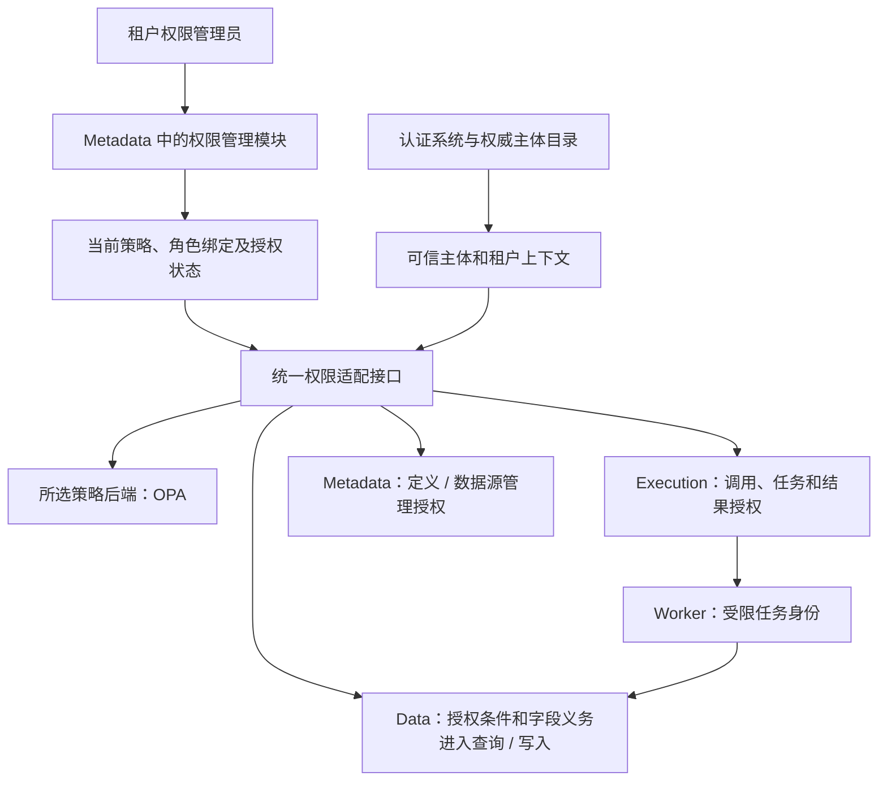

# 权限设计与开源方案调研

状态：需求分析、候选设计与引擎选型验证，尚无业务实现。调研及验证日期：2026-10-18。用户已明确要求灵活配置行过滤、列过滤以及 Action、Function 限制，并要求实际验证后给出选择。本轮选型结论为 OPA 1.21.2，依据是下文记录的小型实验；权限模型、默认行为、接入协议和实施范围仍为设计建议。临时引擎实验不等于 Ontology 权限功能、三库兼容性、性能或多副本撤权验收通过。

本文是公共权限机制的唯一主要说明；查询执行规则仍由 [DataSet](../数据查询/DataSet.md) 维护，[OntologySQL](../数据查询/OntologySQL.md) 复用同一授权计划，保存与事务由[数据读写](../数据读写.md)维护，调用与任务由[执行与调度](../执行与调度.md)维护。

## 1. 已明确需求与设计边界

| 状态 | 内容 |
| --- | --- |
| 本轮已明确需求 | 可配置哪些实例可见、哪些属性可见，以及哪些 Action、Function 可以调用；需要支持灵活的权限条件 |
| 既有已确认原则 | 租户完全隔离；中文业务名称编写、稳定 ID 绑定；五类定义只有一份当前生效定义；直接 SQL、批量和后台任务不得绕过领域校验 |
| 本文新增建议 | RBAC + ABAC，以受控关系授权补充；默认拒绝、显式拒绝优先；读写分开、调用与运行分开；策略管理、模拟和审计集中管理 |
| 本轮选型结论 | 选择 OPA 1.21.2 作为策略求值及过滤编译后端；使用 UCAST 接入统一逻辑计划，列与调用权限由 Ontology 强制执行，不同时引入多个策略后端 |
| 尚待确认 | 首批操作与表达式、列脱敏方式、是否需要大量逐对象共享及委托执行、认证来源、策略管理流程和 OPA 生产接入协议 |

这里的列指 Schema 属性及 Link 属性，而非允许用户输入任意数据库列名。列权限建议同时覆盖读取、写入及查询使用，避免只隐藏界面字段后仍可通过筛选、排序、统计或接口访问原值。定义可见、定义编辑、模型生效、数据访问、任务结果访问分别授权。

## 2. 开源方案调研

以下能力概览源自官方文档，默认分支许可证调研中五个核心仓库均为 Apache-2.0；本轮另外核对了 OPA 1.21.2、Cerbos 0.56.0 的发行版许可证。商业控制台、托管服务及扩展组件分别核对，不能由核心许可证推断。具体运行版本及实测见第 3 节；适配成本仍是设计判断。

| 方案 | 可借鉴或复用的能力 | 行、列与调用授权的适用边界 | 对本项目的判断 |
| --- | --- | --- | --- |
| Casbin | Go 可嵌入；RBAC、带租户域的角色、ABAC、策略组合、适配器及变更通知 | Enforce/BatchEnforce 可判断具体请求；数据权限文档介绍隐式权限与批量判断。源码还提供 GetAllowedObjectConditions，但它提取特定策略结构中的条件字符串，不能视为任意 matcher 到安全 SQL 的完整转换。过滤加载策略也不等于过滤业务行 | 适合部署简单、表达式受限的路线；仍须自建行条件编译、列义务及一致性机制 |
| OPA | Rego 策略、策略测试、部分求值；数据过滤编译、UCAST、SQL 目标及列掩码 | 本轮开源镜像实际返回 UCAST、MySQL/PostgreSQL SQL 和静态列掩码；达梦目标及不支持的内建函数返回 400。列掩码仍由应用执行，不能假定任意 Rego 可下推 | 本轮选择；通过统一 UCAST 接入三库适配，集中表达规则合并，限制策略子集 |
| Cerbos | 基于角色、属性与条件的资源策略，CheckResources 判断实例，PlanResources 返回授权过滤计划 | 本轮判权与条件 AST 对照通过；原生跨角色合并为任一允许即允许，与候选的全局拒绝优先不同，需要额外编码。列、输出及执行身份仍需 Ontology 建模 | 可行备选，本轮不选；不能将单角色内拒绝优先误当作跨角色拒绝优先 |
| OpenFGA | Zanzibar 风格的关系授权、组/成员/共享/继承，Check、ListObjects 等接口，条件关系支持部分 ABAC | 可求可访问对象 ID，但不是通用业务字段条件到 SQL 的编译器；列与金额/部门等业务过滤仍需结合数据层。大量 ID、业务排序、分页和聚合需要额外规划 | 若逐对象共享、协作及关系继承成为主要需求，再验证；不建议首期仅为行列过滤另建关系授权存储 |
| SpiceDB | Zanzibar 风格权限图、关系、权限表达式及带条件关系，可借鉴授权一致性设计 | 擅长对象关系权限；不直接提供本项目跨三库的字段过滤、列投影和业务 SQL 计划。将 Link 同步为授权关系会引入双份事实及撤权一致性成本 | 与 OpenFGA 同属关系授权扩展候选，无需同时引入 |

PostgreSQL RLS 可作为特定后端的纵深防护参考，但不能作为 MySQL/PostgreSQL/达梦共同的唯一权限实现，也不能替代 Action、Function 和输出授权。PostgreSQL 官方文档明确表所有者、超级用户和 BYPASSRLS 等存在绕过边界，若采用需验证实际账号与连接池上下文。

### 官方依据

| 对应方案 | 本轮核对资料 |
| --- | --- |
| Casbin | [总览](https://casbin.apache.org/docs/overview/)、[ABAC](https://casbin.apache.org/docs/abac/)、[数据权限](https://casbin.apache.org/docs/data-permissions/)、[策略子集加载](https://casbin.apache.org/docs/policy-subset-loading/)、[条件提取源码](https://github.com/apache/casbin/blob/master/rbac_api.go)、[许可证](https://api.github.com/repos/casbin/casbin/license) |
| OPA | [数据过滤](https://www.openpolicyagent.org/docs/filtering)、[部分求值](https://www.openpolicyagent.org/docs/filtering/partial-evaluation)、[过滤编译 API](https://www.openpolicyagent.org/docs/rest-api#compiling-a-rego-policy-and-query-into-data-filters)、[列掩码](https://www.openpolicyagent.org/docs/filtering/column-masks)、[许可证](https://api.github.com/repos/open-policy-agent/opa/license) |
| Cerbos | [CheckResources / PlanResources API](https://docs.cerbos.dev/cerbos/latest/api/index.html#resources-query-plan)、[资源策略及跨角色合并语义](https://docs.cerbos.dev/cerbos/latest/policies/resource_policies.html)、[查询计划适配器](https://docs.cerbos.dev/cerbos/latest/recipes/query-plan-adapters/)、[许可证](https://api.github.com/repos/cerbos/cerbos/license) |
| OpenFGA | [关系查询与接口边界](https://openfga.dev/docs/interacting/relationship-queries)、[条件关系](https://openfga.dev/docs/modeling/conditions)、[许可证](https://api.github.com/repos/openfga/openfga/license) |
| SpiceDB | [关系与权限 Schema](https://authzed.com/docs/spicedb/concepts/schema)、[许可证](https://api.github.com/repos/authzed/spicedb/license) |
| PostgreSQL | [Row Security Policies](https://www.postgresql.org/docs/current/ddl-rowsecurity.html) |

## 3. 实测结果、选择与理由

本轮选择 **OPA 1.21.2 + Ontology 自有权限配置与执行层**。取 OPA 返回的 UCAST，经白名单、稳定字段 ID 和类型检查后进入统一查询计划；Data、Metadata、Execution、Worker 分别落实自己资源的权限。初期生产接入建议通过内网/本机 HTTP 或同 Pod 进程完成，具体拓扑仍待架构验证，不要求先将 OPA SDK 嵌入当前本机 Go 1.22.1。生产部署尚未开始。

### 验证环境与范围

实验使用本机 Windows、Docker Desktop Linux/amd64；容器各限制 1 CPU / 256 MiB，端口仅绑定 127.0.0.1，关系引擎使用内存存储。Casbin 使用 Go 1.22.1 运行临时 Go 模块；集合计划使用临时白名单 AST 适配器编译参数化 SQL，在 Python 3.12 的内存 SQLite 执行。业务仓库仅更新设计文档，未新增业务代码、依赖、自动化测试或部署配置，未访问现有业务数据库。

实验包含两个租户、两个部门、两条产线、六个设备，24 个基础用例覆盖多角色、部门/产线条件、价格字段、显式拒绝、跨租户、NULL、默认拒绝、操作参数、Action/Function 直接/间接调用、旧/新值和成员撤销后的新输入。这里的调用链是可信上下文的模拟输入，未验证真实令牌签发或 Worker 沙盒。

| 引擎及锁定版本 | 实际运行结果 | 对本项目的含义 |
| --- | --- | --- |
| OPA 1.21.2 | 24/24 基础用例通过；24 组 UCAST 计划经临时适配器执行，对照 144 次逐对象判权，结果一致；静态列掩码、单实例数据更新、错误条件另测 | 同一策略可用于判权和集合条件生成，能减少自建权限求值/过滤双轨规则 |
| Cerbos 0.56.0 | 初始策略发现跨角色拒绝差异；修正策略和空角色输入适配后 24/24 用例通过，24 组计划与 144 次判权一致 | 能完成需求，但全局拒绝优先必须在策略生成层额外约束，不能直接依赖 EFFECT_DENY |
| Casbin 3.11.0 | 24/24 基础用例通过；标准条件提取示例返回允许、拒绝两类规则的条件字符串，未保留效果区分 | 适合具体请求判权；完整的行列集合计划及拒绝合并仍须自研，不作为本轮主引擎 |
| OpenFGA 1.22.0 | 13/13 关系用例通过，read/read_price 两组 ListObjects 结果正确；条件调用、字段拒绝及删除租户成员后重新判权通过 | 关系共享能力可用，但所得对象 ID 集合不等于业务字段过滤/排序/统计计划，当前需求下会增加授权事实维护 |
| SpiceDB 1.56.2 | 13/13 关系用例通过，read/read_price 两组 LookupResources 结果正确；条件调用、字段拒绝及删除租户成员后的 fullyConsistent 判权通过 | 与 OpenFGA 的本轮取舍一致；没有因不选用而将关系授权能力记为失败，但它不能替代业务字段条件计划 |

OPA 镜像 `openpolicyagent/opa:1.21.2-static` 的运行镜像摘要为 `sha256:0843d2adce51655422e8b95a803629ab9f424803c4bd27876e7f44cce9a2b84d`；Cerbos 镜像 `ghcr.io/cerbos/cerbos:0.56.0` 的摘要为 `sha256:540643bc67ba628011a150ad1d3370f285daa38995be5cd7a4be181da902bec1`。本次结果只适用于记录的版本和规则，不延伸到旧版 OPA 或所有表达式。

### 决定选择的具体发现

1. **OPA 的集合过滤和列掩码在所测开源版实际可用。** `POST /v1/compile/ontology/allow` 分别返回 UCAST、MySQL 和 PostgreSQL 过滤条件；另一条带 mask_rule 的策略返回价格替换为 `***` 的 masks。列过滤仍通过单独字段操作/字段条件授权，不能用一次主体级掩码替代逐行字段权限。
2. **规则合并方式更适合本项目。** Cerbos 初始策略给 finance 允许 read_price、contractor 拒绝 read_price，同一用户兼具两角色时返回 EFFECT_ALLOW。官方资源策略文档明确单角色内拒绝优先、跨角色任一允许即允许。加入 `!("contractor" in request.principal.roles)` 后才符合本项目候选语义；OPA 可在一个受控策略模板中集中组织允许与拒绝组合，但也不是无须配置就自动拒绝优先。
3. **Casbin 的条件提取不能替代完整策略编译。** 标准 RBAC + ABAC 示例中，finance 的允许条件为 `Department == "d1"`，banned 的拒绝条件为 `Blocked == true`；Enforce 正确拒绝被阻止对象，但 GetAllowedObjectConditions 同时返回上述两个字符串。直接 OR 两个字符串会得到错误的授权集合，必须重新解释策略效果和模型。这里是接口适用边界，不是 Casbin 判权错误。
4. **当前主要难点是字段条件与集合查询。** OPA、Cerbos 均可返回可转入统一计划的条件；关系授权引擎需维护独立关系事实，再将对象集合与业务查询结合。当前不因 Ontology 本身具有 Link 就引入第二套授权关系图。

### 已测限制与未测范围

OPA 对 `crypto.sha256(input.resource.department)` 这样的过滤条件返回 400 / pe_fragment_error，对 `application/vnd.opa.sql.dameng+json` 返回 400；因此必须限制可下推表达式并拒绝未知节点。缺少必要主体属性时本次价格规则返回 false。未知操作的过滤响应可以是空结果对象，适配器必须将其解释为拒绝，而不是无 WHERE 条件。

MySQL 目标的含引号输入实测生成反斜线转义的 SQL 文本，不能将其当作参数化查询或由此证明所有 sql_mode 兼容。UCAST 保留输入为普通值；本项目选择重新编译参数化 SQL，同时验证各后端的 NULL、字符串和 NOT 语义。所测 SQLite 适配只证明本组计划和判权一致，没有认证 MySQL/PostgreSQL/达梦。

通过 OPA 数据 API 将活动成员状态更新为 true → false → true，单实例后续判权相应变化；OpenFGA 以 HIGHER_CONSISTENCY、SpiceDB 以 fullyConsistent 读取验证成员删除后的拒绝。这里没有证明多副本即时撤权、请求中途撤权、事务提交围栏、缓存失效、异步任务或外部副作用安全。静态掩码返回也不代表已实现动态逐行脱敏或阻止一切推断。

本轮没有以性能排名作为选择依据，也没有进行生产负载、三库、多跳数据库、授权图规模或故障压测。实验脚本及原始响应归档于本目录的[原始验证包](验证资料/engine-validation-20261018.zip)，归档说明与校验信息见[验证资料](验证资料/README.md)，用于复查和复跑，不是业务实现或正式验收套件。

继续自研的部分限定为中文配置、ID 绑定、权限管理、UCAST 到统一计划的适配、字段/输出控制、执行身份、审计及撤权协调；不从零建设通用策略语言，也不同时上线 OPA、Casbin 和 Cerbos。若以后大量对象共享成为核心需求，再独立评估 OpenFGA/SpiceDB。

## 4. 统一权限模型与可配置范围

建议将权限表达为“谁，在什么可信上下文中，可以对哪些资源执行什么操作，需要满足哪些条件，以及怎样约束字段和执行身份”。

| 组成 | 候选内容与边界 |
| --- | --- |
| 主体 | 租户内用户、用户组、角色、服务身份；同一人可有多个角色。用户组与组织定义用的 Group 分组是不同概念 |
| 资源 | 分类/分组范围、五类定义、Schema/Link 属性、实例、关系、Action、Function、执行记录、结果和数据源 |
| 操作 | 定义发现/读取/编辑/生效/删除，实例 read/create/patch/delete，关系 read/create/delete，Action invoke、Function invoke、任务读取/取消、导入/导出、策略管理等；最终操作码待定 |
| 条件 | 主体部门/岗位/负责产线，实例所有者/部门/状态，受控 Link 关系及请求时间/调用路径等；字段按当前定义类型、单位和稳定 ID 校验 |
| 字段义务 | 可读字段、可写字段、禁止字段、经明确授权的脱敏形式；查询使用默认要求原值可读，额外开放需显式确认推断风险 |
| 约束 | 允许经哪个 Action 调用、目标对象/参数范围、执行能力上限、时间范围、预算；参数条件不替代对真实目标数据的校验 |
| 管理 | 谁能创建/生效策略、分配角色、管理成员及执行模拟；管理权限与业务数据权限分开 |

RBAC 管“维修员、财务、部门负责人”等职责，ABAC 管“本部门、本人负责产线、金额范围、资源状态”等条件。关系授权补充“某人负责这条产线，设备属于该产线”等场景，首期建议限于明确的有界关系谓词，不开放无限图遍历或任意网络调用。

策略可按租户、分类、分组、具体定义选择作用域，但组织归属本身不自动授予权限。若支持父范围规则，必须显式声明匹配后代；类型继承、定义换组/跨分类移动均重新计算匹配，不能因中文同名或存在普通 Link 就自动继承授权。基类字段仍按有效字段 ID 判断，不能通过子类型入口规避禁止项。

主体属性来自认证系统或服务端权威目录，资源属性来自 Data 的可信读取，请求时间、来源及 viaAction 等由服务端生成或验证。客户端不能自报部门、角色、所有者或调用路径来放宽授权。成员被撤销后，旧 JWT 中的角色信息不能在有效期内继续作为唯一授权依据；需权威状态校验或明确的撤销机制。

## 5. 规则合并、空值与表达式

建议默认拒绝、显式拒绝优先；没有匹配允许规则就拒绝。租户隔离始终作为强制交集，不允许租户管理员或任何业务 allow 规则覆盖。

对主体 u、操作 a 和资源 r，候选合并语义为：

```text
允许(u, a, r) = 租户一致
               AND 至少一条匹配的允许规则
               AND 没有匹配的显式拒绝规则
```

多角色允许范围可取并集，但必须保留每条规则中“资源/行条件、操作、字段”的组合。举例：角色甲可读全部设备的名称，角色乙仅可读本部门设备的采购价，合并后仍只能读取本部门设备的采购价；不能把全部行和全部字段分别取并集后组合，造成越权。字段读取还须满足该行本身可读以及对应行上的字段允许/拒绝条件，字段规则不能单独复活被禁止的行。

列权限首批建议采用每次查询可确定的字段集合；如果字段只对部分结果行可见，应拒绝无条件读取原值，或使用明确支持的逐行掩码计划。不能统一投影敏感列后忽略行条件。逐行脱敏、动态结果形状及冲突掩码的合并需另行认证；无法确定安全输出时拒绝。通配字段查询只展开当前可授权的字段，显式请求未授权原值应明确拒绝，默认不把被过滤的字段描述一并返回。

条件建议只开放类型化的等值、比较、集合、空值、AND/OR/NOT 及有界 EXISTS。禁止直接填写 SQL、脚本、任意正则/网络函数或无限递归。策略引用中文业务名，生效时绑定稳定 ID；改名不改变绑定，删除或类型变化必须处理依赖，不能自动绑定同名新字段。

语义需在引擎求值、内部 AST 和数据库编译间一致：必要主体上下文缺失、策略加载失败或表达式不支持时拒绝受影响请求；资源空值通过明确 isNull 等操作表达，普通比较的真值归一规则固定，不能让 SQL 三值逻辑把拒绝条件漏掉。NOT、空集合、decimal、单位、时区和字符串比较须逐库核对，遇到无法安全翻译的条件不能删除条件后继续查询。

## 6. 行列权限怎样进入数据访问

权限层提供两类候选能力：对已知主体/目标/参数的决策，以及对集合查询生成仍待资源属性判断的条件与字段义务。对外字段名和引擎接口未冻结；内部至少要区分允许、拒绝、带条件、无法安全求值，不能把空条件或引擎错误当作读取全集。

| 入口 | 强制执行位置及要求 |
| --- | --- |
| DataSet / OntologySQL 查询、按 ID/批量读取 | Data 将租户条件、用户条件、授权行条件合成完整查询计划；字段投影、返回描述和脱敏一起检查，文本与按 ID 入口不能绕过行策略 |
| 过滤、排序、分组、聚合、COUNT | 同一合法行集合及字段使用权限；统计、分页均在完整授权过滤后进行，不能先取一页再在内存中删掉越权行 |
| Link 正/反/both、多跳、展开 | 每个端点、关系事实、上下文和中间节点均受对应授权；反向入口不额外授予权限，不用无权中间节点推导可见关系 |
| 创建、更新、删除 | 校验目标操作和提交字段；创建校验最终新值，更新同时检查旧行可修改及新行允许状态，删除检查真实目标及连带影响 |
| 批量、事务、导入 | 复用相同规则；atomic 批次有一项越权则整批不提交，分块导入每块按当前授权执行；权限拒绝不能伪报成功 |
| 预览、元数据、导出、搜索和结果缓存 | 复用同一授权边界；没有字段读取权限时不经补全、样例、错误、SQL 字段映射或文件泄露；索引命中也须再次授权 |

具体查询编排、结果及分页仍见 [DataSet](../数据查询/DataSet.md)，这里不定义另一套 QuerySpec。ORM 与直接 SQL 都应消费已授权计划；不能依赖前端隐藏、GORM Hook 或网关一次性检查。

可下推的条件由 Data 和[存储引擎](../存储引擎.md)按受控逻辑字段映射编译为参数化 SQL，不把用户策略文本或引擎返回的 SQL 片段直接拼入任意查询。本轮选择 OPA UCAST，校验后转入同一内部表示，保留字段来源、别名、类型和绑定参数；Cerbos AST 仅作为验证对照，达梦由自己的方言适配认证。只能解释而不能安全下推的集合条件，首期建议拒绝该查询组合；后续若支持有界执行，须证明完整过滤先于聚合/分页，并另行限制成本。

写入检查在 Data 的真实事务/条件写边界执行，防止“先检查再被并发改归属”。例如维修员不能将设备从自己部门改到其他部门，也不能通过 create、默认值、Link 改边或批量更新获取不允许的数据归属；所有者、部门、租户及权限属性的修改单独受控。外部源没有可认证的并发保证时，相关受保护写操作不可用。

计算字段、关联汇总及物化结果需要记录受保护输入来源。首批建议默认不得用派生字段绕过依赖字段/行权限；确需向低权限主体提供汇总时，建立独立授权的输出契约，明确允许披露的结果和推断边界。隐藏采购价后仍返回可逆推出采购价的公式结果，不能算完成列保护。

受限主体的查询可能只反映其可见关系。层级、真实直接邻居、完整产线和组合范围修改仍按 Link 的完整性契约处理，不把隐藏节点两侧连接成新的直接相邻，也不能用可见子集覆盖完整成员。

## 7. Action、Function 与运行身份

调用权限、目标数据权限、代码执行能力及输出权限分开检查。Action/Function 的现有 permissions 清单建议作为能力要求或策略绑定入口，不另外维护一套可与公共策略冲突的允许名单；具体清单结构待定。

| 场景 | 候选规则 |
| --- | --- |
| 直接调用 Action | 具有该 Action 的 invoke，目标实例及参数满足策略，前置业务条件仍由数据所有者检查；Action 列表可见不等于任意目标均可执行 |
| 直接调用 Function | 具有该 Function 的直接 invoke；运行时只得到已声明且实际获准的数据/外部访问能力，纯计算声明须配合真实隔离 |
| Action 内部调用 Function | 显式配置允许经哪个 Action 调用，并核对绑定的实现及可信调用链；可以不向调用者开放 Function 的直接调用入口，避免绕过 Action 约束 |
| 嵌套调用 | 传递原调用者、租户、可信调用链及能力上限，权限只能在明确委托范围内使用；限制深度，不能借下一层服务账号自动放大权限 |
| Worker 数据访问 | 默认有效范围为调用者当前数据授权、Action/Function 声明能力及本次目标/参数约束的交集；Worker 进程账号和数据库连接账号不成为业务全权身份 |
| 受控委托 | 若业务动作确需调用者没有的直接 CRUD 能力，单独声明仅经指定 Action 可用的目标/字段/操作范围，并要求授予者有对应委托管理权限；全局显式拒绝与租户隔离仍有效 |
| 返回结果 | 输出字段、任务输入回显、日志、异常和文件均受当前输出/数据授权；有输入访问能力不自动允许把原值返回给调用者 |

“仅能通过 Action 改状态”可以表示为：普通直接 patch 没有允许规则，特定 Action 的可信调用路径有受限允许；不能先设一个覆盖全部路径的显式拒绝，再让 Action 悄悄绕过。viaAction 等上下文由服务端签发并绑定主体、目标、实现和能力范围，客户端同名参数无效。真正的委托执行为额外候选能力，首期不默认给业务脚本配全库凭据。

建议任务提交、首次启动、重试、每次受保护数据/外部调用及结果读取分别按当前授权检查。执行记录保存实际代码与输入语义用于一致运行，不能保存一次 allow 决策后永久复用。事件、订阅和定时任务使用明确的租户服务身份及授权范围，事件中的用户字段不自动成为身份；配置者和执行身份变更均纳入检查。

任务所有者可以查询状态不等于永远可以读取结果。撤权后下载旧结果、轮询、通知附件和重复幂等请求也重新检查；若不能按结果来源安全重算当前可见字段，拒绝整个结果读取。需要即时撤销访问的结果经鉴权下载入口提供，不能仅依赖仍有效的外部直链。

运行器凭据限租户、资源、操作、任务及有效期，避免任意脚本拿共享数据库账号绕过 Data。实际沙盒与网络/文件/密钥限制由 Function 和执行文档维护，权限策略配置本身不能证明代码隔离。已经发出的外部操作无法靠撤权撤销；按现有幂等、核对及补偿契约处理。

## 8. 管理面与执行面

候选架构如下，不要求新增独立的常驻权限微服务：



建议初期由 Metadata 中独立的 authorization 模块拥有租户策略、角色/成员绑定及授权状态；外部身份目录仍拥有人员等原始身份事实。各资源服务保存自己的执行审计，策略后端不拥有业务实例、Link 或任务状态。依赖通过窄接口及服务契约传递，不能让 Data 直接读取 Metadata 的私有权限表。

本轮已选择 OPA，建议先通过内网/本机 HTTP 或同 Pod 进程接入，SDK 嵌入另行核对 Go 工具链及依赖；图中的箭头是逻辑调用，尚不承诺生产网络拓扑。各入口采用同一策略语义及授权状态，并在 Data 最终访问位置落实，避免只在入口做决定。

建议支持中文可视化条件编辑、角色模板、作用域选择、试算和影响预览。试算给出允许/拒绝原因、命中规则及受限字段，不执行业务 Action/Function；读取真实样例须有数据权限，策略查看权限不自动授予业务数据读取。规则解释和 SQL 计划属于受保护信息，不向无权调用者返回敏感条件。

权限管理员只能在被委托的范围和授权上限内修改策略或分配角色，禁止借创建角色、自加入用户组或更换服务身份扩大自身权限；平台运维身份也不默认为全租户业务数据读取者。临时紧急访问若有需要，单独设计时限和审计，不作为无租户回退。

## 9. 灵活配置示例

以下 JSON 仅表示候选的用户编辑结构，不是已实现接口或最终策略格式。分类、Schema、属性及 Action/Function 仍按中文选择，生效时转换为稳定 ID。`subject.departmentId`、`subject.lineIds` 是服务端提供的有类型属性引用，不是客户端可填写的字符串变量。

```json
{
  "name": "维修员查看负责产线设备",
  "effect": "allow",
  "subject": {"role": "产线维修员"},
  "resource": {"category": "生产管理", "schema": "设备"},
  "operations": ["instance.read"],
  "rowCondition": {
    "and": [
      {"field": "所属部门", "op": "eq", "subjectAttribute": "departmentId"},
      {
        "existsLink": {"category": "生产管理", "name": "产线设备成员"},
        "direction": "反向",
        "targetIdInSubjectAttribute": "lineIds"
      }
    ]
  },
  "readFields": ["设备编码", "设备名称", "运行状态"]
}
```

此例授权域同时限制部门和负责产线，不把所属部门、采购价或关联产线的完整数据返回给用户；策略求值可受控读取这些条件依赖，不能因此开放用户对隐藏属性的任意查询。lineIds 必须有规模和更新契约；大型范围优先评估受控关系谓词，而不是无限扩大 IN 列表。示例未授予设备修改、导出或任何 Action/Function 调用。

| 业务配置 | 候选表达及预期边界 |
| --- | --- |
| 财务查看采购价 | 单独允许匹配部门/范围的采购价读取，保持行与列条件成对；不会将维修员可读的全部行扩展成全部价格可读 |
| 维修员只能创建维修工单 | 允许“创建维护工单”的 invoke，限定目标为负责设备、参数为合法维护原因；数据效果按声明的受限调用能力检查 |
| 计算函数仅供某 Action 内部使用 | Function 只允许受信调用路径中的指定 Action，不开放直接 invoke；用户伪造调用路径不能生效 |
| 外包人员不准读取成本 | 对该主体范围显式拒绝成本字段，其他角色的允许不能覆盖；派生计算与导出同样检查 |
| 按业务状态限制修改 | 只允许把获准目标从指定旧状态改为指定新状态，字段仅限运行状态；旧值、新值及业务并发条件均在保存边界验证 |

## 10. 策略生效、撤权与缓存

建议策略也只提供当前有效配置，允许编辑草稿、校验、模拟、影响预览和原子替换；审计保留变更前后内容用于追踪，不开放业务请求选择历史授权。引擎内部 policyVersion、模型 ID 或 bundle 摘要若必须使用，由适配层固定到权威当前策略，不进入五类定义的业务引用，也不能由客户端挑选更宽松的旧策略。

策略、角色成员、服务身份、关系授权事实、条件属性及被引用定义变化，都可能改变授权。生效时生成内部授权状态标记，用于并发控制、审计和缓存失效；它不是业务 version。缓存键及使用校验覆盖租户、主体/成员状态、策略、目标/字段、查询条件、定义/映射及实际影响决策的上下文。时间策略缓存不得越过条件边界，资源属性依赖不能只依赖策略摘要。

沿用[定义生效与迁移](../发布与迁移.md)的权威状态检查原则：变更生效后的新授权检查不得继续用旧允许；失效事件用于加速，TTL 或短期 token 不能单独证明撤权已完成。无法确认当前授权状态时拒绝受影响操作，首期可以关闭相关缓存。旧查询计划、结果缓存、分页游标和下载入口同样重校验；即使只是角色成员变化也不能漏掉。

撤权与进行中操作需要明确串行边界。若要求撤权生效后不再发生旧权限写入，须先阻断相关入口、排空或停止可中止的本地操作，并在数据提交处使用已认证的授权状态校验/协调后再宣布生效；不能仅靠一次跨服务预检查承诺原子撤权。外部调用已被接收的效果无法撤回，长查询已经返回的数据也不能收回。跨服务阻断、运行任务处理和故障恢复协议仍待验证。

如果以后引入 OpenFGA/SpiceDB，不把任意业务 Link 自动复制为权限。只同步明确的授权事实，并设计 outbox、去重、状态确认及撤权顺序；异步复制期间不能允许旧关系继续授予已撤销的权限。授权图的 ListObjects 结果也不能直接替代 DataSet 的合法排序、分页、列过滤和聚合。

## 11. 后续验证与实施顺序

以下仅为后续规划，不构成开始编码、引入依赖或部署服务的授权。

1. 确认实际角色/部门/负责产线、可见字段、可改字段、Action/Function 及是否需要委托执行，冻结最小操作集和表达式子集。
2. 基于本轮 OPA 1.21.2 引擎验证，冻结生产接入、受控 Rego 模板、UCAST 白名单和统一计划适配；扩大实际业务样例，验证三库及拒绝/NULL 语义。独立引擎对照已完成所述小型范围，不重复作为未做工作。
3. 从第一个 Data/Metadata 闭环落实默认拒绝、租户边界、行过滤、静态字段集合和读写旧/新值校验，认证 MySQL/PostgreSQL/达梦适配，不先上线无行列约束的临时入口。
4. 随执行模块落实 Action/Function 直接与间接调用、任务身份、异步启动/重试、结果访问和撤权；再决定受控委托、逐行掩码和复杂关系授权的范围。
5. 在正确性基础上验证多副本生效、权限模拟、管理边界、审计及性能；大量共享图、原生 RLS、匿名化统计等独立扩展逐项确认。

选型必须考察：已知资源决策与过滤计划一致性、条件/字段耦合、Go 接入、三库映射、错误关闭、角色/属性变更、新旧策略切换、审计、升级及实际运维成本。不要用孤立 Enforce 基准替代包含 SQL、过滤编译和权威校验的端到端测量。

## 12. 验收与待定事项

AUTH 编号仅在本文定义，相关模块引用。以下都是未来的正确性/性能验证计划；当前文档检查不能表述为权限功能或三库认证通过。性能数据和门槛只在[性能与容量](../性能与容量.md)维护。

| 编号 | 要求 | 未来验收方法 |
| --- | --- | --- |
| AUTH-01 | 默认拒绝、租户强制交集、错误关闭 | 无匹配规则、跨租户 ID、引擎不可用、缺少主体属性、空/不支持条件均不能意外读取全集或执行动作 |
| AUTH-02 | 多角色组合及显式拒绝无放大 | 用“全部行的名称 + 本部门采购价”核对成对授权；全局拒绝不能被角色允许、子类型或调用路径覆盖 |
| AUTH-03 | 查询各形态使用完整授权集合 | 对按 ID、批量、多跳、EXISTS、展开、排序、分页、COUNT/聚合核对结果；无先分页后过滤，无隐藏中间节点泄露 |
| AUTH-04 | 列原值、写入与推断入口受控 | 隐藏字段不能由投影、排序/条件、分组、计算、描述、预览、导出或错误回显泄露；部分行字段可见时拒绝或按已认证逐行掩码执行 |
| AUTH-05 | 写入同时检查旧值、新值及连带影响 | 越部门转移、所有者变更、Link 改边、计算依赖、默认值、批量和事务均不可绕过；注入并发归属变化验证保存边界 |
| AUTH-06 | 条件语义跨判定、计划及三库一致 | 对同一资源逐对象判定与集合查询对照；覆盖 NULL/缺失、NOT、空集合、decimal/单位、时区、拒绝条件和无法下推路径 |
| AUTH-07 | 调用与执行能力分离 | 直接 Function、经 Action 调用、嵌套及伪造 viaAction 分别验证；获准调用不获得未声明数据访问，委托范围不可扩大 |
| AUTH-08 | 异步及非人工触发使用当前受限身份 | 排队后撤权、重试前撤权、周期/事件服务身份停用均停止新增越权操作；代码上下文不能固化旧允许，Worker 凭据无跨任务复用 |
| AUTH-09 | 多副本撤权和缓存边界可核对 | 在权限/成员/条件属性变化、失效事件丢失、旧游标/缓存、长任务和权威服务故障下检查生效边界，不靠 TTL 宣称即时撤权 |
| AUTH-10 | 策略管理及稳定 ID 不产生提权 | 无权分配角色、自加组、跨管理范围改策略或更换执行身份均拒绝；改名身份不变、同名重建不接管，移组/继承重新计算授权 |
| AUTH-11 | 模拟、解释及审计本身受保护 | 模拟不执行业务副作用；记录主体、租户、操作、资源范围、策略标记、结果/原因和追踪 ID，敏感参数、原值及凭据不直接写入日志 |
| AUTH-12 | 每个执行路径与后端保留相同约束 | ORM、直接 SQL、分表、反向源、导入、预览逐项核对；三库及跨源组合不能认证的条件明确不可用 |
| AUTH-13 | 授权成本受控且不改结果换性能 | 无逐行远程判权；限定条件大小、角色数、关系扇出和中间集合；比较带同等授权的 SQL 基线、引擎与受限自研成本 |
| AUTH-14 | 历史结果、通知和文件遵循当前访问权限 | 撤权后旧任务结果、幂等重放响应、导出文件、搜索结果和下载均不可继续泄露；无法安全裁剪旧结果时拒绝读取 |

待定：认证/成员目录接入、实际角色模板、策略操作码与 AST 协议、字段默认暴露及脱敏方式、关系谓词首批范围、受控委托需求、策略编辑/生效职责、OPA 生产拓扑/接入协议、授权状态的权威校验及串行协议、审计保留期限、三库/跨源认证与权限性能预算。本轮已选 OPA 1.21.2，但未采购、部署生产引擎、安装业务依赖或开始 Ontology 实现。
