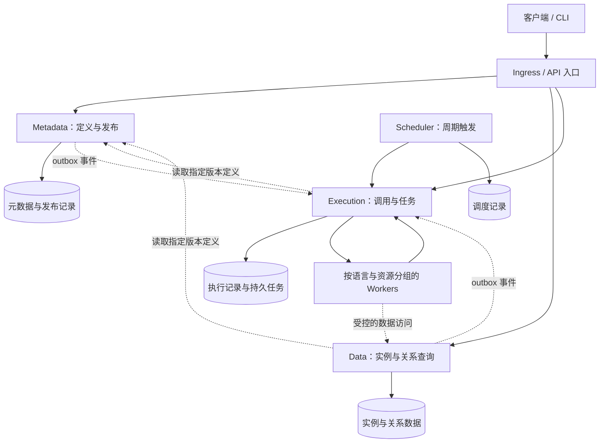

# 总体架构设计

状态：设计草案，尚未实现。对应需求：[MOD-01～08](../需求文档/模块化与演进需求.md)、[SCALE-01～10](../需求文档/横向扩展与可靠性需求.md)、[PERF-01～06](../需求文档/性能与容量需求.md)。

## 1. 设计建议

采用单仓库组织多个可独立部署的服务。定义按五类对象拆模块，数据查询和执行计算按负载拆服务。首先实现最小闭环，再以压测决定缓存、消息系统和存储扩展，避免尚无负载依据就引入多套基础设施。



图中的存储表示逻辑所有权，初期可以共用数据库基础设施，使用独立 schema/库、账号和迁移。任务持久化可以先使用所属服务的数据库；是否引入消息系统由吞吐和调度需求决定。图中任务分派是逻辑关系，可以实现为 Worker 主动领取，或由消息系统传递引用。

## 2. 服务和数据所有权

| 部署单元 | 内部模块与职责 | 权威数据 | 扩展方式 |
| --- | --- | --- | --- |
| Metadata | schema、enum、link、action、function、publish | 类型定义、不可变发布集、激活状态 | 多副本、版本缓存；发布写入受协调 |
| Data | instance、relation、query、adapter | 实例、关系、数据 outbox、模型存储迁移记录 | 多副本；受数据库容量约束 |
| Execution | invocation、task、dispatch、subscription | 执行记录、尝试、租约、幂等键、订阅与任务 outbox | 多副本接收及分派 |
| Scheduler | schedule、trigger | 周期规则、到期登记及待发送触发 | 多副本安全；领导者或分片方案待细化 |
| Worker | runtime、artifact、executor | 临时工作目录和缓存；结果通过 Execution 提交 | 按语言、CPU/内存及外部配额独立扩容 |
| migrate 命令/Job | 各服务平台迁移、Data 所有的模型存储迁移 | 由对应数据所有者保存记录 | 每目标受控执行，不以增副本提高吞吐 |

API 入口优先复用 Ingress 或现有代理，承担路由、基础鉴权及入口限流。资源级权限由各服务执行。初期建议对外 HTTP/JSON 与 OpenAPI；服务间可先使用 HTTP，是否采用 gRPC 依据协议、流式调用和实测需求决定。

### 发布与版本读取

Metadata 协调定义校验及版本激活，Data 执行其拥有的数据和结构迁移；请求与任务固定发布版本，跨服务步骤可恢复。发布集、迁移流程、兼容窗口和缓存版本规则统一见 [元数据与发布设计](元数据与发布设计.md)。

### 执行与副作用

Execution 管理持久任务和尝试，Worker 执行代码，Scheduler 登记周期触发；模型和数据事件交由 Execution 的订阅模块分派。调用方式、运行器、状态、幂等、outbox 与触发去重统一见 [执行与调度设计](执行与调度设计.md)。

## 3. 建议代码目录

以下是未来代码布局，当前仅创建文档。

```text
services/
  metadata/
    go.mod
    cmd/server/
    cmd/migrate/
    internal/
      schema/
      enum/
      link/
      action/
      function/
      publish/
      transport/
      adapter/
    migrations/
    Dockerfile
  data/                     # 独立 go.mod、cmd、internal、迁移与镜像
  execution/                # 独立 go.mod、cmd、internal、迁移与镜像
  scheduler/                # 独立 go.mod、cmd、internal、迁移与镜像
workers/
  <runtime>/                # 按语言管理依赖、入口与镜像
contracts/
  openapi/
  events/
  runtime/                  # 运行清单、任务与结果协议
libs/
  <基础库>/                  # 按需要建立；禁止共享业务实现
deploy/
  compose/
  kubernetes/
tests/
  integration/
  contracts/
  performance/
docs/
  需求文档/
  设计文档/
```

各 Go 服务使用独立 `go.mod`，本地可生成 `go.work` 辅助开发；每个服务在 `GOWORK=off` 时仍能独立构建，不能靠工作区隐式补齐依赖。当前 `.gitignore` 已忽略 `go.work`。公共协议产物和基础库需有独立版本，避免一次共享改动强制所有服务同步升级。

模块内部按实际复杂度区分领域规则、用例接口与适配实现，不强制每个小模块都建立大量空目录。发布协调层通过模块接口检查引用；禁止五类模块互相调用私有 repository。Go 的 `internal` 有助于限制外部导入，但服务内模块边界还需要依赖规则检查和测试约束。

## 4. 部署与扩缩容

Docker Compose 用于本地或单机多副本验证，需配套入口负载均衡、服务发现及无冲突的端口配置。跨主机调度、自动弹性及故障恢复使用 Kubernetes 等平台；增加 Compose 副本本身不等于高可用或自动扩缩容。

在线服务和 Worker 分别建立 Deployment、配置、资源配额与弹性策略；入口通过 Service 发现可用副本。调度器允许多副本，先以选主实现故障接管；只有调度吞吐成为瓶颈时再增加分片。两种模式均保留持久化唯一约束及触发幂等。

readiness 表示能否接收新流量，startup 处理初始化，liveness 仅用于进程不可恢复的失效检测。依赖故障应暴露状态并限制流量，避免把数据库瞬断变成所有 Pod 重启。滚动发布时摘流、停止领取新任务，等待有界时长后退出，未完成任务由租约与恢复逻辑处理。

HPA 最大副本数须受数据库连接、集群资源和下游配额共同约束；Worker 以待执行任务和等待时间为主要负载信号。配置详见 [扩展需求](../需求文档/横向扩展与可靠性需求.md)。多节点环境使用副本分散和适当的中断预算；这些不能替代数据库复制及备份恢复。

副本可替换并不禁止本地缓存，但正确性不能依赖某个副本的内存或本地磁盘。Redis 是否需要，按缓存与协调用途评估，不作为必选依赖。

## 5. 性能设计重点

查询在 Data 内编译与执行，使用版本缓存、批量关联和执行预算。逻辑类型、物理模型、双向访问索引、数据库候选及限制统一见 [数据与查询设计](数据与查询设计.md)，优化依据是实际查询计划与代表性负载。

用户函数计算进入 Worker，查询服务不承担任意语言执行。任务传递使用制品/结果引用控制消息大小，依赖预热和制品缓存按版本隔离。缓存、物化关系、读副本和独立消息系统均根据 [性能报告要求](../需求文档/性能与容量需求.md) 决定是否引入。

## 6. 专题设计与后续工作

| 文档主题 | 当前状态及后续工作 | 对应需求 |
| --- | --- | --- |
| [元数据与发布设计](元数据与发布设计.md) | 已有流程草案；细化五类接口、引用检查、兼容窗口及激活状态机 | CORE-01～06、PUB-01～04、MOD-01/02/07、SCALE-07 |
| [数据与查询设计](数据与查询设计.md) | 已有选型与映射草案；确定数据库、实例/关系存储、查询协议与预算 | CORE-01～05、MOD-04/05、PERF-01/02/03 |
| [执行与调度设计](执行与调度设计.md) | 已有运行及触发草案；细化运行器协议、任务状态、租约与重放策略 | CORE-06、RUN-01～05、TRG-01～02、SCALE-04/05/06、PERF-03 |
| 部署与容量设计 | 待建立；配置、探针、连接池、扩容信号、故障与恢复目标 | SCALE-01～10、PERF-04/05 |
| 工程与发布设计 | 待建立；独立构建、依赖边界、契约检查、升级与回退流程 | MOD-03/06/08、PERF-06 |

首要决策是确定一个数据库和运行器、补齐负载量级并冻结服务契约。随后以建模发布、实例写入与查询的小闭环验证边界，再进入执行和弹性实现。
